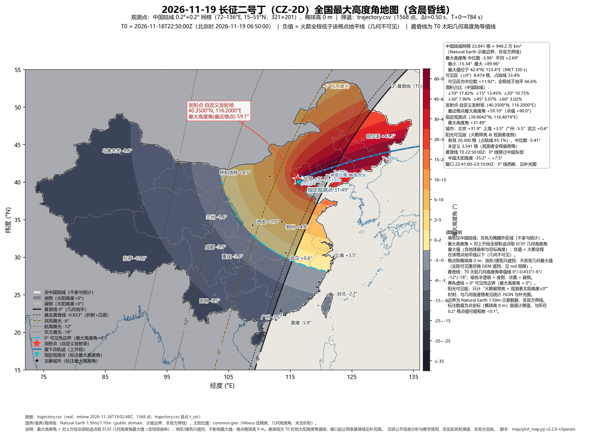
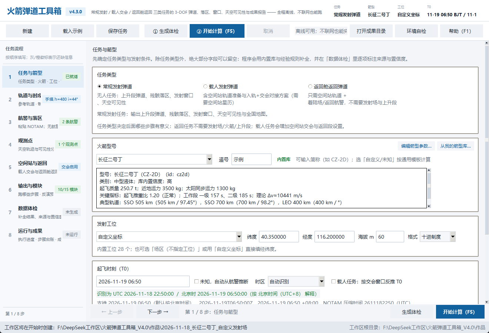
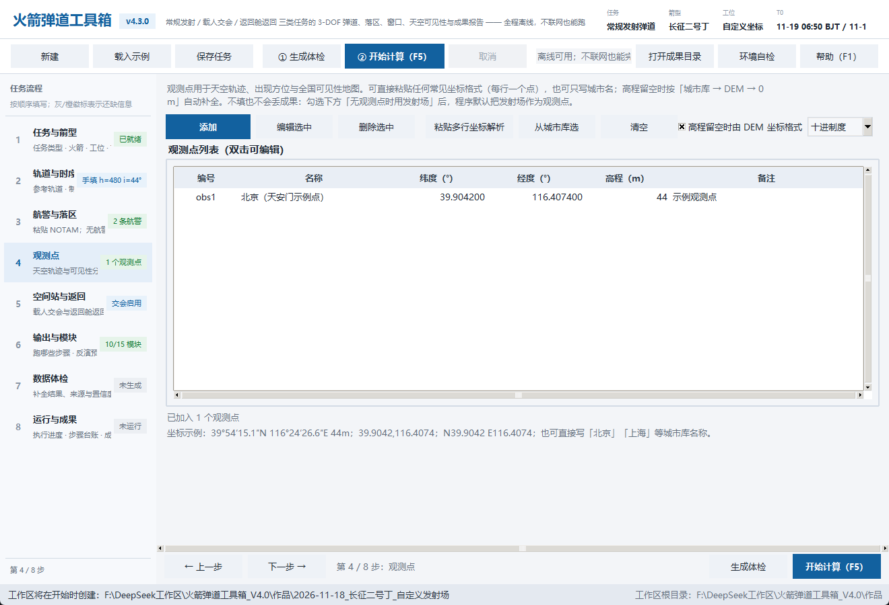
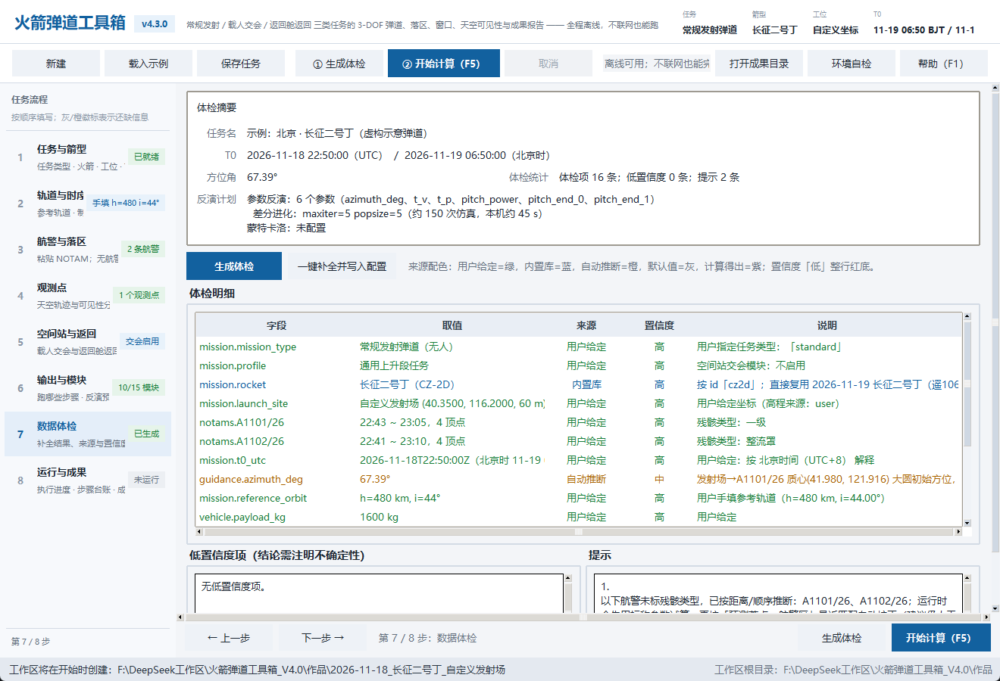
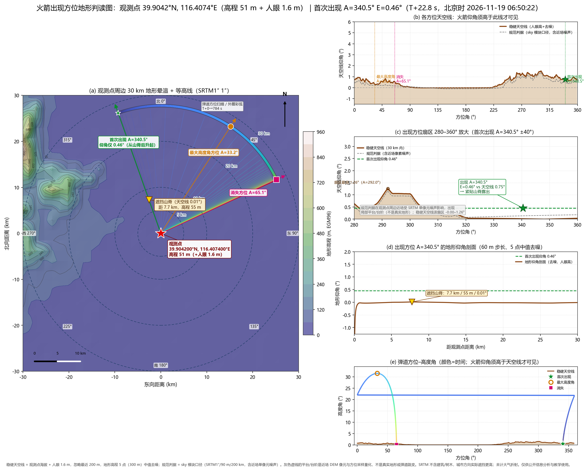
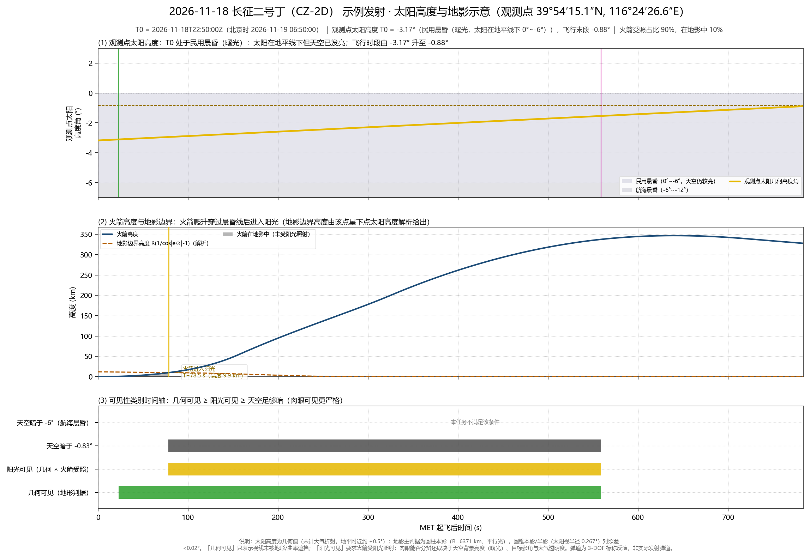
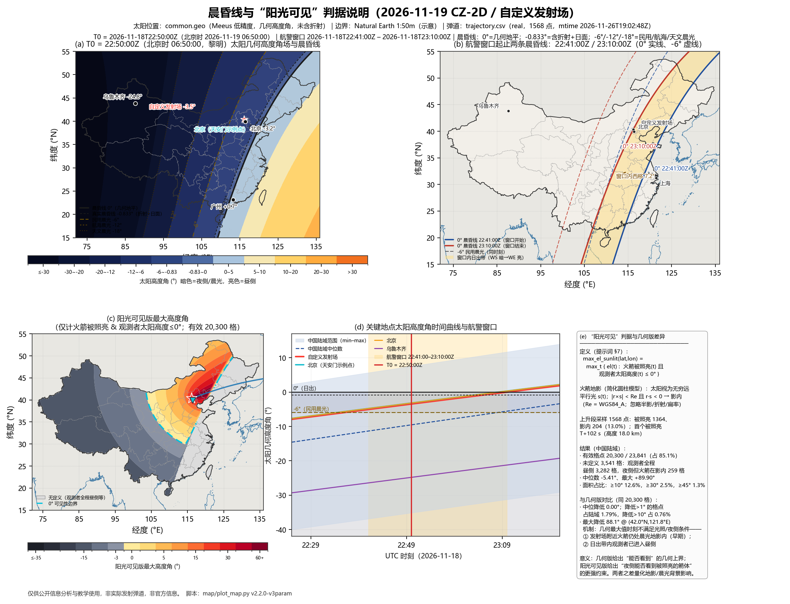

# 火箭弹道工具箱 · Rocket Ballistic Toolkit

> **离线 3-DOF 弹道预报与任务成果工具箱**：把「一次发射（或一次返回）」变成一整套可交付成果——
> 弹道 → 残骸落区 → 入轨根数 → 发射窗口（航警时窗 + 轨道平面/交会）→ 观测点天空轨迹 →
> 全国最大高度角地图 → 三维 KMZ → 不确定度 → 中文技术报告 + 交付自检。
>
> 常规发射 · 载人交会 · 返回舱返回，三类任务共用同一套向导与成果口径；**全程离线**，不需要联网、不需要改代码、不需要手写数据库文件。

`Python 3.10+` · `Windows 10/11 x64` · `离线可用` · `v4.3.0` · 仅供公开信息分析与教学使用



> 本仓库的**展示图统一使用「北京」作为示例地点**：发射场设在北京北部（自定义坐标 40.35°N, 116.20°E），
> 观测点设在北京天安门（39.9042°N, 116.4074°E）。这是一次**虚构的示意任务**，不是真实发射。

---

## 目录

- [1. 这是什么](#1-这是什么)
- [2. 功能一览](#2-功能一览)
- [3. 界面：八步向导](#3-界面八步向导)
- [4. 北京示例（可复现）](#4-北京示例可复现)
- [5. 快速开始](#5-快速开始)
- [6. 输出成果](#6-输出成果)
- [7. 数据与目录](#7-数据与目录)
- [8. 验证](#8-验证)
- [9. 打包免安装版](#9-打包免安装版)
- [10. 已知限制与免责声明](#10-已知限制与免责声明)
- [11. 文档与许可](#11-文档与许可)

---

## 1. 这是什么

输入「箭型 + 发射工位 + 起飞时刻 + 航警 + 参考轨道 + 观测点」，程序会：

1. 用内置库 + 推理引擎补全缺失数据，并逐项标注**来源与置信度**（数据体检）；
2. 跑 3-DOF 质点弹道（RK4，事件对齐），自动反演制导/箭型参数；
3. 计算残骸落区、入轨根数、发射窗口、天空可见性、全国最大高度角场与三维轨迹；
4. 生成中文技术报告、一页纸任务摘要、成果清单与逐项 PASS/FAIL 的交付自检。

三类任务：

| 任务类型 | 额外输入 | 额外成果 |
|---|---|---|
| **常规发射弹道** | 航警（可无）/ 观测点（可无） | 落区判定、发射窗口、天空轨迹、全国地图、KMZ |
| **载人发射弹道** | 空间站 OEM/TLE | 交会窗口、相位调整 + 转移 + 末段逼近时间线、总 ΔV、预计对接时刻 |
| **返回舱返回弹道** | 空间站星历 + 着陆场/返回航警 | 制动窗、再入/开伞/着陆时序、落点与 1σ 散布、返回舱弹道图与 KML |

> 「参数留空不会导致少跑」：没有观测点默认用发射场，没有航警可「预测落区」；
> 任何因依赖不满足而跳过的步骤都会写进**步骤台账**并注明原因。

## 2. 功能一览

- **八步向导式 GUI**（tkinter，零外部 UI 依赖），左侧步骤导航 + 常驻任务概要条 + 步骤台账 + 成果文件树；
- **自定义箭型图形编辑器**：多级/并联助推器、多机多阶段点火、折线俯仰剖面、整流罩、残骸气动，支持「仅本次任务」或保存到用户箭型库；
- **参考轨道 5 种来源**：自动推断 / 内置模板 / 我的轨道库 / 手填（含 RAAN、LTAN）/ TLE 导入；
- **航警解析**：粘贴 NOTAM 原文自动解析多边形与时间窗，支持 DMS/十进制混写；无航警可预测落区；
- **发射窗口**：航警时窗 + 轨道平面窗口 + 载人交会发射窗口 / T0 反推；
- **天空轨迹与可见性**：方位-高度角轨迹、地形遮挡（SRTM/粗 DEM）、太阳/地影、后随「出现方位地形判读图」；
- **全国最大高度角地图**：321×201 网格、含晨昏线与阳光可见性版本，逐项自检；
- **三维 KMZ/KML**：轨迹、残骸、航警区、观测点，自包含图标，双击即用 Google Earth；
- **蒙特卡洛不确定度**：参数扰动 + 落点/入轨协方差椭圆；
- **中文技术报告**（Markdown + docx）、任务摘要、成果清单、`qc_report.json` 交付自检；
- **CLI**：同一套能力，支持任务 JSON / 历史 config、模块裁剪、DEM 导入、环境自检。

## 3. 界面：八步向导

| 步骤 | 作用 | 关键点 |
|---|---|---|
| ① 任务与箭型 | 任务类型、火箭、发射工位、T0、载荷 | 「编辑箭型参数…」图形编辑器（免写数据库） |
| ② 轨道与时序 | 参考轨道（5 种来源）、制导覆盖、分离/抛罩/SECO | 手填含 RAAN/LTAN 可触发轨道平面窗口 |
| ③ 航警与落区 | 粘贴 NOTAM 原文解析 / 手工编辑 | 无航警可「预测落区」 |
| ④ 观测点 | 多行坐标粘贴、城市库选择 | 留空默认用发射场，不会丢天空类成果 |
| ⑤ 空间站与返回 | 空间站数据来源、交会参数、返回舱设置 | 载人/返回任务才需要 |
| ⑥ 输出与模块 | 模块分组勾选、四种预设、反演预算、离线高程 | 实时显示「预计产出」 |
| ⑦ 数据体检 | 每个字段的取值/来源/置信度 | 用户给定优先于内置库/推断 |
| ⑧ 运行与成果 | 进度、步骤台账、结果摘要、日志、成果文件树 | 双击文件即打开 |





## 4. 北京示例（可复现）

任务文件：[`examples/北京示例_任务输入.json`](examples/北京示例_任务输入.json)
（发射场：北京北部自定义坐标；观测点：北京天安门；航警区：东北方向两条示意禁区）

```bash
python -m app.main --cli --mission "examples/北京示例_任务输入.json" --workdir "作品\示例_北京_2026-11-19"
```

本机实测结果（2026-11-27，全模块，含参数反演）：

| 项目 | 结果 |
|---|---|
| 交付自检 | **QC 35/35 PASS**，退出码 0 |
| 入轨 | 近地点 282 km / 远地点 937 km / 倾角 45.64° / e=0.0469 |
| 残骸落点 | 3/3 在对应航警区内（一级 42.005,122.199；整流罩 42.809,125.724） |
| 发射窗口（航警） | 2026-11-18 22:36:12 ~ 22:55:34 UTC（19.4 min） |
| 天空可见（北京观测点） | 首次出现 06:50:22 北京时间，方位 340.5°、仰角 0.46°；最大仰角 31.5° |
| 成果文件 | 44 个（sim / sky / map / viz / report） |

**天空可见性（北京天安门观测点）**





## 5. 快速开始

### 5.1 源码运行（需要 Python 3.10+）

```powershell
python -m pip install -r requirements.txt

# 图形界面（或双击 启动器.bat）
python -m app.main

# 内置示例（常规发射，快速验证安装）
python -m app.main --cli --demo cz2d --workdir "作品\示例_CZ2D"

# 环境自检
python -m app.main --env
```

GUI 最短路径：顶部「载入示例」→「① 生成体检」→「② 开始计算（F5）」→ 在「⑧ 运行与成果」
看 `report\任务摘要.md` 与 `report\成果清单.md`。

### 5.2 命令行

```powershell
python -m app.main --cli --demo cz2d --workdir "作品\示例"          # 内置示例
python -m app.main --cli --mission 任务.json --workdir "作品\我的任务"
python -m app.main --cli --mission 任务.json --modules export,summary,report,qc
python -m app.main --cli --mission 任务.json --no-invert             # 跳过反演（快）
python -m app.main --cli --mission 任务.json --mc 250 --jobs 1       # 蒙特卡洛 250 次
python -m app.main --import-dem "D:\高程\山西.tif"                    # 导入离线高程后退出
python -m app.main --env                                             # 环境自检
```

## 6. 输出成果

每个任务结束都会尝试产出（任何子步骤失败都不影响其它子步骤）：

```
作品\<日期_型号_工位>\
├─ config.json / config_initial.json / 任务输入.json / 运行日志.txt
├─ sim\      弹道序列、事件表、落点、入轨根数、关键节点、飞行阶段、环境剖面…
├─ sky\      天空轨迹图与数据、出现方位地形判读图、太阳/地影
├─ map\      全国最大高度角地图 / 晨昏线 / 落区图
├─ viz\      三维 KML/KMZ
├─ uncertainty\  蒙特卡洛（可选）
└─ report\   任务摘要、成果清单、技术报告（md/docx）、发射窗口、qc_report.json
```

`report\任务摘要.md`（一页纸）与 `report\成果清单.md`（全量文件 + 步骤台账 + 输出完整性核对）
是每次交付的依据；`qc_report.json` 逐项 PASS/FAIL。

## 7. 数据与目录

```
app\              应用层（GUI / 流水线 / 推理引擎 / 报告 / 用户库）
engine\           数值内核与出图脚本（common\ + scripts\）
  data\ne\        Natural Earth 底图（离线）
  data\dem\       SRTM 瓦片缓存（不随仓库提供，运行期生成）
app\data\         内置库：箭型 28、发射工位 28、城市 343、载荷 26、轨道 15、空间站 OEM、粗 DEM
user_data\        运行时生成：我的箭型 / 轨道 / 时序模板
作品\             默认工作区根（每个任务一个子目录）
tests\            单元测试 / 回归 / GUI 冒烟 / 性能一致性
文档\             v4 用户文档
build\            PyInstaller 打包工具链
```

## 8. 验证

```powershell
python tests\test_gui_headless.py       # GUI 无头冒烟（8 步页面 / 体检 / 步骤台账）
python tests\test_userdb.py             # 用户库（自定义箭型/轨道/模板）
python tests\test_t0_window.py          # 交会窗口 / T0 反推（含端到端）
python tests\test_v4_custom.py          # 自定义箭型/轨道/制导/时序/三类任务
python tests\test_summary.py            # 通用成果（关键节点/阶段/统计/摘要/清单）
python tests\test_db_validate.py        # 内置库校验
python tests\run_regression.py          # 历史任务回归（引擎逐位一致）
```

本机实测：北京示例 **QC 35/35**；载人 CZ-2F 交会任务 **QC 37/37**；常规 CZ-2D 示例 **QC 35/35**；
GUI 冒烟、冻结 exe 冒烟均通过。

## 9. 打包免安装版

`build\` 下提供 PyInstaller 一键打包（one-folder，约 209 MB，带全部科学计算依赖）：

```powershell
powershell -ExecutionPolicy Bypass -File build\build.ps1
# 产物：build\dist\火箭弹道工具箱\火箭弹道工具箱.exe（不需要安装 Python）
```

细节（资源清单、隐藏依赖、排除项、验证记录）见 [`build/README_打包说明.md`](build/README_打包说明.md)。

## 10. 已知限制与免责声明

- **仅供公开信息分析与教学使用**；非实际发射/返回弹道，非官方信息，不能作为任务依据。
- 3-DOF 质点模型，不含侧向机动细节、风场、真实发动机调节与分离扰动；残骸按无控弹道 + 阻力估算。
- 轨道平面窗口假设不同 T0 时弹道相对地球固连、整条轨迹随地球自转旋转，不是六自由度制导。
- 交会对接是「相位调整 + Hohmann + 末段 Lambert」的工程估算模型，**不是飞行程序**；TLE 回退在历元数天后沿迹误差可达数度。
- 返回舱为瞬时制动 + 升力再入 + 两级伞降；1σ 散布是参数扰动样本的协方差椭圆。
- 内置空间站 OEM 只覆盖 2026-11-20 ~ 2026-11-27；其他日期需导入新 OEM/TLE。
- 粗 DEM（内嵌 0.02°）只给出地形遮挡近似值，正式结论请补 SRTM 或导入高程。
- 程序不联网检索 NOTAM；中国以外任务的底图仍是中国范围。

## 11. 文档与许可

- v4 用户文档索引：[`文档/00_文档索引.md`](文档/00_文档索引.md)
- 交付说明：[`交付说明_v4.md`](交付说明_v4.md)
- 打包说明：[`build/README_打包说明.md`](build/README_打包说明.md)
- 版本记录：[`CHANGELOG.md`](CHANGELOG.md)

代码与文档仅用于学习、研究与教学用途，请勿用于任何实际发射/飞行决策。
