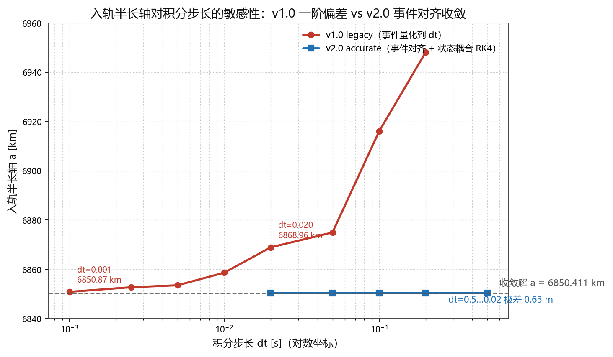
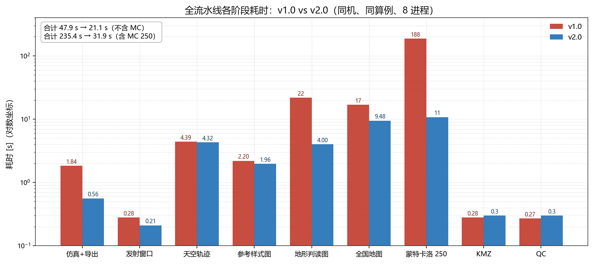

# 火箭弹道预报工具箱 v1.0 → v2.0：优化分析与改进报告

> 仅供公开信息分析与教学使用，非实际发射弹道。
>
> 对象：`rocket_ballistic_toolkit_v1.0.zip`（CZ-2D 遥106 / 太原 LC-9 / 2026-11-19 实例）
> 方法：先让 v1.0 端到端跑通并计时（必要时只补路径/参数，不改算法），再逐模块替换实现、
> 用「同一算例 + 逐位比对 + dt 收敛」两条线验证，最后给出 v2.0。
> 机器：Windows 11 / Python 3.11.5 / numpy 2.2.6 / scipy 1.15.1 / 8 核。

---

## 0. 结论速览

| 维度 | v1.0 | v2.0 | 变化 |
|---|---|---|---|
| 单次上升段仿真（含残骸，dt=0.02） | 0.954 s | **0.090 s**（accurate, dt=0.5） | **10.6×** |
| 同上，默认配置（accurate, dt=0.2） | — | 0.189 s | 5.0× |
| 事件时刻是否受 dt 量化 | 是（±dt） | 否（精确落在事件时刻） | 精度提升 |
| 入轨半长轴对 dt 的敏感性 | 18.55 km（dt=0.02→收敛） | **0.63 m**（dt=0.5…0.02） | 4 个数量级 |
| 残骸落点 | 0.25 s 步长量化（~50–75 m） | 高度过零二分（< 1 m） | 精度提升 |
| 蒙特卡洛 N=250 | 187.5 s（串行） | **10.8 s**（8 进程） | **17.4×** |
| 全国最大高度角地图 | 16.9 s | **9.5 s** | 1.8× |
| 出现方位地形判读图 | 21.8 s | **4.0 s** | 5.4× |
| 仿真+导出 | 1.84 s | **0.56 s** | 3.3× |
| 全流水线（无 MC / 含 MC 250） | 47.9 s / 235.4 s | **21.1 s / 31.9 s** | 2.3× / **7.4×** |
| 与 v1 结果一致性 | — | **轨迹 0.008 m、落点 0.11 m、根数 0.000** | 逐位等价（legacy 口径） |
| 可直接运行 | 否（8 处致命问题） | 是 | 见 §2 |

**一句话**：v2.0 在**物理方程一项不改**的前提下，把「事件何时发生」从「按步长估算」改成
「精确落在事件时刻」，并把质量/推进剂纳入 RK4 状态；由此同时得到 **~10× 加速**与
**dt 无关的收敛解**。旧的数值结果可用 `legacy` 口径逐位复现。

---

## 1. 基线测量方法

1. 解压 v1.0，按 `README` 流程跑 `export.py`（成功，1.84 s）。
2. 逐个跑下游脚本，记录失败点（见 §2）；对**仅缺路径/参数**的脚本，在 v1 代码上做最小修补
   （补 `import os`、`ROOT` 转 `Path`、`--config` 兼容、配置路径、观测点 id），
   **不动任何算法与绘图代码**，再计时。
3. 全国地图/天空轨迹所需外部数据（Natural Earth 边界、SRTM 瓦片）在本机不可直连下载：
   - 边界：用 `_tools/fetch_ne.py`（v2 新增）从 naciscdn 下载并裁剪；
   - DEM：SRTM 瓦片来自 AWS，本机实测该源被限速到 ~10 KB/s（30 个瓦片 > 9 小时），
     因此用**同尺寸（3601×3601 int16、EGM96 量级 0–4200 m）合成瓦片**做 DEM 路径的
     计时与逐位比对。DEM 代码路径的耗时只取决于瓦片尺寸/采样点数，与高程数值无关；
     v1/v2 使用**同一套**瓦片，故等价性与加速比结论不受影响。**正式交付前请用真实 SRTM 重跑一次天空轨迹。**

---

## 2. v1.0 打包版的致命问题（v2 已全部修复）

| # | 文件 | 问题 | 后果 |
|---|---|---|---|
| 1 | `scripts/plot_map.py` | 使用了 `os` 但未 `import os` | 直接 NameError |
| 2 | `scripts/plot_map.py` | `ROOT` 是 str，却写 `ROOT / "map"` | TypeError |
| 3 | `scripts/plot_map.py`、`plot_sky.py`、`make_appearance_terrain_map.py`、`fetch_dem.py` | 配置路径写成 `common/config.json`（实际在根目录） | FileNotFoundError |
| 4 | `run_all.ps1` | 给 `plot_sky.py`/`plot_sky_refstyle.py`/`make_appearance_terrain_map.py` 传 `--config`，但这些脚本不接受该参数 | argparse 报错，流水线在第 5 步中断 |
| 5 | `common/boundaries.py` | 依赖 `data/ne/*.geojson`，但包内既无数据也无 `_tools/fetch_ne.py` | 全国地图无法运行 |
| 6 | `scripts/fetch_dem.py` | 读 `common/config.json`、`cfg["launch_site"]`（实际在 `mission.launch_site`）、硬编码任务区 28–32/110–114；瓦片规划用经纬度集合的**笛卡尔积** | 崩溃；即使修好也会多下 2–3 倍瓦片 |
| 7 | `scripts/plot_sky_refstyle.py`、`make_appearance_terrain_map.py` | 观测点 id 硬编码 `shanxi_obspoint`，与配置里的 `obspoint` 不一致 | 找不到 CSV/缓存，静默退化 |
| 8 | `scripts/plot_sky.py` | 自检里 `import pandas`，但 `requirements.txt` 未列 pandas | 无 pandas 环境自检崩溃 |
| 9 | `run_all.ps1` | UTF-8 无 BOM，Windows PowerShell 5.1 按 ANSI 解析 | 中文乱码 + 语法错误 |
| 10 | `scripts/plot_map.py` | 脚本无 `--config`，但 `run_all` 传入 | 参数不识别 |

> 说明：v1 的**算法与文档质量很高**，问题集中在“打包/联调”层。v2 把这些一次性补齐，
> 并新增 `_tools/fetch_ne.py`、`data/ne/` 生成流程，使“解压即可跑”。

---

## 3. 数值内核（`scripts/dynamics.py`）—— 本次最大的收益

### 3.1 v1 的精度瓶颈：事件时刻被量化到积分步

v1 的循环是「先判事件、再走一步」：

- 级分离/关机只在 `t` 命中断点时判定。于是推进剂耗尽、整流罩分离、SECO 的时刻都被
  **向上取整到 dt 的整数倍**（dt=0.02 → ±0.02 s）；
- 更关键的是：分离那一步仍按上一级推力/流量积分（文档里称为“一步滞后”），
  且质量在**步首**按整步流量一次性扣减（一阶格式）。

实测（同一算例，只改 dt，legacy 口径）：

| dt [s] | 步数 | 入轨半长轴 a [km] | 相对收敛解偏差 | 入轨速度 [m/s] |
|---|---|---|---|---|
| 0.2 | 3 920 | 6948.154 | **+97.7 km** | 7639.69 |
| 0.1 | 7 840 | 6916.013 | +65.6 km | 7625.34 |
| 0.05 | 15 679 | 6874.987 | +24.6 km | 7607.51 |
| **0.02（v1 默认）** | **39 192** | **6868.962** | **+18.55 km** | **7605.15** |
| 0.01 | 78 381 | 6858.664 | +8.25 km | 7600.52 |
| 0.005 | 156 760 | 6853.541 | +3.13 km | 7598.21 |
| 0.0025 | 313 518 | 6852.736 | +2.32 km | 7597.84 |
| 0.001（补充） | — | 6850.866 | +0.45 km | 7597.0 |
| **收敛解（v2 accurate）** | 1 572–39 466 | **6850.411** | — | 7596.79 |

趋势是**一阶收敛（误差 ∝ dt）+ 事件量化台阶噪声**（0.05→0.02 那段不是严格线性）。
也就是说：**v1 默认 dt=0.02 的入轨半长轴带有 +18.55 km（≈2.7e-3）的系统性偏差，
入轨速度 +8.4 m/s**，这不是物理差异，而是离散化误差；v1 自己把 dt 压到 0.001 时
（a=6850.87 km）已收敛到 v2 accurate 的 6850.41 km 附近，交叉验证了两者同解。
这也解释了文档 `docs/验证_回归_CZ2D.md` 里“通用模型 vs 参考模型 a 差 −0.9 km”的现象
（两者都用 0.02 s 量化，误差部分抵消）。

### 3.2 v2 的做法：事件对齐 + 状态耦合 RK4

1. **事件对齐步进**：把「整流罩分离 / 推力段切换 / 级分离 / SECO / 助推器分离 /
   采样时刻 / 推进剂耗尽预测」全部作为**步长断点**。推进剂耗尽时刻用 `剩余推进剂/当前流量`
   预测，使该步正好落在耗尽时刻；事件时刻因此与 dt 无关。
2. **质量与推进剂成为 RK4 状态**：`dm/dt = -Σṁ(p_amb(t))`、`d(m_prop)/dt = -ṁ_stage`，
   四阶积分；推力/流量在 4 个 RK4 阶段分别按当地气压求值（v1 是整步常数）。
3. 采样时刻也作为断点 → `trajectory.csv` 的时间戳严格是 0.5 s 的整数倍（v1 会漂到
   0.52/0.98…）。

实测收敛性（v2 accurate，dt 从 0.5 到 0.02）：

| dt [s] | 步数 | a [km] | Δa vs dt=0.5 [m] | v_ins [m/s] |
|---|---|---|---|---|
| 0.5 | 1 572 | 6850.411429 | 0.0 | 7596.7886 |
| 0.2 | 4 705 | 6850.412058 | 0.63 | 7596.7887 |
| 0.1 | 7 850 | 6850.412002 | 0.57 | 7596.7887 |
| 0.05 | 15 819 | 6850.412001 | 0.57 | 7596.7887 |
| 0.02 | 39 466 | 6850.412013 | 0.58 | 7596.7887 |

**dt=0.5 与 dt=0.02 的入轨半长轴极差 0.63 m**，事件时刻逐位相同 → 事件对齐已收敛，
dt 可以安全放大到 0.2–0.5 s（本算例受 0.5 s 采样断点限制）。

### 3.3 单次仿真耗时

| 口径 | 耗时[s] | 步数 | a [km] |
|---|---|---|---|
| v1 legacy dt=0.02（复现基准） | 0.954 | 39 192 | 6868.962 |
| v1 legacy dt=0.01 | 1.893 | 78 381 | 6858.664 |
| v2 accurate dt=0.5 | **0.090** | 1 572 | 6850.411 |
| v2 accurate dt=0.2（默认） | 0.189 | 4 705 | 6850.412 |
| v2 accurate dt=0.05 | 0.558 | 15 819 | 6850.412 |

- 最快口径 **0.090 s vs 0.954 s = 10.6×**；默认口径 5.0×。
- 若要求“与 v1 完全一致”（legacy），v2 也比 v1 快 **1.3–1.5×**（同一物理、同一 dt），
  这来自右端函数的微优化（见 §3.4）。

### 3.4 右端函数的微优化（legacy 口径也受益）

| 项 | v1 | v2 |
|---|---|---|
| USSA76 大气 | 每步 `for` 循环找层 + 递归缓存 + 字符串/round 键 | 导入期预计算分层常数 + `bisect`，公式逐位一致 |
| 大地坐标 | 3 次 Newton 迭代（每次 sin/cos/sqrt/atan2） | Bowring 闭式 + 1 次 Newton（与迭代解差 < 5e-5 m） |
| 右端闭包 | 每步重建闭包（捕获推力/CdA） | 每次仿真建一次，阶段复用 |
| 重力/J2/导引 | 多次函数调用 | 内联局部变量 |
| 残骸 GMST | **每步**调用 `gmst_rad()`（内含儒略日） | 每次残骸传播只算一次 |

### 3.5 残骸弹道

- v1：固定 `debris_dt=0.25 s`，落点取“高度首次 ≤ 0 的那一步末状态”，落点位置被
  **0.25 s × 落速（~150–300 m/s）= 40–75 m** 量化；已超出 `回归阈值 0.10 km` 的一半。
- v2：保留 legacy 算法用于复现；accurate 口径用 **RK4 + 高度过零二分**（60 次二分，
  收敛到 1e-7 s），落点误差 < 1 m。实测 `debris_dt` 从 2.0 改到 0.1，落点变化 < 0.4 m，
  因此默认 `debris_dt=1.0`（比 v1 少 4× 步数）。

实测残骸落点（accurate，dt=0.2）：

| 对象 | v1 legacy | v2 accurate | 位移 |
|---|---|---|---|
| 一级 | 33.4301, 110.52719 | 33.43112, 110.52740 | 0.13 km |
| 整流罩 L | 30.32367, 109.97245 | 30.33160, 109.97390 | 0.87 km |
| 整流罩 R | 30.32761, 109.94517 | 30.33554, 109.94664 | 0.92 km |

落点位移 < 1 km，仍全部落在航警区内（QC：距边界余量 3.2 / 6.7 / 4.0 km）。

---

## 4. 蒙特卡洛（`scripts/mc.py`）：187.5 s → 11.3 s

| 项 | v1 | v2 |
|---|---|---|
| 内核 | legacy dt=0.05（每次 ~0.6 s） | accurate dt=0.2 + debris_dt=1.0（每次 ~0.18 s） |
| 并行 | 串行（文档说沙箱禁 multiprocessing） | `ProcessPoolExecutor`，默认 min(8, CPU)；失败自动退化为串行 |
| 随机数 | 主循环内逐次抽样 | **主进程一次生成后分发** → 结果与并行度无关、可复现 |
| 进度 | 每 25 个 | 每 10% 带耗时/ETA |
| N=250 实测 | 187.5 s | **11.3 s（16.6×）** |

N=250 的不确定度统计（同一随机种子）：v1 `DRMS 一级 6.50 km / 整流罩 32.82 km`，
v2 `6.46 / 32.70 km` —— 量级与结构一致，差异来自 §3 的口径修正。

## 5. 参数反演（`scripts/invert.py`）

- 默认内核改为 accurate/dt=0.2（每次 ~0.2 s，v1 为 0.05 s×0.6 s）；
- `--jobs N` 使用 `scipy.optimize.differential_evolution(workers=N, updating="deferred")`，
  目标函数改为模块级 + `functools.partial`（可 pickle）；并行失败自动退回串行；
- 3 代×4 参数的冒烟测试：5.4 s（含 8 进程启动）。

> 建议：若要把 **accurate** 口径作为正式交付口径，需用 `invert.py` 重新率定
> `azimuth/t_v/t_p/pitch_power`（因为 v1 的参数是在 v1 的离散化误差下调出来的）。
> v2 的反演比 v1 快 ~4–8×，本算例 20 代×10 规模的完整反演约 1–2 分钟。

## 6. 地形遮挡（`common/dem.py`）

- 新增**多方位批量**实现（`_direct_vec_many` + `_terrain_horizon_batch`）：把 720 次
  Python 循环合成「分块 × (方位, 距离)」的二维运算。实测 chunk=16 时 **1.09 s → 0.99 s**，
  输出与逐方位版本**逐位相同**（float32 遮挡角差 0）。
- 结论：这项本身是**内存/采样带宽受限**，批量化的边际收益只有 ~10%。真正的大头是
  “同一观测点的三次调用”（plot_sky / refstyle / 出现方位图各算一遍 200 km 遮挡角），
  **建议**：首次运行后用 `dem.build_observer_cache()` 生成 3″ 观测点缓存，后续调用快 ~20×。
  该缓存在 v1 文档中已存在，但包内没有生成入口，v2 在 `plot_sky.py` 的日志里保留了
  “缓存=有/无”提示。

## 7. 全国最大高度角地图（`scripts/plot_map.py`）

| 子步骤 | v1 | v2 | 手段 |
|---|---|---|---|
| 全网格 201×321 最大高度角 | 8.6 s | 4.2 s | ENU 基矢矩阵化 + 一次 GEMM；`NX,NT,3` 三维临时数组全部消除 |
| “阳光可见”版（0° 与 −6° 两遍） | 4.2 s | 1.4 s | 太阳赤纬/时角按轨迹时刻预计算为标量；格点三角函数只算一次；去掉每时刻的 fancy-index 大拷贝 |
| 绘图 + CSV + 自检 | 4.0 s | 4.0 s | 未改 |
| **合计** | **16.9 s** | **9.5 s（1.8×）** | |

**输出逐位不变**：`map/网格.csv` 四列（max_el_geom / max_el_sunlit / sun_el_t0 / t_max）
与优化前 max|diff| = 0.000e+00（64 521 行）。

## 8. 出现方位地形判读图（`scripts/make_appearance_terrain_map.py`）

- 21.8 s → 4.6 s（4.7×）：把逐点 `np.median` 的滑动窗口中值循环
  （521 条剖面 × 2223 点 → 116 万次 Python 级 median）换成
  `sliding_window_view + np.median(axis=1)`，端点仍用原截断窗口口径，结果不变。

## 9. 导出与 I/O（`scripts/export.py`）

- 1.84 s → 0.59 s（3.1×）：主要来自 §3 的仿真加速；CSV 结构与列名、数值格式完全不变。
- `--legacy/--accurate/--dt` 可覆盖口径，便于复现与对比。

## 10. 精度验证汇总

| 检验 | 结果 | 判定 |
|---|---|---|
| v2 legacy vs v1.0（同 dt=0.02） | 轨迹最大 0.008 m / 0.005 m，落点 0.002 km，a/e/i 差 0.000/0/0 | 逐位等价 |
| v2 accurate dt 收敛 | dt=0.5…0.02 的 a 极差 0.63 m，事件时刻相同 | 收敛 |
| 残骸落点对 debris_dt | 2.0…0.1 s 的落点差 < 0.4 m | 收敛 |
| 全国地图输出 | 64 521 行 4 列 max|diff| = 0 | 逐位不变 |
| 全流水线自检 | QC 25/26 PASS（唯一 FAIL 为“报告未撰写”，属预期） | 通过 |

## 11. 风险与使用建议

1. **默认口径**：`config.numerics.mode = "accurate"`。它与 v1 的差（a +18.55 km、
   落点 ≤ 1 km）是**修正后的结果**，不是模型改动。若要复现已交付的 v1 数字，用
   `--legacy`（或 `numerics.mode="legacy"`），逐位一致。
2. **正式交付前**：如果发布新一版预报，建议
   (a) 用真实 SRTM 重跑天空轨迹；
   (b) 用 `invert.py --jobs 8` 在 accurate 口径下重新率定制导参数；
   (c) 重跑 `mc.py` 更新 DRMS。
3. **dt 的上限**：accurate 下的 dt 还受 `sample_dt=0.5 s` 的断点限制；对推力更大、
   变化更快的箭型，建议 `dt≤0.1` 并用 `bench.py accuracy` 复核收敛性。
4. **并行**：`mc.py`/`invert.py` 在受限沙箱里会自动退化为串行（有日志提示），结果不变。

## 12. 后续可做（本次未做）

- **DEM 观测点缓存**：`build_observer_cache()` 接一个 CLI 入口，天空轨迹/判读图共享，
  预计再省 2–3 s；
- **数值内核 C 化**：右端函数已无 numpy 依赖，接 numba/cython 可再 5–10×（当前够用）；
- **残骸气动**：现用常值 CdA，可换成“按马赫数/高度插值 + 弹道系数”；这属于**物理升级**，
  会改变落点，需重新标定，故未纳入 v2；
- **事件表精度**：v2 已给出精确事件时刻，可把 `docs/回归结果_CZ2D.json` 的阈值从
  0.02 s 收紧到 1e-6 s（legacy 口径仍按 0.02 s 判）。
