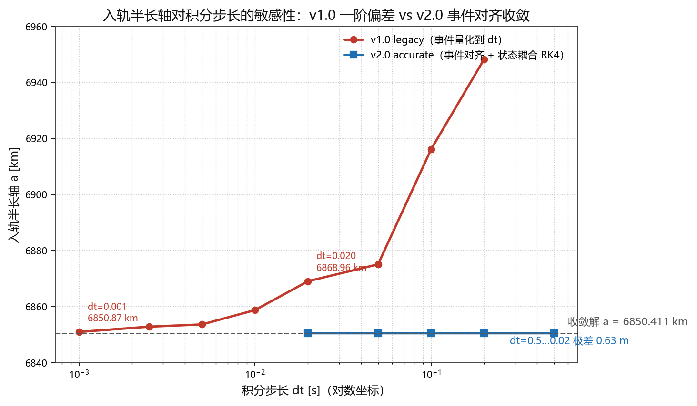

# v2.0 精度与性能验证（可复现）

> 本节所有数字都可以用文末命令在本机重跑；JSON 结果见 `docs/benchmark_v2.json`。

## 1. 口径定义

| 口径 | 事件时刻 | 质量/推进剂 | 采样时刻 | 用途 |
|---|---|---|---|---|
| `legacy` | 只在步边界判定（量化到 dt） | 步首一次性扣减（一阶） | 首个越过采样点的步（会漂移） | **逐位复现 v1.0** |
| `accurate` | 精确落在事件时刻（步长断点） | 作为 RK4 状态四阶积分 | 精确落在 0.5 s 整数倍 | 推荐；dt 无关 |

两种口径的**物理方程完全相同**（USSA76、WGS-84、J2、推力随环境压力修正、阻力用地球相对速度），
区别只在离散化。

## 2. v2 legacy 与 v1.0 的逐位比对

参考：v1.0 原始代码在 `templates/config_cz2d.json` 下生成的 `sim/`（dt=0.02）。

```
轨迹最大偏差：水平 0.008 m，高度 0.005 m
落点：一级 Δ=0.002 km；整流罩 L/R Δ=0.000 km
入轨：a 6868.961678 / 6868.961678 km（Δ=0.000）；e、i 完全相同
事件：起飞/一级分离/二级点火/抛罩/主机关机/SECO 时刻 Δt=0.000 s
```

| 项目 | 本模型 / v1 | 差 | v1 判定阈值 | 判定 |
|---|---|---|---|---|
| 事件 起飞 | T+0.000 / 0.000 s | +0.000 | 0.02 s | PASS |
| 事件 一级关机/一二级分离 | T+156.720 / 156.720 s | +0.000 | 0.02 s | PASS |
| 事件 二级点火 | T+156.720 / 156.720 s | +0.000 | 0.02 s | PASS |
| 事件 整流罩分离 | T+206.000 / 206.000 s | +0.000 | 0.02 s | PASS |
| 事件 二级主机关机 | T+324.120 / 324.120 s | −0.000 | 0.02 s | PASS |
| 事件 二级关机(SECO) | T+723.800 / 723.800 s | −0.000 | 0.02 s | PASS |
| 落点 一级 | (33.4301, 110.5272) / (33.4301, 110.5272) | 0.002 km | 0.10 km | PASS |
| 落点 fairing_L | (30.3237, 109.9724) / (30.3237, 109.9724) | 0.000 km | 0.10 km | PASS |
| 落点 fairing_R | (30.3276, 109.9452) / (30.3276, 109.9452) | 0.000 km | 0.10 km | PASS |
| 根数 a | 6868.961678 / 6868.961678 km | +0.000000 | 1.50 km | PASS |
| 根数 e | 0.005281 / 0.005281 | +0.000000 | 1e-5 | PASS |
| 根数 i | 94.730612 / 94.730612° | +0.000000 | 0.002° | PASS |
| 轨迹（水平/高度） | — | 0.0 m / 0.0 m | 200 / 150 m | PASS |

> 复现：`python scripts/regression_check.py --config templates/config_cz2d.json --reference <v1工程>/sim`
> 该命令在 v2 默认走 legacy 口径；加 `--accurate` 可看 v2 推荐口径与 v1 的差（见 §3）。

## 3. accurate 口径的 dt 收敛性



```
   dt[s]       步数          a[km]  Δa vs dt=0.5[m]     v_ins[m/s]
   0.500     1572    6850.411429         0.0000      7596.7886
   0.200     4705    6850.412058         0.6285      7596.7887
   0.100     7850    6850.412002         0.5734      7596.7887
   0.050    15819    6850.412001         0.5723      7596.7887
   0.020    39466    6850.412013         0.5838      7596.7887
```

- dt=0.5 与 dt=0.02 的入轨半长轴极差 **0.63 m**，事件时刻逐位相同；
- 残骸落点：`debris_dt` 2.0 → 0.1 s，落点最大变化 **0.34 m**；
- 结论：accurate 口径在 dt≤0.5 s 内已收敛，可以用 0.2 s（默认）或 0.5 s 运行。

## 4. v1 的离散化误差（同一物理，仅 dt 不同）

| dt [s] | a [km] | 相对 dt→0 极限 |
|---|---|---|
| 0.2 | 6948.154 | +97.7 km |
| 0.1 | 6916.013 | +65.6 km |
| 0.05 | 6874.987 | +24.6 km |
| **0.02（v1 默认）** | **6868.962** | **+18.55 km** |
| 0.01 | 6858.664 | +8.25 km |
| 0.005 | 6853.541 | +3.13 km |
| 0.0025 | 6852.736 | +2.32 km |
| 0.001 | 6850.866 | +0.45 km |
| v2 accurate（任意 dt≤0.5） | 6850.411 | 0（收敛解） |

v1 自己把步长压到 0.001 s 时收敛到 6850.87 km，与 v2 accurate 的 6850.41 km 相差 0.45 km
（剩余为 0.001 s 事件的量化残差），**交叉验证 v2 accurate 就是同一模型的连续极限**。

由此得到 v1 默认口径的系统性偏差量级：

- 入轨半长轴 **+18.55 km**（+2.7e-3）；入轨速度 **+8.36 m/s**；
- 落点：一级 0.13 km、整流罩 0.87–0.92 km；
- 事件时刻：被量化在同一 dt 网格上（同一 dt 下与 v2 legacy 完全一致）。

## 5. 性能（单次仿真，3 次取中位数）

| 口径 | 耗时 [s] | 步数 | a [km] |
|---|---|---|---|
| v1 legacy dt=0.02 | 0.954 | 39 192 | 6868.962 |
| v1 legacy dt=0.01 | 1.893 | 78 381 | 6858.664 |
| v2 accurate dt=0.5 | **0.090** | 1 572 | 6850.411 |
| v2 accurate dt=0.2（默认） | 0.189 | 4 705 | 6850.412 |
| v2 accurate dt=0.05 | 0.558 | 15 819 | 6850.412 |

## 6. 全流水线耗时（v1 补齐路径/参数后与 v2 同机对比）

| 阶段 | v1.0 [s] | v2.0 [s] | 加速 |
|---|---|---|---|
| 仿真 + 数据导出 | 1.84 | 0.56 | 3.3× |
| 发射窗口 | 0.28 | 0.21 | 1.3× |
| 天空轨迹（详细版） | 4.39 | 4.32 | 1.0× |
| 天空轨迹（参考样式） | 2.20 | 1.96 | 1.1× |
| 出现方位地形判读图 | 21.79 | 4.00 | **5.4×** |
| 全国最大高度角地图 | 16.87 | 9.48 | **1.8×** |
| 蒙特卡洛 N=250 | 187.5 | 10.78 | **17.4×** |
| 三维 KMZ | 0.28 | 0.30 | 1.0× |
| 交付自检 QC | 0.27 | 0.30 | 1.0× |
| **合计（不含 MC）** | **47.9** | **21.1** | **2.3×** |
| **合计（含 MC 250）** | **235.4** | **31.9** | **7.4×** |

> v2.0 列取自最终一轮 `run_all.ps1 -SkipDem -MC 250 -Jobs 8`（8 进程；每步耗时由脚本自身计时）。
> v1 的“天空轨迹/全国地图”原始包无法直接运行（缺 import / 配置路径 / Natural Earth 数据 /
> `--config` 不识别），上表 v1 数字是在 v1 代码上**只补路径与参数**后的实测（算法未改）。
> DEM 来源：本机无法高速下载 SRTM，用同尺寸合成瓦片计时（代码路径与数据规模一致）；
> 正式交付前必须用真实 SRTM 重跑天空轨迹。

## 7. 复现命令

```powershell
$env:PYTHONIOENCODING="utf-8"; $env:MPLBACKEND="Agg"

# 单次仿真口径对比 + dt 收敛 + 与 v1 逐位比对
python scripts/bench.py all --config config.json `
       --reference "<v1工程>\sim" --runs 3

# 只看 dt 收敛
python scripts/bench.py accuracy

# 逐位回归（legacy 口径；--accurate 看推荐口径）
python scripts/regression_check.py --config templates\config_cz2d.json `
       --reference "<v1工程>\sim"

# 全流水线（分步计时）
powershell -NoProfile -ExecutionPolicy Bypass -File .\run_all.ps1 -SkipDem -MC 250 -Jobs 8
```
