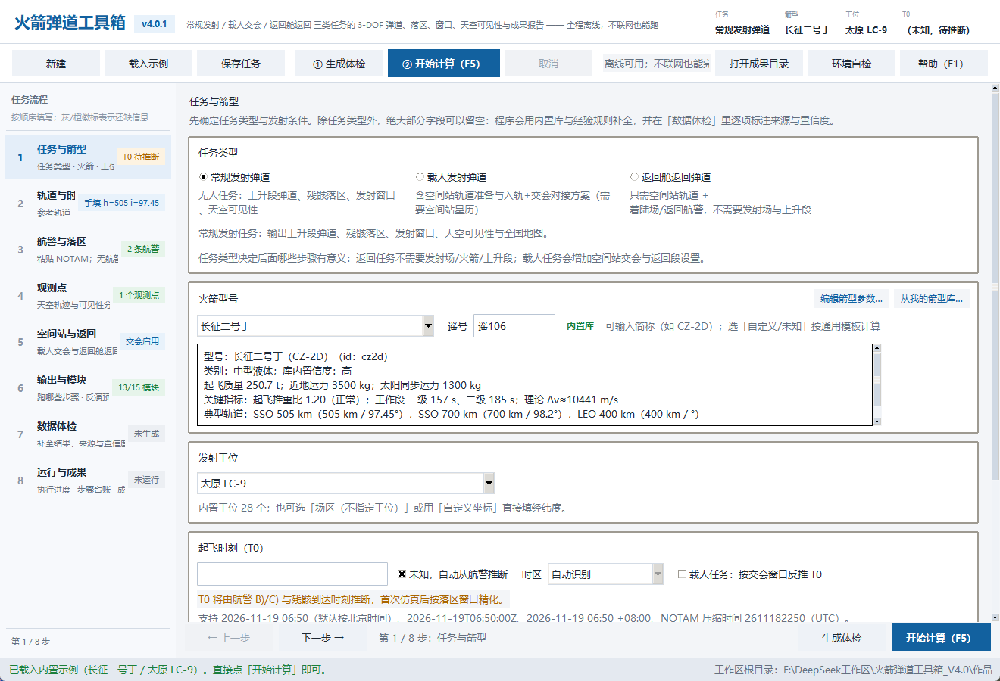
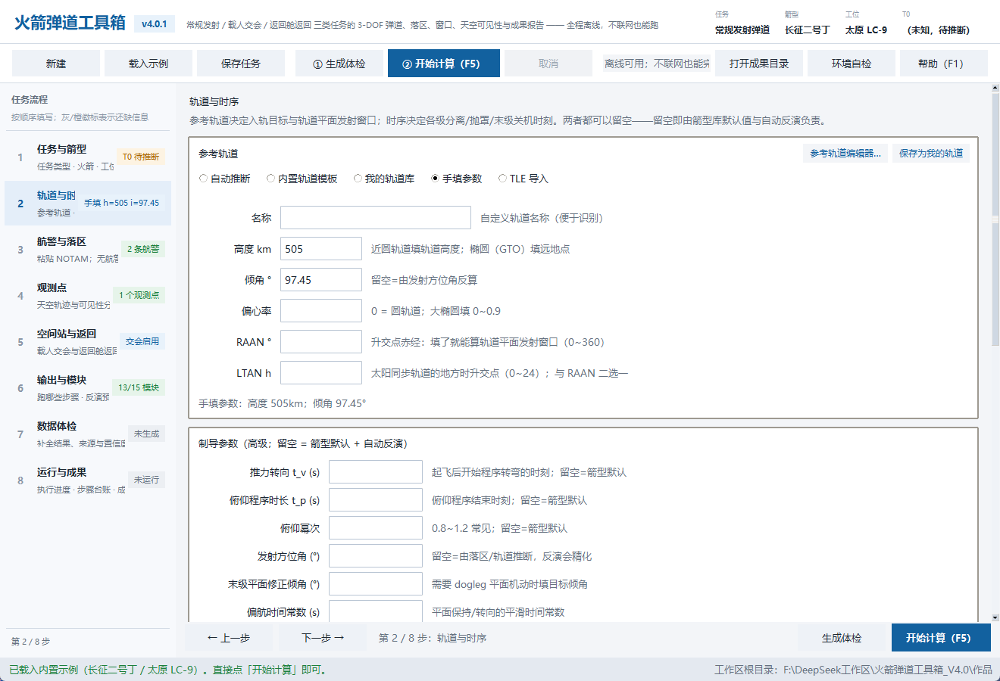
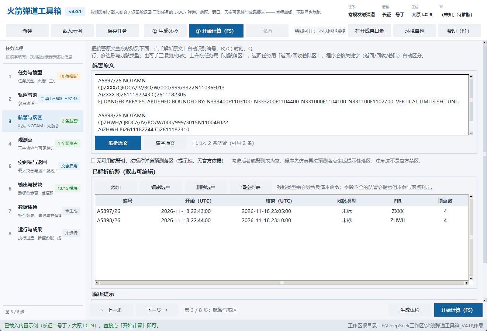
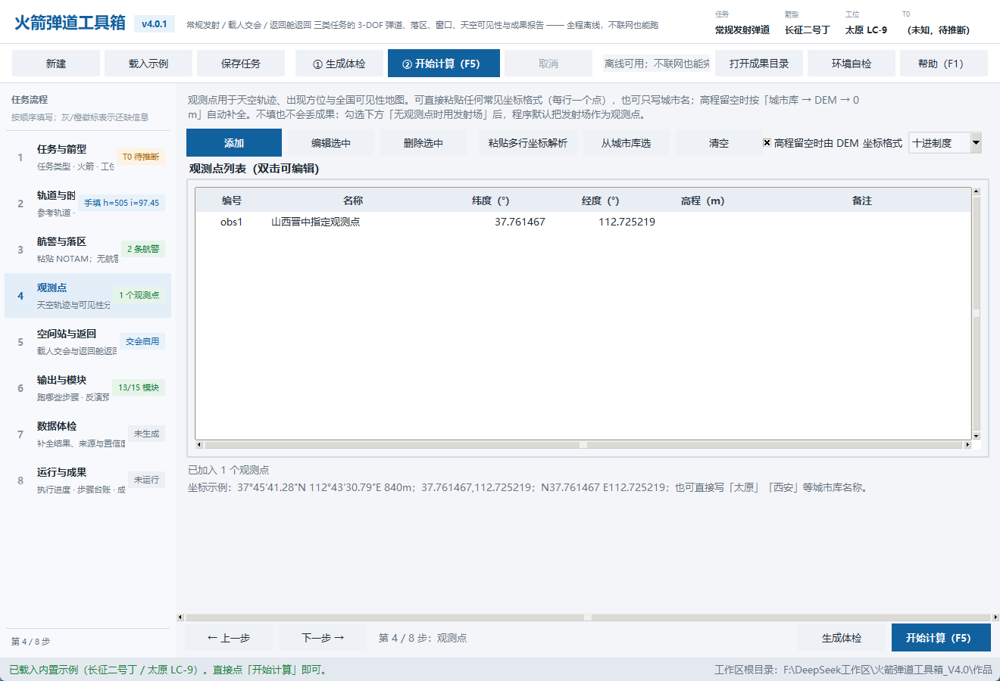
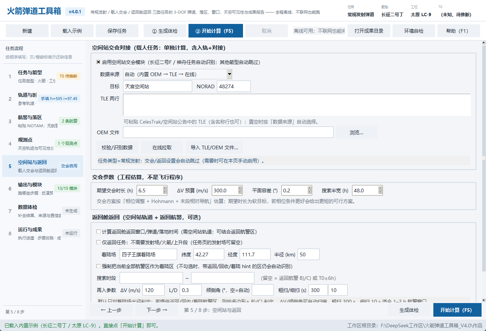
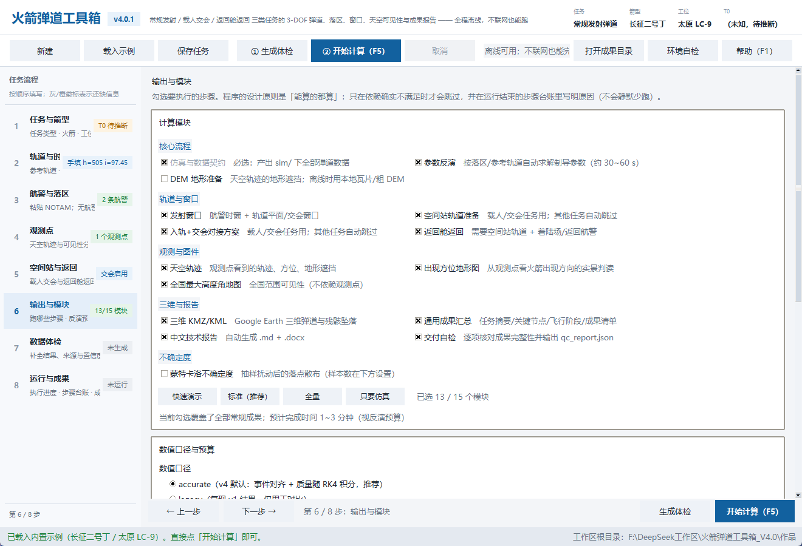
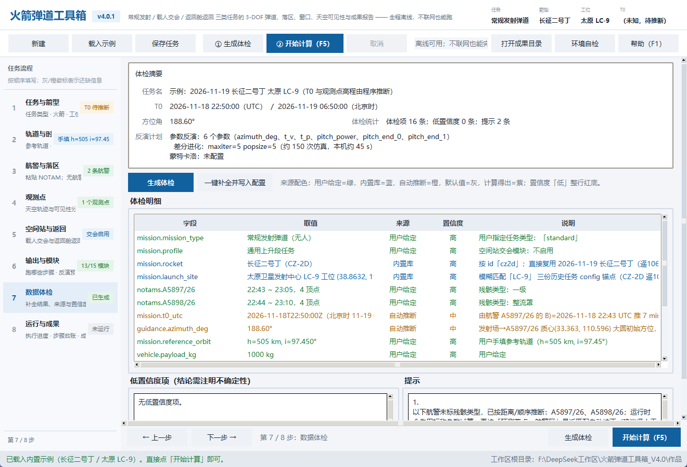
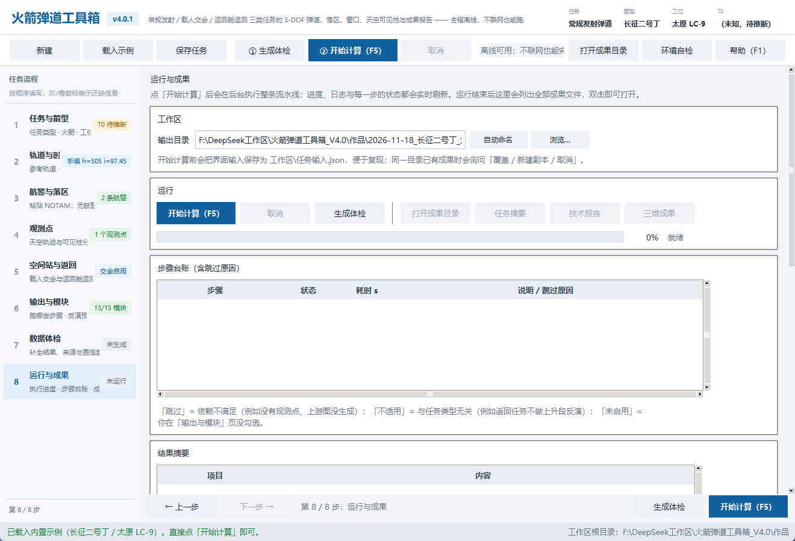
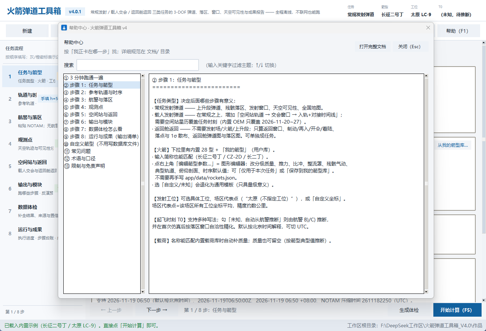

> 适用版本：v4.0（2026-11）

# 02 用户手册

本手册按界面顺序组织，可当参考书查：第一节讲窗口骨架，第二至九节逐个讲八个步骤
（每步：作用 / 怎么填 / 留空会怎样 / 边界情况），第十节起讲库管理、工作区、复现与命令行。

---

## 1. 界面总览

v4 把 v3 的「7 页 Notebook 平铺」改成 **左侧八步向导 + 右侧步骤页**：
第一次用按 1→8 往下走即可，熟练后 `Ctrl+1..8` 直达。

### 1.1 窗口骨架



> 说明：顶部是工具条与常驻「任务概要条」（任务类型 / 箭型 / 工位 / T0）；左侧是 1→8 的步骤向导，每步右侧的徽标表示该步是否已就绪。


| 区域 | 位置 | 内容 |
|---|---|---|
| 标题区 | 最上 | `火箭弹道工具箱` + `v4.0` 徽标 + 一句副标题 |
| 任务概要条 | 标题区右侧 | 常驻显示 **任务类型 / 箭型 / 工位 / T0**，任何页面改动后立即刷新 |
| 工具条 | 第二行 | 新建、载入示例、保存任务、① 生成体检、② 开始计算（F5）、取消、打开成果目录、环境自检、帮助（F1） |
| 左侧向导 | 左栏 232 px | 八步列表，每步：序号 + 标题 + 副标题 + 状态徽标；底部显示「第 N / 8 步」 |
| 右侧步骤页 | 主区 | 当前步骤表单；页面可滚动 |
| 页面底部导航 | 主区下方 | ← 上一步 / 下一步 → / 「第 N / 8 步：标题」/ 生成体检 / 开始计算（F5） |
| 状态栏 | 最下 | 左侧一行状态提示（成功绿、警告橙、错误红），右侧工作区根目录 |

### 1.2 工具条按钮

| 按钮 | 等价快捷键 | 作用 |
|---|---|---|
| 新建 | `Ctrl+N` | 清空为一个新的空任务 |
| 载入示例 | — | 载入内置「长征二号丁 / 太原 LC-9」示例（含 2 条航警、1 个观测点） |
| 保存任务 | `Ctrl+S` | 把当前界面输入保存为任务 JSON（`MissionInput` 结构） |
| ① 生成体检 | — | 补全配置并跳到「⑦ 数据体检」，不写盘、不跑计算 |
| ② 开始计算（F5） | `F5` | 写 `任务输入.json` → 生成 `config.json` → 跑流水线 |
| 取消 | — | 请求取消：**当前步骤结束后**停止，已生成文件保留 |
| 打开成果目录 | — | 用资源管理器打开当前工作区 |
| 环境自检 | — | 打印版本、路径、依赖、内置库条目数、粗 DEM 状态 |
| 帮助（F1） | `F1` | 打开帮助中心（左侧主题 + 搜索，可一键打开 `文档\`） |

计算或后台任务进行中时，除「取消」外的按钮会置灰，避免重复触发。

### 1.3 左侧向导的状态徽标

徽标是本步「够不够算」的即时判据，颜色规则与表格一致（绿=就绪、橙=缺信息、灰=不适用/未生成）：

| 步骤 | 徽标示例 | 触发条件 |
|---|---|---|
| 任务与箭型 | `已就绪` / `待选火箭` / `待选工位` / `T0 待推断` | 缺箭型、缺工位、T0 为空（三者的先到先判） |
| 轨道与时序 | `自动推断` / `模板：SSO 500` / `手填 h=500` / `TLE 导入` / `… 自定义时序` | 参考轨道来源；启用自定义时序时加 `· 自定义时序` |
| 航警与落区 | `2 条航警` / `预测落区` / `无航警` | 已解析可用航警数；勾了「预测落区」 |
| 观测点 | `3 个观测点` / `默认发射场` / `未设置` | 观测点条数；未填时看「无观测点时用发射场」是否勾选 |
| 空间站与返回 | `交会启用` / `含返回段` / `仅返回任务` / `不适用` | 三个开关的组合 |
| 输出与模块 | `15/15 模块` | 已勾模块数 / 总数 |
| 数据体检 | `已生成` / `N 项待关注` / `未生成` | 低置信度项数量 |
| 运行与成果 | `未运行` / `运行中…` / `已完成` / `有失败步骤` / `已取消` | 最近一次运行结果 |

### 1.4 菜单

| 菜单 | 项 | 说明 |
|---|---|---|
| 文件 | 新建任务 `Ctrl+N`、载入示例（长征二号丁）、打开任务 JSON… `Ctrl+O`、保存任务 JSON… `Ctrl+S`、打开工作区、退出 | 「打开任务 JSON」既能读 `MissionInput` 任务文件，也能读历史 `config.json`（自动反推输入） |
| 数据 | 箭型参数编辑器…、参考轨道编辑器…、我的箭型库…、我的轨道库…、导出我的数据包…、导入我的数据包… | 见 §10；编辑器字段说明见 [03](03_自定义箭型.md)、[04](04_参考轨道与发射时序.md) |
| 设置 | 工作区根目录…、DEM 瓦片目录…、导入离线高程文件…、清空 DEM 缓存…、环境自检 | 改完路径写入根目录 `settings.json` |
| 帮助 | 帮助中心 `F1`、打开文档目录、关于 | 「打开文档目录」打开的就是本 `文档\` |

### 1.5 快捷键

| 快捷键 | 作用 |
|---|---|
| `F5` | 开始计算 |
| `F1` | 帮助中心 |
| `Ctrl+1` … `Ctrl+8` | 直跳第 1~8 步 |
| `Ctrl+N` / `Ctrl+O` / `Ctrl+S` | 新建 / 打开任务 JSON / 保存任务 JSON |
| `Alt+←` / `Alt+→` | 上一步 / 下一步 |
| `Esc` | 关闭帮助中心等对话框（对话框内有效） |

---

## 2. 步骤 ① 任务与箭型

**作用**：确定任务类型、箭型、发射工位、起飞时刻、载荷。这一页决定后面哪些步骤有意义。

### 2.1 任务类型（三选一，必选）

| 选项 | 内部值 | 适用 | 影响 |
|---|---|---|---|
| 常规发射弹道 | `standard` | 无人任务 | 上升段弹道、落区、发射窗口、天空可见性、全国地图 |
| 载人发射弹道 | `crewed` | 载人飞船（CZ-2F 等） | 在常规之上增加「空间站轨道 → 交会窗口 → 入轨+对接时间线」，并默认可启用返回舱返回 |
| 返回舱返回弹道 | `return` | 只要返回段 | **不需要发射场/火箭/上升段**；只算返回窗口、制动、再入、开伞、着陆、落点与 1σ 散布 |

- 默认值是「常规发射弹道」，不是「自动识别」。程序内部的 `auto` 只在命令行/任务 JSON 里出现：
  `auto` 时按箭型判定，**CZ-2F 会被识别为载人**。
- 切到「返回舱返回」后，本页只用来给任务取名；发射场字段会被忽略（工位提示改为「返回任务不使用发射场」）。
- 载人任务不强制必须选 CZ-2F，但内置空间站星历只覆盖 **2026-11-20 ~ 2026-11-27**，
  超出范围要自己导入 TLE/OEM（见 §6）。

### 2.2 火箭型号

| 项 | 说明 |
|---|---|
| 下拉选择 | 内置 28 型 + 「我的箭型」+ `自定义/未知` |
| 可输入简称 | 如 `CZ-2D`、`长二丁`；输入后失焦/回车即匹配 |
| 右侧「编辑箭型参数…」 | 打开图形编辑器；详见 [03_自定义箭型.md](03_自定义箭型.md) |
| 右侧「从我的箭型库…」 | 打开用户库管理对话框 |
| 遥号 | 只进入任务名/报告，不影响物理 |
| 箭型简介区 | 型号、类别、库内置信度、起飞质量、LEO/SSO 运力、关键指标（起飞推重比、工作段、理论 Δv）、典型轨道、说明 |

**留空/未匹配会怎样**：按「通用中型液体火箭模板」计算，结果只有量级意义；数据体检里
火箭型号的置信度为「低」并进入低置信度列表。

**边界情况**：

- 起飞推重比 <1.15 时简介区会直接提示「偏低，可能无法起飞」——先怀疑推力/台数填重了。
- 选了自定义箭型（编辑器返回）后，改型号文本会**放弃**「仅本次任务」的自定义箭型
  （已保存到用户库的除外）。
- 类别（小型固体/中型液体/大型液体/载人）只是量级锚点，切换类别不会改你已填的分级数据。

### 2.3 发射工位

| 选项 | 说明 |
|---|---|
| 具体工位 | 内置发射场库里的工位条目 |
| `XX卫星发射中心（不指定工位）` | 场区级条目：取该场区所有工位的**平均坐标**，精度约数公里 |
| `自定义坐标` | 自己填纬度/经度/海拔；支持十进制度与度分秒（`38.8587`、`38°51′31″N`） |
| 坐标格式 | 工具条上的「格式」下拉切换十进制度/度分秒，影响输入解析与列表显示 |

**留空会怎样**：`site_label` 为空且无坐标时，程序会用箭型库的典型工位或按经纬度合理性兜底；
落区/方位角推断会因此不可靠，体检里会标出。**建议至少选到「场区（不指定工位）」**。

**边界情况**：

- 经纬写反会被拦：纬度 >90° 且经度 ≤90° 时直接报「疑似经纬度写反」。
- 坐标 (0,0) 被拒绝（视为未填）。
- 海拔可留空：由城市库/DEM 自动补全（观测点页的「高程自动补全」勾选框控制）。

### 2.4 起飞时刻 T0

| 项 | 说明 |
|---|---|
| 输入框 | 支持多种写法，实时预览「识别为 UTC …／北京时 …」 |
| 勾选「未知，自动从航警推断」 | 输入框置灰；T0 由航警 B)/C) 与残骸到达时刻推断，首次仿真后按落区窗口精化 |
| 勾选「载人任务：按交会窗口反推 T0」 | 仅载人/交会任务生效：运行时按空间站轨道算**交会发射窗口**；若你填的 T0 在窗口内（默认按 2° dogleg 预算加宽，约 ±8 min）就**原样保留**，只按目标平面重飞并校核；只有在窗口外才平移。报告 §4.4 给出 dogleg 窗口、穿越面最佳时刻、所需平面修正与入轨面残差 |
| 时区 | 自动识别 / UTC / 北京时间（UTC+8）；默认自动（无时区标记时按北京时间解释） |

支持的写法示例：

```text
2026-11-19 06:50
2026-11-19T06:50:00Z
2026-11-19 06:50 +08:00
2611182250          # NOTAM 压缩时间，按 UTC 解释
```

**留空会怎样**：等价于「未知，待推断」——**前提是有带 B)/C) 的航警**；两者都没有时
生成配置会直接报错「无法确定起飞时刻 T0」。例外：载人任务勾选「按交会窗口反推 T0」后可以不填
T0，程序以当前时刻为窗口搜索中心，运行时再按交会窗口定 T0（日志与报告会说明）。

T0 不会被程序悄悄改：只要在 dogleg 可达窗口内（默认 ±8 min），程序按你给的时刻飞，
报告 §4.4 给出"需平面修正约 X°"与**入轨面残差**（实测入轨面与空间站面夹角，示例约 0.02°）。
未填 T0 时才用窗口中心（穿越面最佳时刻）作为推荐。

**T0 与交会窗口的关系**（v4.1）：载人任务的发射窗口本质上是"飞船入轨时空间站轨道面/相位合适"的
时刻集合。不勾选反推时，若你给的 T0 不在可行窗口内，报告 §5.3 会说明交会计算实际采用的 T0
（内部按最近窗口），并给出 ΔRAAN 量级；勾选反推后，T0、弹道、落区、窗口、交会**全部同一时刻**，
报告不再出现这种"两套 T0"的说明。

**边界情况**：T0 由航警推断（`t0_src=infer`）时，体检里 T0 置信度可能是「低」并进入
低置信度列表；程序仍会在运行中以「T0 精化」步骤按落区窗口自洽性回调。

### 2.5 载荷与任务名

| 字段 | 留空后果 |
|---|---|
| 载荷名称 | 不影响质量推断；若能在内置载荷库（26 条）匹配，会自动补质量与轨道提示 |
| 载荷质量 kg | 按箭型典型载荷推断（体检里来源=内置库/默认值） |
| 任务名 | 按「日期 + 箭型 + 工位」自动命名 |

---

## 3. 步骤 ② 轨道与时序




**作用**：指定入轨目标、覆盖制导参数、微调分离/抛罩/末级关机时刻。**整页可以完全不动**。

两句话概括留空语义：

- 参考轨道与制导参数留空 → 由箭型默认 + 自动反演决定（参考轨道作为**软约束**）；
- 发射时序留空 → 每行使用该箭型的默认时刻（推进剂耗尽或库内程序时刻）。

细节（五种轨道来源、字段含义、RAAN/LTAN 与窗口、时序四种写法、反例）见
[04_参考轨道与发射时序.md](04_参考轨道与发射时序.md)；箭型参数本身见
[03_自定义箭型.md](03_自定义箭型.md)。本页还有：

| 卡片 | 内容 |
|---|---|
| 参考轨道 | 五种来源单选 + 模板/我的轨道下拉 + 手填高度/倾角/偏心率/RAAN/LTAN + TLE 粘贴解析 + 实时预览；卡片右上「参考轨道编辑器…」打开编辑器，「保存为我的轨道」把当前手填值存入用户库 |
| 制导参数（高级） | `t_v` / `t_p` / `pitch_power` / `方位角` / `i_target_deg` / `yaw_tau` / `fairing_divert_mps`，留空=箭型默认并参与反演 |
| 发射时序 | 左侧箭型默认值、右侧自定义值；「填入箭型默认」「全部清空」「保存为模板…」「应用模板…」；时间轴预览与差值提醒 |
| 当前箭型参数速览 | 各级结构/推进剂/台数/真空推力/真空比冲/俯仰终角/分离时刻，助推器与整流罩行；底部给出起飞质量、推重比、理论 Δv 与警告 |

---

## 4. 步骤 ③ 航警与落区




**作用**：把官方 NOTAM 变成可判定的危险区；没有航警时用「预测落区」兜底。

### 4.1 怎么填

1. 把 NOTAM 原文**整段**粘进上方文本框（支持 ICAO 英文、中文任务卡、只有 Q 行圆、
   只有多边形顶点等写法）；
2. 点「解析原文」；
3. 在下方列表核对：编号、B)/C) 有效期、Q 行、FIR、多边形、残骸类型（一级/二级/整流罩/助推器）；
4. 不够准就「编辑选中」手工修，或「添加」一条。

### 4.2 关键约定

| 约定 | 说明 |
|---|---|
| 多边形顶点顺序 | **`[纬度, 经度]`**，不是 GeoJSON 的经度在前 |
| 有效性 | 同时有 `id`、`b_utc`、`c_utc`、≥3 个顶点才算「可用」；字段不全的会被标黄并忽略 |
| 残骸类型 | 原文没写时程序先按距发射场远近猜，运行时再用「预测落点 ↔ 航警区」最近匹配**自动校正** |
| 时区 | B)/C) 一律按 UTC 解析 |

### 4.3 没有航警怎么办

勾选「无可用航警时，按标称弹道预测落区（提示性，无官方依据）」：

- 程序先按标称程序仿真，再用预测落点生成**提示性落区**（约 ±0.35°）；
- 这样落区判定、发射窗口、KML 里仍有「参考区」；
- 报告中会明确标注「预测，无官方依据」，不能用于正式结论。

不勾且无航警：不做落区判定、不算发射窗口（也不会静默消失——步骤台账会写明原因）。

### 4.4 边界情况

- 只给了 Q 行圆（半径型危险区）时，程序按圆心+半径生成多边形近似；
- 同一次任务的多条航警会按距离/残骸类型匹配，匹配不上会在体检与报告里提示；
- 返回任务的「着陆区」也来自航警：带「返回/回收/着陆」关键字的区会被优先当着陆区，
  也可在「⑤ 空间站与返回」里强制把当前全部航警区当着陆区。

---

## 5. 步骤 ④ 观测点




**作用**：决定「天空轨迹 / 出现方位地形图 / 全国可见性地图」从哪儿看。

### 5.1 怎么填

| 方式 | 操作 |
|---|---|
| 单个添加 | 「添加」→ 填名称/纬度/经度/高程/备注（经纬留空时按名称查城市库） |
| 批量粘贴 | 「粘贴多行坐标解析」，每行一个点；坐标行与城市名行可混排 |
| 城市库选择 | 「从城市库选」→ 搜索 → 可 Ctrl/Shift 多选 → 双击或「添加选中」 |
| 编辑/删除 | 表格双击，或按钮；「清空」清空全部 |

支持的坐标写法：

```text
37°45′41.28″N 112°43′30.79″E 840m
37.761467,112.725219
N37.761467 E112.725219
太原
```

### 5.2 高程与两个勾选框

| 控件 | 默认 | 语义 |
|---|---|---|
| 高程留空时由 DEM / 城市库自动补全 | 勾选 | 补全顺序：城市库 → DEM → 0 m |
| 无观测点时用发射场 | 勾选 | 没有观测点时把发射场坐标当观测点，保证天空类成果不丢 |

### 5.3 留空会怎样

- 观测点为空 + 勾选「无观测点时用发射场」：以发射场为观测点，天空轨迹/出现方位/全国地图
  照常产出；数据体检里观测点来源标为「自动推断」，任务摘要会写「未填写 → 默认使用发射场」。
- 观测点为空 + **取消**该勾选：`sky`、`appear` 两步会标「跳过」并写明原因；
  全国最大高度角地图仍会生成（不依赖观测点）。

### 5.4 边界情况

- 纬度 >90° / 经度 >180° 会直接报错（并提示疑似经纬写反）；
- 观测点只用于「从该点看火箭」，不影响弹道本身；
- 多点会逐个出图，文件名带地点名+经纬度（如 `天空轨迹_太原_37.76N_112.72E.png`）。

---

## 6. 步骤 ⑤ 空间站与返回




**作用**：载人任务的交会目标数据、返回舱返回参数。常规发射任务这一页基本不用管。

### 6.1 空间站交会（仅载人/交会任务）

| 控件 | 默认 | 说明 |
|---|---|---|
| 启用空间站交会 | 勾选 | 非载人任务会被自动跳过（台账记「不适用」） |
| 数据来源 | 自动 | `auto` / 内置 / 在线 / TLE / OEM |
| 目标 / NORAD | 天宫空间站 / 48274 | 只影响报告与匹配 |
| TLE 两行 | 空 | 用户 TLE 优先于内置 |
| OEM 文件 | 空 | 用户 OEM 优先级最高；「浏览…」选择 |
| 校验/识别数据 | — | 确认当前来源是否覆盖任务时刻 |
| 在线拉取 | — | 需在「输出与模块」勾「允许联网补全」 |
| 导入 TLE/OEM 文件… | — | 直接导入文件 |

数据优先级（`engine/common/station.py` 的解析顺序，`app/data/station/README.md` 同口径）：

1. 用户 OEM（`station.oem_path`）；
2. 用户 TLE（`station.tle`）；
3. 内置 OEM 快照（仅当任务时刻落在 `2026-11-20T00:00:00Z ~ 2026-11-27T00:00:00Z`）；
4. 内置 TLE（历元 ±45 天内，>20 天会警告沿迹误差）；
5. 在线拉取（需联网）；
6. 失败 → 中文提示要求导入。

交会参数：期望交会时长 6.5 h、ΔV 预算 300 m/s、平面容差 0.2°、窗口搜索半宽 48 h。

> 交会模型是**工程估算**（相位调整 + Hohmann + 末段逼近），不是飞行程序。报告 §5 给时间线与总 ΔV。

### 6.2 返回舱返回

| 控件 | 默认 | 说明 |
|---|---|---|
| 启用返回舱返回 | 不勾 | 需要空间站星历（否则会提示先启用） |
| 仅返回任务（不计算上升段） | 不勾 | 等价于任务类型=返回舱返回 |
| 着陆场 / 纬度 / 经度 / 半径 | 四子王旗 / 42.27 / 111.70 / 50 km | 固定着陆场 |
| 强制把当前全部航警区作为着陆区 | 不勾 | 不勾时，带返回/回收/着陆 hint 的区仍会自动识别 |
| 搜索时段 | 空 | 留空=按返回航警 B)/C)（各自 −3 h / +1 h）；无航警则 T0±6 h |
| ΔV (m/s) / L/D / 倾侧角 | 120 / 0.30 / 空 | 倾侧角留空=自动扫描 |
| 粗扫 / 细扫 (s) | 300 / 10 | 再入参数自动扫描步长 |

- 返回任务**不需要**发射场、火箭与上升段；上升段相关步骤在台账里统一记「不适用」并附原因。
- 返回任务的 KML/KMZ 由「返回舱返回」步骤自己产出（`viz\返回舱弹道.kmz`），通用 KML 步骤会跳过。

---

## 7. 步骤 ⑥ 输出与模块




**作用**：决定跑哪些步骤、反演预算、数值口径、是否联网、离线高程。

设计原则是「**能算的都算**」：只在依赖确实不满足时跳过，并在步骤台账里写明原因。

### 7.1 十五个模块（按用途分组）

| 分组（关掉会少什么） | 模块 | 说明 |
|---|---|---|
| 核心流程 | `export` 仿真与数据契约 | **必选**（复选框锁定），产出 `sim\` 下全部弹道数据 |
| | `invert` 参数反演 | 按落区/参考轨道求解制导参数，约 30~60 s |
| | `dem` DEM 地形准备 | 天空轨迹的地形遮挡；离线时用本地瓦片/粗 DEM |
| 轨道与窗口 | `window` 发射窗口 | 航警时窗 + 轨道平面/交会窗口 → `report\发射窗口计算.json` |
| | `station` 空间站轨道准备 | 载人/交会任务用，其他任务自动跳过 |
| | `docking` 入轨+交会对接方案 | 载人/交会任务用，其他任务自动跳过 |
| | `return` 返回舱返回 | 需空间站星历 + 着陆场/返回航警 |
| 观测与图件 | `sky` 天空轨迹 | 观测点视角的轨迹、方位、地形遮挡 |
| | `appear` 出现方位地形图 | 从观测点看火箭出现方向的实景判读 |
| | `map` 全国最大高度角地图 | 全国可见性（不依赖观测点） |
| 三维与报告 | `kml` 三维 KMZ/KML | Google Earth 三维弹道与残骸坠落 |
| | `summary` 通用成果汇总 | 任务摘要/关键节点/飞行阶段/成果清单（v4 新增） |
| | `report` 中文技术报告 | 自动生成 `.md` + `.docx` |
| | `qc` 交付自检 | 逐项核对成果完整性 → `report\qc_report.json` |
| 不确定度 | `mc` 蒙特卡洛 | 抽样扰动后的落点散布（样本数在下方设置） |

### 7.2 四种预设

| 预设 | 勾选 | 反演预算 | 典型耗时 |
|---|---|---|---|
| 快速演示 | `export` `summary` `report` `qc` | 快速（6/5） | 约 10~20 s，先验证环境 |
| 标准（推荐） | 默认全勾，除 `mc` | 自动 | 首次一个任务约 1~3 min |
| 全量 | 全勾（含 `mc`，样本数自动填 300） | 精细（20/10） | 最慢，含天空/地图/三维/蒙特卡洛 |
| 只要仿真 | `export` `invert` `summary` `report` `qc` | 快速（6/5） | 最快，用于批量试算 |

### 7.3 数值口径与预算

| 项 | 选项 | 说明 |
|---|---|---|
| 数值口径 | `accurate`（默认，事件对齐 + 质量随 RK4 积分）/ `legacy`（复现 v1，仅对比用） | 写进 `config.numerics.mode` |
| 反演预算 | 自动 / 快速（maxiter=6, popsize=5，约 30 次仿真）/ 精细（maxiter=20, popsize=10，约 200 次仿真） | 「自动」= 0/0，由 `autoplan` 按参数个数与置信度决定 |
| 蒙特卡洛样本 | 0 = 不跑；勾选 `mc` 时必须 >0 | 建议 100~500 |
| 并行进程 | 0/1 = 串行 | 本机实测差分进化**串行更快**；>1 时仅在非冻结态生效 |
| 允许联网补全 | 默认**不勾** | 只影响 DEM 瓦片下载与空间站在线拉取；不勾时不会等网络超时 |

### 7.4 离线高程（弱网/内网环境）

- 支持 GeoTIFF（WGS84，带 `.tfw` 或内嵌地理参照）与 SRTM HGT / HGT.GZ / ZIP；
- 导入后计算时**优先使用**它，其次才是在线 SRTM，最后是内嵌粗 DEM（约 2 km）；
- DEM 只影响天空轨迹的地形遮挡与观测点高程，不改变弹道；
- 命令行走廊：`python -m app.main --import-dem "D:\我的高程\山西.tif"`。

### 7.5 预计产出

页面底部会按当前勾选与任务类型实时列出「会生成哪些成果」，以及「缺了哪一类」。
例如关闭 `invert` 会提示「落点/入轨可能偏离航警与参考轨道」；任务类型=返回时提示
「上升段相关模块会自动记为不适用」。

---

## 8. 步骤 ⑦ 数据体检




**作用**：把「程序到底用了什么值、从哪来、多可信」逐项摊开。这是判断结果能不能引用的唯一依据。

### 8.1 页面构成

| 区域 | 内容 |
|---|---|
| 体检摘要 | 任务名、T0（UTC / 北京时）、方位角、体检统计（体检项 N 条；低置信度 N；提示 N）、反演计划 |
| 按钮 | 「生成体检」（重新补全）、「一键补全并写入配置」（落盘 `config.json` 与 `任务输入.json`） |
| 体检明细 | 字段 / 取值 / 来源 / 置信度 / 说明 |
| 左栏 | 低置信度项（结论需注明不确定性） |
| 右栏 | 提示（warnings） |

### 8.2 来源与置信度的读法

`来源` 五类，配色写在 `app/gui/theme.py`：**用户给定=绿，内置库=蓝，自动推断=橙，
默认值=灰，计算得出=紫**；`置信度` 为「低」时整行红底。

| 来源 | 含义 | 典型字段 |
|---|---|---|
| 用户给定 | 你在界面上填的 | T0、工位坐标、观测点、时序、制导覆盖 |
| 内置库 | 箭型/发射场/城市/载荷/轨道/空间站数据 | 箭型参数、工位坐标、城市高程 |
| 自动推断 | 由其他已知量反推 | 方位角（按落区）、T0（按航警）、参考轨道 |
| 默认值 | 兜底常量 | 通用中型液体模板、0 m 高程 |
| 计算得出 | 由公式得到 | 起飞推重比、理论 Δv |

### 8.3 建议动作

| 看到 | 建议 |
|---|---|
| 落区/残骸相关项置信度低 | 核对航警原文与残骸类型 |
| T0 是「推断值」 | 有准确时刻就填上；否则在报告中注明 |
| 方位角来源是「推断」 | 提供航警落区可显著改善（落区反算方位角） |
| 参考轨道置信度低 | 在步骤 ② 指定轨道模板/手填/TLE |
| 火箭型号置信度低/未匹配 | 用箭型编辑器定义，或换内置型号 |

---

## 9. 步骤 ⑧ 运行与成果




### 9.1 开始计算前

- 输出目录：默认按「工作区根 + 自动命名」生成，可手改或「浏览…」；
- 开始计算时会先把界面输入写成 `工作区\任务输入.json`（便于复现）；
- 目录里已有成果时会弹「覆盖 / 新建副本 / 取消」三选一（命中 `config.json`、
  `运行日志.txt`、`sim\trajectory.csv`、`report\qc_report.json` 等任一即视为有成果）。

### 9.2 运行中

| 显示 | 说明 |
|---|---|
| 进度条 + 百分比 | 按步骤权重估算（反演权重最大，天空/地图/蒙特卡洛次之） |
| 当前步骤 | 显示 `STEP_NAMES` 里的中文步骤名 |
| 已用时间 | 分:秒 |
| 实时日志 | 普通=黑、警告=橙、错误=红；可暂停自动滚动、清空；完整日志同时写 `运行日志.txt` |
| 取消 | 请求后当前步骤结束即停；已生成文件保留 |

### 9.3 运行后

| 区域 | 内容 |
|---|---|
| 结果摘要 | 任务类型、通用成果文件数、交付自检通过项、耗时等；载人任务会额外显示「T0 反推」「入轨面残差」与「交会对接」摘要（含对接点星下点） |
| 步骤台账 | 步骤 / 状态 / 耗时 / 说明（跳过原因） |
| 成果文件 | 按目录分组，双击打开；顶部提示「共 N 个文件 / 体积；应产出缺失 M 项」 |
| 快捷按钮 | 打开成果目录、任务摘要、技术报告、三维成果、成果清单 |

步骤台账的六种状态：

| 状态 | 含义 | 你该做什么 |
|---|---|---|
| 完成 | 正常跑完 | — |
| 跳过 | 依赖不满足（无观测点、上游图未生成、样本数为 0…） | 读「说明」，补数据后重算 |
| 不适用 | 与任务类型无关（返回任务不做上升段反演） | 不用管 |
| 未启用（未勾选模块） | 你在步骤 ⑥ 没勾 | 需要就勾上重算 |
| 失败 | 步骤报错（异常或非零退出码） | 看 `运行日志.txt` 对应段落 |
| 取消 | 你点了取消 | 已生成文件保留，可重跑 |

---

### 9.4 帮助中心（F1）

按「我卡在哪一步」组织，左侧主题 + 搜索，右上角可打开完整文档目录。



## 10. 我的库管理

用户数据都在 `user_data\`（开发态 = 项目根 `user_data\`），由 `app/core/userdb.py` 管理，
**与内置库 `app/data\*.json` 分离**——程序永远不会改内置库。

| 文件 | 内容 | 结构 |
|---|---|---|
| `user_data\rockets.json` | 自定义箭型 | `{"schema": "rocketkit.user_db.v1", "rockets": [...]}` |
| `user_data\orbits.json` | 我的参考轨道 | `{"schema": ..., "orbits": [...]}` |
| `user_data\sequences.json` | 发射时序模板 | `{"schema": ..., "templates": [...]}` |

### 10.1 菜单「数据」

| 菜单项 | 能做什么 |
|---|---|
| 箭型参数编辑器… | 打开箭型编辑器编辑当前箭型（六页，见 [03](03_自定义箭型.md)） |
| 参考轨道编辑器… | 打开轨道编辑器：模板下拉 / 从 TLE 导入… / 从我的轨道库载入… / 保存到我的轨道库 / 删除；表单 + 右侧「校验与派生量」；底部「使用此轨道」= 仅本次任务（见 [04](04_参考轨道与发射时序.md)） |
| 我的箭型库… | 列出/新建/编辑/删除/导入/导出箭型 |
| 我的轨道库… | 列出/新建/编辑/删除/导入/导出轨道（新建与编辑走轨道编辑器） |
| 导出我的数据包… | 把箭型+轨道+时序模板导出成一个 JSON（`userdb.export_bundle`） |
| 导入我的数据包… | 导入数据包，默认跳过同名条目（`userdb.import_bundle`） |

### 10.2 覆盖规则

- 用户库里同 `id` 的箭型会**覆盖**内置库同 id 条目，并标注 `_shadow_builtin`；
- 不同 id 的则追加在后面；
- 从内置箭型「克隆新建」时会清空 `launch_sites/sites`，避免把发射场错误地推断到原箭型的工位；
- 删除用户箭型不会影响内置库；要恢复内置，删掉用户库里那条同 id 记录即可。

---

## 11. 工作区结构

每次运行一个目录，结构如下（目录在「环境准备」步骤创建）：

```text
作品\<日期_箭型_工位>\
├─ config.json            本次完整配置（反演后会回填最优点）
├─ config_initial.json    反演前初值（便于核对改了什么）
├─ 任务输入.json           界面/命令行原始输入（MissionInput），用于复现
├─ 运行日志.txt            完整运行日志（带时间戳）
├─ sim\                   弹道/事件/落点/入轨/关键节点/阶段/环境/返回舱
├─ sky\                   天空轨迹图与 sky_summary.json
├─ map\                   全国最大高度角地图、晨昏线、返回舱落区图
├─ viz\                   三维 KML/KMZ
├─ report\                技术报告、任务摘要、成果清单、自检、发射窗口
├─ uncertainty\           蒙特卡洛样本与统计（启用 mc 时）
└─ 数据体检\               预留目录（环境准备步骤创建）
```

文件的逐项说明见 [05_输出成果清单.md](05_输出成果清单.md)。

---

## 12. 复现与命令行

### 12.1 复现一次任务

| 想复现什么 | 做法 |
|---|---|
| 同一次界面输入 | 用工作区里的 `任务输入.json`：`python -m app.main --cli --mission "...\任务输入.json"` |
| 完全相同的物理结果 | 直接复用 `config.json`：`python -m app.main --cli --mission "...\config.json"`（程序能识别完整 config 并反推输入） |
| 只想重跑某几步 | 命令行 `--modules export,sky,map`，或在步骤 ⑥ 只勾对应模块 |

### 12.2 常用命令

```powershell
# 环境自检
python -m app.main --env

# 内置示例
python -m app.main --cli --demo cz2d --workdir "作品\demo"

# 跳过反演（用箭型默认制导参数，快）
python -m app.main --cli --mission "作品\demo\任务输入.json" --no-invert

# 只跑指定模块
python -m app.main --cli --mission "作品\demo\任务输入.json" --modules export,window,sky,kml

# 蒙特卡洛 300 次、8 进程
python -m app.main --cli --mission "作品\demo\任务输入.json" --mc 300 --jobs 8

# 载人任务：用户 TLE + 目标 RAAN / 太阳同步 LTAN
python -m app.main --cli --mission "作品\cz2f.json" --station-tle css.tle
python -m app.main --cli --mission "作品\demo\任务输入.json" --window-raan 152.3
python -m app.main --cli --mission "作品\demo\任务输入.json" --window-ltan 13.5

# 导入离线高程后退出
python -m app.main --import-dem "D:\我的高程\山西WGS84.tif"
```

命令行行为要点：

- 工作区已存在成果时默认**自动新建 `_2` 副本**并打印提示；要复用旧目录必须加 `--overwrite`；
- 退出码 `0`=全部完成，`1`=有失败步骤或校验未通过，`2`=输入/配置错误；
- 数据体检、自动计划（反演/蒙特卡洛计划）、产物列表都会打印到控制台。

### 12.3 界面输入的保存与读取

- 「保存任务 JSON…」存的是 `MissionInput`（字段见 `app/core/model.py`），
  含 `mission_type`/`custom_rocket`/`ref_orbit_*`/`guidance_overrides`/`auto_observer` 等 v4 字段；
- 「打开任务 JSON…」既能读这种文件，也能读历史 `config.json`
  （识别特征：同时含 `mission` 与 `vehicle` 键 → 走 `mission_input_from_config` 反推）。

---

## 13. 输入格式速查

| 输入 | 支持的写法 | 备注 |
|---|---|---|
| T0 | `2026-11-19 06:50`、`2026-11-19T06:50:00Z`、`2026-11-19 06:50 +08:00`、`2611182250` | 默认按北京时间解释；`Z` 结尾按 UTC |
| 经纬度 | `37.761467`、`37°45′41.28″N`、`N37.761467` | 纬度在前；WGS-84 |
| 观测点批量 | 每行一个点，可混排城市名 | 每行至少 3 个数字才当坐标行 |
| 航警多边形 | 每行一个顶点 `纬度,经度` | 与 GeoJSON 相反 |
| 发射时序 | `206`、`T+206`、`206s`、`2026-11-19T07:10:00Z` | 必须 >0；绝对时刻需能解析出 T0 |
| 制导参数 | 纯数字 | 留空=不覆盖（参与反演）；填了=固定（不进反演） |

## 相关链接

- [快速开始](01_快速开始.md)
- [自定义箭型](03_自定义箭型.md)
- [输出成果清单](05_输出成果清单.md)
