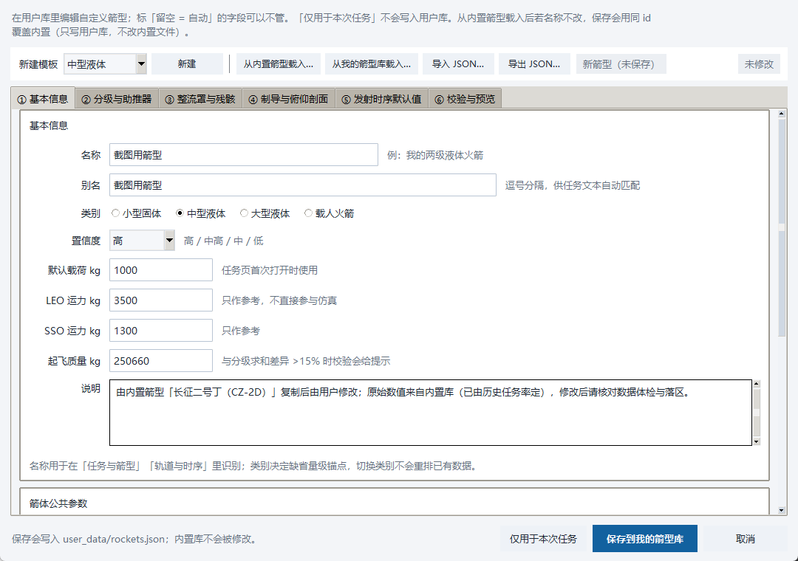
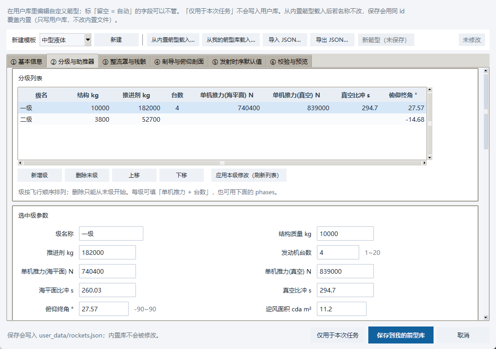
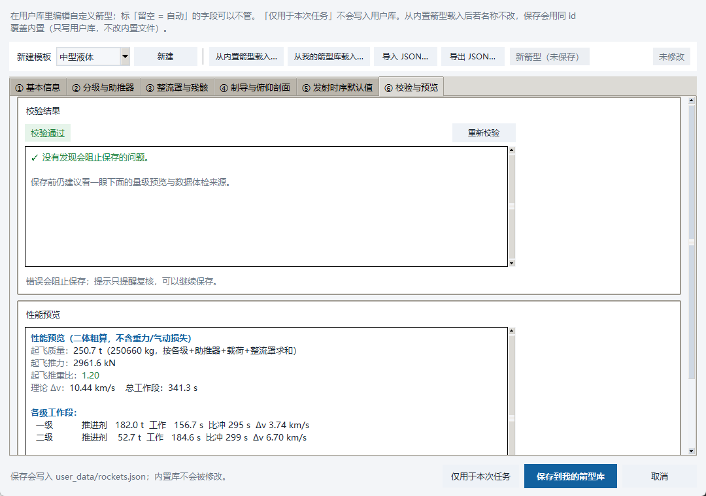

> 适用版本：v4.0（2026-11）

# 03 自定义箭型

## 1. 为什么要有编辑器

v3 时代，「换一型不在内置库里的火箭」意味着手工编辑 `app/data/rockets.json`
（约 130 KB、28 条记录、字段多且格式严格），门槛极高，还容易把内置库改坏。

v4 的做法：

| | v3 | v4 |
|---|---|---|
| 自定义箭型 | 手写 `app/data/rockets.json` | 图形编辑器（`app/gui/dialog_rocket.py`） |
| 存放位置 | 与内置库同一文件 | **用户库** `user_data\rockets.json`（`app/core/userdb.py`） |
| 内置库 | 可被误改 | **只读**，程序永不写入 |
| 校验 | 无（改错就跑不动） | `validate_rocket` 分「错误 / 提示」，错误阻止保存 |
| 预览 | 无 | `rocket_metrics`：起飞质量、推重比、各段工作秒数、理论 Δv |
| 复用 | 无 | 从内置/我的库载入、导入/导出 JSON、导出整包 |

**结论：不需要再手写 `app/data/rockets.json`。**

## 2. 三个入口

| 入口 | 位置 | 说明 |
|---|---|---|
| 编辑当前箭型 | 步骤 ①「火箭型号」卡右上「编辑箭型参数…」 | 以当前选中的箭型为初值 |
| 编辑当前箭型 | 步骤 ②「当前箭型参数速览」卡右上「编辑箭型参数…」 | 同上，改完回到步骤 ② 时序行会刷新 |
| 库管理 | 菜单「数据 → 我的箭型库…」→ 新建/编辑选中 | 在用户库里增删改 |

编辑器顶部工具条：

| 按钮 | 作用 |
|---|---|
| 新建模板（下拉：小型固体/中型液体/大型液体/载人火箭）+「新建」 | 按类别**克隆一个已率定的内置箭型**作为起点（见下表） |
| 从内置箭型载入… | 挑任意内置箭型作起点；载入后变成「新箭型」，保存时写用户库，不改内置库 |
| 从我的箭型库载入… | 挑一条已保存的自定义箭型继续编辑（保存时更新同一条） |
| 导入 JSON… | 支持三种结构：单条箭型对象、`{"rocket": {...}}`、`{"rockets": [...]}`（用户数据包） |
| 导出 JSON… | 把当前箭型导出为单文件，便于分享 |

「新建」克隆关系（`userdb.TEMPLATE_SOURCE`）：

| 类别 | 克隆的内置箭型 | 说明 |
|---|---|---|
| 小型固体 `small_solid` | `cz11` | 固体小火箭，量级最小 |
| 中型液体 `medium_liquid` | `cz2d` | 最常见的默认 |
| 大型液体 `large_liquid` | `cz5` | 捆绑助推器、大运力 |
| 载人火箭 `crewed` | `cz2f` | 含逃逸塔量级与载人任务口径 |

克隆时会：改名为「我的<类别>火箭」、生成 `user_xxx` 形式的 id、**清空 `launch_sites/sites`**
（避免把工位推断到原箭型的发射场）、写 `_derived_from` 与说明「由内置箭型「X」复制后…」。
内置库读不到时才退回手写的量级模板。

## 3. 六个分页逐项说明








> 标「留空=自动」的字段可以不管。「边界」列来自 `userdb.FIELD_LIMITS` 与 `validate_rocket` 的
> 判定区间；「量级参考」列是公开资料的常见经验值，只用来发现「明显填错」，不是硬约束。

### 3.1 ① 基本信息

| 字段 | 物理含义 | 量级参考 | 备注 |
|---|---|---|---|
| 名称 | 任务页/时序页显示的名字 | — | 必填 |
| 别名 | 逗号/顿号分隔，供任务文本自动匹配 | — | 如「长二丁、CZ-2D」 |
| 类别 | 量级锚点（四类） | — | 只改 `class_key`，不重排已有数据 |
| 置信度 | 你自己对这套参数的把握 | 高/中高/中/低 | 会进入数据体检 |
| 默认载荷 kg | 任务页首次打开时的载荷 | 0 ~ 1e6 | 与 `vehicle.payload_kg` 联动 |
| LEO 运力 kg | 只作参考 | 0 ~ 1e6 | 不直接参与仿真 |
| SSO 运力 kg | 只作参考 | 0 ~ 1e6 | 不直接参与仿真 |
| 起飞质量 kg | 展示/自洽性校验用 | ≥100 | 与分级求和差 >15% 会给提示（仿真按分级求和） |
| 说明 | 自由文本 | — | 建议写数据来源 |
| 适配器 kg | 计入起飞质量 | 0 ~ 1e5 | 默认 0 |
| 本次载荷 kg | 计入起飞质量 | 0 ~ 1e6 | 与顶部「默认载荷」是同一物理量的两处入口 |
| cda 系数 | 上升段气动阻力缩放 | 0.1 ~ 5.0 | 1.0 = 按迎风面积原样算；大于 1 表示更钝 |
| 典型轨道（表） | 该箭型常用入轨目标 | 高度 80~200000 km，倾角 0~180° | 任务未给轨道时推断会参考这里；「添加/更新选中/删除选中」 |

### 3.2 ② 分级与助推器

**分级列表**（按飞行顺序，删只能从末级删）：级名、结构 kg、推进剂 kg、台数、单机推力(海平面) N、
单机推力(真空) N、真空比冲 s、俯仰终角 °。

**选中级参数**（推力/比冲都是**单机**值，台数在仿真里相乘）：

| 字段 | 物理含义 | 量级参考 | 边界 |
|---|---|---|---|
| 级名称 | 报告与事件表里出现的名字 | — | — |
| 结构质量 kg | 干重（含发动机、贮箱） | 0.02~0.15 × 推进剂 | 必须 >0 |
| 推进剂 kg | 该级装药量 | 见箭型量级 | 必须 >0；0 ~ 1e7 |
| 发动机台数 | 并联台数 | 1 ~ 20 | 与单机推力相乘 |
| 单机推力(海平面) N | 起飞段用 | 液体 0.3~2.5 MN/台 | 0 ~ 5e7 |
| 单机推力(真空) N | 高空段用 | 通常比海平面高 10~15% | 0 ~ 5e7 |
| 海平面比冲 s | 起飞段 | 液体 250~300；固体 230~260 | 100 ~ 500 |
| 真空比冲 s | 高空段 | 液体 280~460；固体 250~290 | 100 ~ 550 |
| 俯仰终角 ° | 该级结束时的俯仰角 | 一级 20~45；末级 0~10 | -90 ~ 90 |
| 迎风面积 cda m² | 该级的阻力面积 | 一级 10~60；末级 3~20 | 0 ~ 200 |
| 俯仰持续时间 s | 该级程序转弯时长 | 100~300 | 留空=自动；>0 |

> 若某级填了 `phases`，则本卡的推力/比冲**不参与计算**（phases 优先）。

**phases（多阶段 / 多次点火）**：用于「一台发动机多次点火」或「一级内多组发动机各有关机时刻」。
它有数据时优先于单机推力/比冲；首次添加会用单机字段生成一组。

| 字段 | 含义 |
|---|---|
| 阶段名称 | 便于识别，如「一级主机」「二级第一次点火」 |
| 结束 MET s | 该阶段结束的相对起飞秒；**留空 = 按推进剂耗尽结束** |
| 发事件（emit_event） | 是否在该阶段结束处写事件（报告与事件表可见） |
| thrusters（推进剂组） | 每行 `n`（台数，1~20）/ `thrust_vac_n`（单机真空推力 N）/ `isp_vac_s`（真空比冲 s），可选 `thrust_sl_n` / `isp_sl_s` |

最小 phases 示例（一级两台并联 + 二级两次点火）：

```json
"stages": [
  {"name": "一级", "dry_kg": 10000, "prop_kg": 180000, "pitch_end_deg": 30,
   "phases": [
     {"name": "一级主机", "end_met": 159.0, "emit_event": true,
      "thrusters": [{"n": 4, "thrust_vac_n": 804000, "isp_vac_s": 289}]}
   ]},
  {"name": "二级", "dry_kg": 3000, "prop_kg": 20000, "pitch_end_deg": 5,
   "phases": [
     {"name": "二级一次点火", "end_met": 210.0, "emit_event": true,
      "thrusters": [{"n": 1, "thrust_vac_n": 740000, "isp_vac_s": 300}]},
     {"name": "二级二次点火", "end_met": 240.0, "emit_event": true,
      "thrusters": [{"n": 1, "thrust_vac_n": 740000, "isp_vac_s": 300}]}
   ]}
]
```

**助推器（可选）**：勾「启用助推器」后填

| 字段 | 含义 | 量级 | 边界 |
|---|---|---|---|
| 数量 | 枚数 | 2 / 4 | 1 ~ 8 |
| 单枚结构质量 kg | 干重 | 1000~5000 | 0 ~ 2e6 |
| 单枚推进剂 kg | 装药 | 10000~80000 | 必须 >0 |
| 分离时刻 s | 助推器抛离的相对秒 | 100~170 | 留空=自动；1 ~ 20000 |
| 备用单枚推力(真空) N | **仅在没有 thrusters 时使用** | 0.5~1.5 MN | 0 ~ 5e7 |
| 备用比冲 s | 同上 | 280~300 | 100 ~ 550 |
| thrusters（表） | 每枚助推器的推进剂组；`n` 是**每枚**的发动机台数 | — | — |

助推器按「枚数 × 每枚一组推进剂」计算，与一级并联工作、到 `分离时刻` 抛掉。

### 3.3 ③ 整流罩与残骸

**整流罩（可选）**：

| 字段 | 含义 | 量级 | 边界 |
|---|---|---|---|
| 启用整流罩 | 关掉 = 无整流罩（不影响载荷） | — | 质量 ≤0 会被归一化成「无整流罩」 |
| 质量 kg | 两半合计 | 300~1500 | 0 ~ 1e6 |
| 半罩数 | 通常 2 | 2 | ≥1 |
| 分离时刻 s | 抛罩相对秒 | 150~250 | 留空=自动；>0 |
| 迎风面积 cda m² | 整流罩自身阻力面积 | 8~20 | 0 ~ 200 |

**残骸气动参数** 的「对象」行是**自动生成**的：`stage_0 … stage_{n-2}`（即每一级被抛掉的
残骸，末级与卫星不在表内）+ `fairing`（有整流罩时）+ `boosters`（有助推器时）。

| 字段 | 含义 | 默认 | 为什么重要 |
|---|---|---|---|
| cda m² | 残骸的阻力面积 = Cd × 迎风面积 | 7.0（助推器 8.0） | **直接决定落点远近**：cda 越大，再入减速越早、落点越近 |
| 附带质量 kg | 残骸附着的额外质量（如残余推进剂、设备） | 0 | 越大落点越远 |
| divert m/s | 横向分离速度（分离时的侧向冲量） | 0（助推器默认 0） | 制造**横向散布**，影响落点横偏而非射程 |

调整顺序建议：先按公开资料定 cda 数量级（一级空壳 5~15 m²），再用 `sim\落点与射程.csv`
与航警区反复对比微调——**这是「落点是否入区」最有效的旋钮**。

### 3.4 ④ 制导与俯仰剖面

**制导默认值**（作为该箭型的默认，任务页可逐项覆盖）：

| 字段 | 含义 | 建议范围 | 边界 |
|---|---|---|---|
| t_v s | 推力转向（开始程序转弯）时刻 | 5~15 | 0.5 ~ 60 |
| t_p s | 俯仰程序时长 | 60~200 | 5 ~ 1200 |
| pitch_power | 俯仰程序幂次 | 0.8~1.2 | 0.2 ~ 3 |
| t_fairing s | 抛罩时刻（制导用） | 150~250 | 1 ~ 20000 |
| 抛罩横向 m/s | 抛罩时的横向分离速度 | 0~5 | 0 ~ 50 |
| yaw_tau s | 偏航时间常数 | 100~500 | 10 ~ 2000 |
| yaw2_tau s | 二级偏航时间常数 | 100~500 | 10 ~ 2000 |
| i_target ° | 末级平面修正目标倾角（dogleg 用） | 与目标轨道同量级 | 0 ~ 180 |
| seco_band km | 末级关机高度带 | 0~50 | 0 ~ 2000 |
| seco_e_max | 末级关机偏心率上限 | 0~0.05 | 0 ~ 0.5 |

**折线俯仰剖面**：勾「使用折线剖面」后按「时间 s / 角度 °」给若干折点，线性插值。
**启用后 `t_v / t_p / pitch_power` 对该箭型不起作用**（步骤 ② 的箭型速览会明确提示）。
校验要求：时间严格递增、首节点 >0、至少 2 个节点，否则视为错误或忽略。

### 3.5 ⑤ 发射时序默认值

这里是「该箭型的默认时刻」（单位秒，MET）：助推器分离、各级关机/分离、整流罩分离、末级关机（SECO）。
留空 = 按推进剂耗尽或程序自动。任务页（步骤 ②）可以逐项覆盖，覆盖值优先。

### 3.6 ⑥ 校验与预览

| 区域 | 内容 |
|---|---|
| 校验结果 | 徽标（尚未校验/存在错误/有提示/通过）+ 「重新校验」；错误会阻止保存，提示只提醒复核 |
| 性能预览 | 起飞质量、起飞推力、推重比、各级工作段秒数与理论 Δv（不含重力与气动损失），以及 warnings |

校验分两级（`userdb.validate_rocket`）：

**错误（阻止保存，会让仿真跑不出来）**

| 触发条件 | 提示 |
|---|---|
| 名称为空 | 请填写箭型名称 |
| 没有分级 | 至少要有一级 |
| 某级结构质量 ≤0 | 第 N 级「X」结构质量必须 > 0 |
| 某级推进剂 ≤0 | 第 N 级「X」推进剂质量必须 > 0 |
| 某级既无单机推力也无 phases | 没有推力数据：请填「单机推力 + 台数」或 phases 里的 thrusters |
| 某级无比冲 | 没有比冲数据（isp_vac_s） |
| 启用助推器但单枚推进剂 ≤0 / 无推力 / 数量不在 1~8 | 对应提示 |
| 俯仰剖面节点格式错 / 时间不递增 / 首节点 ≤0 | 对应提示 |

**提示（可保存，但建议复核）**

| 触发条件 | 提示 |
|---|---|
| 级数 >5 | 级数偏多，请确认是否误填 |
| 某级比冲不在 150~520 s | 超出常见范围 |
| 迎风面积 <0 或 >120 m² | 不合理 |
| `sep_met`/`seco_met`/`pitch_duration_s` ≤0 | 必须 > 0 |
| 整流罩质量 ≤0 | 将按无整流罩处理 |
| 制导参数超出建议范围 | 反演可能从一个很偏的点开始 |
| 俯仰剖面节点 <2 | 将被忽略 |
| 起飞质量与分级求和差 >15% | 建议对齐（仿真按分级求和算） |
| 起飞推重比 <1.0 / <1.15 / >2.2 | 无法离地 / 偏低 / 偏高 |

## 4. 两种出口：仅本次任务 vs 保存到我的箭型库

| | 仅用于本次任务 | 保存到我的箭型库 |
|---|---|---|
| 底部按钮 | 「仅用于本次任务」 | 「保存到我的箭型库」（强调色） |
| 写文件 | 不写 | 写 `user_data\rockets.json`（新增或更新同 id 记录） |
| 记录标记 | 去掉 `_user` | `_user: true` + `_created_at/_updated_at` |
| 回到界面的效果 | 型号框显示该名字，徽标「自定义」，`custom_rocket_mode="session"` | 同样显示，但 `custom_rocket_mode="user_db"`，下次从库里能找到 |
| 改型号文本 | 会**放弃**该自定义箭型（未保存的） | 不会丢失（库里还在） |
| 进 `config.json` | `mission.custom_rocket.record` 完整写入，`mode="session"` | 同上，`mode="user_db"` |

两个按钮都会先跑一次校验/归一化：**有「错误」时两个出口都拒绝**并跳到第 ⑥ 页；
「提示」可以继续。

## 5. 内置库与用户库的覆盖规则

| 规则 | 说明 |
|---|---|
| 存储分离 | 内置 `app/data/rockets.json` 只读；用户 `user_data/rockets.json` 可写 |
| 合并 | `userdb.merge_rockets`：同 id → 用户记录覆盖内置并标 `_shadow_builtin`；新 id → 追加 |
| 不继承工位 | 从内置克隆新建时清空 `launch_sites/sites`，避免发射场推断串味 |
| 同 id 覆盖 | 从内置箭型载入后**不改名**直接保存：写入同 `id`，用户库记录覆盖内置显示（`_shadow_builtin`） |
| 改名即新增 | 一旦改了名称再保存：按新箭型作为**另一条**记录写入（避免同名不同 id 的匹配混乱） |
| 删除 | `delete_rocket` 只删用户库条目；删掉同 id 记录即恢复内置版本 |
| 分享 | 编辑器「导出 JSON…」导出单型；「导出我的数据包…」导出箭型+轨道+时序模板整包 |

## 6. 从内置复制后要改哪些（检查表）

按「对结果影响从大到小」排序：

1. **推进剂与结构质量**（各级 `prop_kg` / `dry_kg`）——决定工作段长短与运力；
2. **推力/比冲 + 台数**（或 phases）——决定推重比与上升速率；
3. **分级数量与分离时刻**（`sep_met` / `seco_met`）——决定入轨点；
4. **整流罩质量与抛罩时刻**——影响中段质量与落区；
5. **残骸 cda**——直接决定落区远近，是「落点入区」的主旋钮；
6. **制导 t_v / t_p / pitch_power**——决定重力损失与入轨精度；
7. 名称/别名/置信度/说明——影响显示、匹配与体检；
8. 起飞质量、LEO/SSO 运力——只影响展示与自洽性提示。

## 7. 完整最小示例：两级液体

一个「能跑出正常弹道」的最小两级液体箭型（数值仅供量级参考，请按你的型号替换）：

```json
{
  "id": "user_demo_two_stage",
  "name": "示例两级液体 2t 级",
  "aliases": ["示例两级", "demo-2stage"],
  "class_key": "medium_liquid",
  "class": "中型液体（用户自定义）",
  "confidence": "中",
  "liftoff_mass_kg": 214500,
  "note": "教材级示例：一级 4×804 kN(vac)、二级 1×740 kN(vac)，仅用于演示编辑器填写方式。",
  "typical_orbits": [
    {"name": "SSO 500", "alt_km": 500.0, "i_deg": 97.4},
    {"name": "LEO 400", "alt_km": 400.0, "i_deg": 42.0}
  ],
  "vehicle": {
    "adapter_kg": 120.0,
    "payload_kg": 1000.0,
    "ascent_cda_scale": 1.0,
    "stages": [
      {"name": "一级", "dry_kg": 10000, "prop_kg": 180000, "engines": 4,
       "thrust_sl_n": 740000, "thrust_vac_n": 804000,
       "isp_sl_s": 260, "isp_vac_s": 289,
       "pitch_end_deg": 30, "pitch_duration_s": 150,
       "cda_attached_m2": 24, "sep_met": 159},
      {"name": "二级", "dry_kg": 3000, "prop_kg": 20000, "engines": 1,
       "thrust_vac_n": 740000, "isp_vac_s": 300,
       "pitch_end_deg": 5, "pitch_duration_s": 80,
       "cda_attached_m2": 8, "seco_met": 239}
    ],
    "fairing": {"mass_kg": 500, "halves": 2, "sep_met": 200, "cda_m2": 12},
    "debris": {
      "stage_0": {"cda": 7.0, "extra_mass_kg": 0.0},
      "fairing": {"cda": 12.0, "extra_mass_kg": 0.0}
    }
  },
  "guidance_defaults": {
    "t_v": 8.0, "t_p": 100.0, "pitch_power": 1.0, "t_fairing": 200.0
  }
}
```

填完应有的自检指标（`rocket_metrics` 口径）：

| 指标 | 约值 | 判断 |
|---|---|---|
| 起飞质量 | ≈ 214.6 t（含适配器 120 kg、载荷 1 t、整流罩 0.5 t） | 与 `liftoff_mass_kg` 差 <0.1%（校验阈值 15%） |
| 起飞推重比 | ≈ 1.41 | 正常（1.15~1.45） |
| 一级工作段 | ≈ 160 s | 与 `sep_met=159` 吻合 |
| 二级工作段 | ≈ 80 s | 与 `seco_met` 相差不要超过十几秒 |
| 理论 Δv | ≈ 10 km/s | 扣掉重力/气动损失后约 9.4 km/s |

**落地到界面上的操作顺序**：编辑器 → 新建（中型液体，自动克隆 cz2d）→ ①基本信息改名 →
②把两级质量/推力/比冲逐项改成上表 → ③确认整流罩与 cda → ⑤核对时序默认值 →
⑥「重新校验」看有没有红色错误 → 「保存到我的箭型库」→ 回任务页选中它 → 生成体检 → 计算。

## 相关链接

- [用户手册](02_用户手册.md)（步骤 ① 与 ② 的界面说明）
- [参考轨道与发射时序](04_参考轨道与发射时序.md)
- [常见问题与限制](06_常见问题与限制.md)
