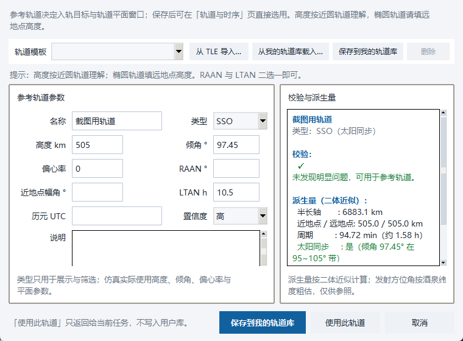

> 适用版本：v4.0（2026-11）

# 04 参考轨道与发射时序

本篇讲两件事：**入轨目标怎么指定**（参考轨道）与 **分离/抛罩/关机时刻怎么改**（发射时序）。
两者都在步骤 ②「轨道与时序」页，且**都可以完全留空**。

## 1. 参考轨道影响什么

| 作用 | 说明 |
|---|---|
| 反演的**软约束** | 不会强行改弹道，但反演会同时朝「落点入航警区」和「入轨接近参考轨道」收敛 |
| 轨道平面发射窗口 | 参考轨道里有 RAAN 或 LTAN 时，额外计算「什么时候发射才能进这个轨道面」 |
| 报告与摘要 | `report\弹道仿真报告.md` §2.1、`report\任务摘要.md` 的「参考轨道」行 |

参考轨道**不是**弹道本身：它只影响制导参数怎么被反演、入轨根数被怎么评价。

## 2. 五种来源

页面顶部单选（`REF_ORBIT_MODES`）：

| 来源 | 内部值 | 适用场景 | 需要填什么 | 触发平面窗口 |
|---|---|---|---|---|
| 自动推断 | `auto` | 大多数任务，**默认** | 不用填 | 仅当推断出的倾角落在 95~105°（SSO） |
| 内置轨道模板 | `template` | 标准 SSO/LEO/MEO/GTO/GEO 任务 | 下拉选一条 | 模板自带 RAAN/LTAN 才触发 |
| 我的轨道库 | `user` | 反复使用的自有轨道 | 下拉选一条（需先保存过） | 该轨道含 RAAN/LTAN 才触发 |
| 手填参数 | `custom` | 明确的非标轨道 | 至少填高度或倾角；可加 e/RAAN/LTAN | 填了 RAAN 或 LTAN 就触发 |
| TLE 导入 | `tle` | 已有目标的公开 TLE | 粘贴两行 TLE → 「解析 TLE 并填入」 | 解析出的 RAAN 会触发 |

### 2.1 自动推断（默认）

两遍推断（`config_build` 的 §5）：

1. 先用「箭型典型轨道」得到一条备用参考轨道；
2. 用航警落区反算发射方位角（无落区时用典型轨道反算）；
3. 再用**方位角反算倾角**作为任务特定参考轨道。

所以：**有航警落区时，倾角会比箭型典型值更贴近本次任务**；这也解释了为什么体检里
方位角来源可能是「自动推断」、参考轨道来源也是「自动推断」。

自动推断也会用你填的 `orbit_alt_km / orbit_i_deg`（或载荷库给的轨道提示）作为输入。
两个值都留空时完全按箭型库。

### 2.2 内置轨道模板（15 条）

| 模板名 | 高度 km | 倾角 ° |
|---|---|---|
| 太阳同步轨道 400 km | 400 | 97.0 |
| 太阳同步轨道 500 km | 500 | 97.4 |
| 太阳同步轨道 600 km | 600 | 97.8 |
| 太阳同步轨道 700 km | 700 | 98.2 |
| 太阳同步轨道 800 km | 800 | 98.6 |
| 极轨/近极轨 97.4° | 750 | 97.4 |
| 低地球轨道 200 km | 200 | — |
| 低地球轨道 300 km | 300 | — |
| 低地球轨道 400 km | 400 | — |
| 低地球轨道 500 km | 500 | — |
| 国际空间站轨道 400 km / 51.6° | 400 | 51.6 |
| 中地球轨道 2000 km | 2000 | 55.0 |
| 地球同步转移轨道 GTO | 35786 | 27.0 |
| 地球同步轨道 GEO 35786 km | 35786 | 0.0 |
| 倾斜地球同步轨道 IGSO 35786 km / 55° | 35786 | 55.0 |

模板里只有高度/倾角（无 RAAN/LTAN），所以**选模板本身不会触发平面窗口**；
要算 SSO 的平面窗口，请改用「手填参数」并填 LTAN。

### 2.3 我的轨道库

- 存放：`user_data\orbits.json`（`{"schema": "...", "orbits": [...]}`）；
- 保存途径一：轨道编辑器「保存到我的轨道库」；
- 保存途径二：步骤 ② 卡片右上「保存为我的轨道」（把当前手填的 name/高度/倾角/e/RAAN/LTAN 存下）；
- 保存前会跑 `validate_orbit`：**名称与高度必填**，倾角可留空（按发射场纬度/方位角推断）；
- 选用：把来源切到「我的轨道库」→ 下拉选择；选中后会回填到手填字段，便于再改。

### 2.4 手填参数

| 字段 | 说明 |
|---|---|
| 名称 | 只用于识别 |
| 高度 km | **近圆轨道填轨道高度；椭圆填远地点高度**（与编辑器派生量口径一致） |
| 倾角 ° | 留空 = 由发射方位角反算 |
| 偏心率 | 0 = 圆；大椭圆 0~0.9 |
| RAAN ° | 升交点赤经，0~360；**填了就算轨道平面窗口** |
| LTAN h | 太阳同步的地方时升交点，0~24；与 RAAN 二选一 |

至少填「高度」或「倾角」之一，否则页面会拒绝（`请至少填写轨道高度或倾角`）。

### 2.5 TLE 导入

粘贴两行（含名称行也可以）→「解析 TLE 并填入」：

- 解析只看 **第二行平均根数**：倾角、RAAN、偏心率、近地点幅角、平均运动；
  半长轴由平均运动反算（`a = (μ/n²)^(1/3)`，高度 = a − 6378.137 km）；
- **不做 SGP4 传播**：这里只取「参考轨道」，不追求逐点星历；
- 解析后写入手填字段（含 RAAN），并把来源保持为「TLE 导入」，`ref_orbit_tle` 原文一并进 config。

**精度限制（务必记住）**：

| 限制 | 后果 |
|---|---|
| 平均根数 vs 瞬时根数 | 高度/倾角有 km 与 0.0x° 级差异，做入轨软约束够用，做精密定轨不够 |
| TLE 历元与任务时刻不同 | TLE 从历元往后传播，数天后沿迹误差可达数度；RAAN 会被程序按 **T0** 解释 |
| 无历元字段 | 解析结果 `epoch_utc` 为空，窗口计算统一用 `launch_window.raan_epoch_utc = T0` |

## 3. 字段口径与量级

| 字段 | 物理含义 | 量级 / 边界 |
|---|---|---|
| `alt_km` | 近圆轨道高度（椭圆时为远地点） | 80 ~ 200000 km，必填 |
| `i_deg` | 轨道倾角 | 0 ~ 180°；SSO 一般 95~105° |
| `e` | 偏心率 | 0 ~ 0.9（校验要求 <1）；>0.05 且高度 >300 km 会给「大椭圆请填远地点」提示 |
| `raan_deg` | 升交点赤经 | 0 ~ 360°，自动取模 |
| `argp_deg` | 近地点幅角 | 0 ~ 360°，只记录（圆轨道无意义） |
| `ltan_h` | 太阳同步地方时升交点 | 0 ~ 24 h |
| `epoch_utc` | 历元（文档用） | 当前版本不参与传播，仅记录 |
| `type` | 轨道类型标签 | `SSO/LEO/MEO/GTO/GEO/IGSO/极轨/自定义` |
| `confidence` | 置信度 | 高/中高/中/低；低置信会放宽反演边界 |

**RAAN 与 LTAN 二选一**。两个都填时，平面窗口优先按 **RAAN** 解释
（`engine/scripts/window.py` 先判 RAAN、再判 LTAN），LTAN 只作为附带信息写进 JSON。

## 4. RAAN / LTAN 与发射窗口

### 4.1 什么时候会算平面窗口

`config_build` 判断「有平面约束」的条件（任一成立）：

1. 载人/交会任务（有空间站目标）；
2. 用户在任务里显式给了 `window_raan_deg`；
3. 显式给了 `window_ltan_h`；
4. 参考轨道里有 `raan_deg`；
5. 参考轨道里有 `ltan_h`；
6. 参考轨道倾角在 95~105°（视为 SSO，由标称 T0 反推 LTAN）。

**既没有航警、也没有任何平面约束时**，`window` 模块会被自动关掉（不会白跑）。

### 4.2 窗口参数

写进 `config.json` 的 `launch_window`：

| 字段 | 默认 | 含义 |
|---|---|---|
| `mode` | `auto` | 自动判断用 RAAN 还是 LTAN |
| `tolerance_deg` | 0.2 | 轨道面容差（|ΔRAAN| 允许值）。收紧到 0.05° 窗口会显著变窄，放宽到 1° 基本全天可行 |
| `search_hours` | 48 | 以 T0 为中心前后搜索 |
| `step_s` | 20 | 搜索步长 |
| `raan_deg` / `ltan_h` | 取决于输入 | 目标平面 |
| `raan_epoch_utc` | `T0` | RAAN 的历元解释 |

界面上的入口：任务页的「期望交会时长/ΔV 预算/平面容差/搜索半宽」在步骤 ⑤；
命令行可用 `--window-raan` / `--window-ltan` 直接给约束。

### 4.3 结果怎么读

| 位置 | 内容 |
|---|---|
| `report\发射窗口计算.json` | 航警时窗 + `orbit_window`（窗口起止、最佳 T0、ΔRAAN、LTAN） |
| 报告 §4.1 | 轨道平面窗口叙述（含容差与搜索范围） |
| 报告 §4.2 | 航警时窗（残骸到达时刻约束） |
| 报告 §4.3 | CZ-2F 交会窗口（相位可行性） |

> 窗口为空（`available: false`）时，JSON 里会写 `reason`，例如「目标轨道只给了高度/倾角，
> 没有 RAAN、LTAN 或交会目标」。这时填一个 RAAN 或 LTAN 就能算。

## 5. 制导参数覆盖（7 项）

| 字段 | 含义 | 典型值 | 填了之后的真实行为 |
|---|---|---|---|
| `t_v` 推力转向 t_v (s) | 起飞后开始程序转弯的时刻 | 5~15 | 写入 `guidance.t_v`，并加入 `_v3.guidance_locked` → **不进反演** |
| `t_p` 俯仰程序时长 t_p (s) | 俯仰程序结束时刻 | 80~200 | 同上 |
| `pitch_power` 俯仰幂次 | 俯仰程序曲线形状 | 0.8~1.2 | 同上 |
| `azimuth_deg` 发射方位角 | 射向 | 由落区/轨道定 | 写入并标记来源=用户（`_azimuth_from=user`）→ **不进反演** |
| `i_target_deg` 末级平面修正倾角 | dogleg 目标倾角 | 与目标轨道同量级 | 直接写入；本就不在反演参数表内 |
| `yaw_tau` 偏航时间常数 | 平面保持/转向平滑 | 100~500 | 直接写入；本就不在反演参数表内 |
| `fairing_divert_mps` 抛罩横向速度 | 抛罩分离横向速度 | 0~5 | 直接写入；本就不在反演参数表内 |

**v4 的语义是「留空 = 自动 / 填了 = 固定」**，与界面提示一致：

1. 你填了 `t_v / t_p / pitch_power / azimuth_deg` 后，这些键会写进 `config._v3.guidance_locked`，
   `autoplan.plan_inversion` 会把它们从反演参数表里剔除（日志与 `report/成果清单.md`
   的自动计划里能看到「由用户固定，不进反演」）。
2. **箭型自身的参数仍可反演**（例如各级 `pitch_end_deg`、末级 `seco_met` 的兜底估计），
   所以「固定制导」不等于「关掉反演」。
3. 想**完全不做任何参数搜索**：在步骤 ⑥ 取消勾选「参数反演」。代价是落点可能不入航警区、
   入轨根数可能偏离参考轨道。
4. **发射时序不受反演影响**：各级分离、整流罩分离、SECO 时刻不会进反演参数表；
   抛罩时刻只在「箭型库里也没有」时才由反演估（有默认值或你填了值就固定）。
5. 核对是否真的生效：看 `config.json` 的 `guidance` 与 `config_initial.json` 是否一致；
   反演回填的参数会出现在 `sim/反演参数.json` 的 `parameters` 里，固定的不会出现。

## 5.1 参考轨道的置信度是怎么定的（v4.0.1）

未显式指定轨道时，倾角由射向反算：`i = arccos(cosφ·sinA)`（φ=场址纬度，A=发射方位角）。
v4.0.1 不再用"与库内典型轨道差多少度"一刀切标低置信度，而是**按射向敏感度定量**：

| 量 | 公式 / 取值 | 说明 |
|---|---|---|
| 射向不确定度 σ_A | 落区质心反算 ±2.0°；由目标轨道反算 ±1.5°；用户给定 ±0.5° | 来源越直接越小 |
| 倾角敏感度 | `di/dA = cosφ·|cosA| / sin i` | 中纬度通常 0.5~1.0 °/°；近赤道/近 180° 逆行时发散 |
| 倾角不确定度 σ_i | `σ_i = (di/dA)·σ_A` | 体检/报告里直接写成 `i=xx.xx°±σ_i` |
| 采用库内典型轨道的门限 | `\|Δi\| ≤ max(5°, 2σ_i)` | 满足则采用典型轨道的高度与倾角（置信度=中） |
| 反算值的置信度 | σ_i ≤ 2.5° → 中；> 2.5°（几何病态）→ 低 | 后者才真的"推不出来" |

另外两条行为：

1. **与库内典型轨道偏离 >5°** 时不再标低置信度，而在数据体检「提示」与报告 §9.1 里给一条
   可执行提示：可能是特殊射向/新任务，也可能该典型轨道不属于本任务（如航警来自别的场址）；
   想锁定轨道就在步骤②显式选择目标轨道（模板/我的轨道库/手填/TLE），置信度会升为高。
2. **需要末级平面修正（dogleg）时**，`guidance.i_target_deg` 的说明会给出量级代价
   `2v·sin(Δi/2)`，并注明"引擎按几何 dogleg 处理、不计 Δv 与推力损失"——
   这是模型口径（见报告 §9），不是本任务数据的低置信度项。

## 6. 发射时序

### 6.1 行是怎么来的

页面上的行由当前箭型生成（与 `config_build._launch_sequence_defaults` 同口径）：

| 行 | 默认值来源 |
|---|---|
| 助推器分离（×N） | `vehicle.boosters.jettison_met` |
| 第 N 级关机/分离 | `vehicle.stages[i].sep_met`（末级不出现） |
| 整流罩分离 | `vehicle.fairing.sep_met`，缺失时回落 `guidance.t_fairing` |
| 末级关机（SECO） | `vehicle.stages[-1].seco_met` |

默认值为空时显示「自动（耗尽）」——表示该级按推进剂耗尽自动分离。

### 6.2 四种写法

| 写法 | 例子 | 解析 |
|---|---|---|
| 纯秒数 | `206`、`206.5` | 相对起飞的秒 |
| 带 T+ 前缀 | `T+206` | 同上 |
| 带秒后缀 | `206s`、`206 秒` | 同上（全角「＋」「，」「秒」也认） |
| 绝对 UTC 时刻 | `2026-11-19T07:10:00Z` | 换算成相对 T0 的秒；**必须能解析出 T0**，否则该行视为无法识别 |

无效输入（`abc`、`-5`、`0`、空）→ 该行回落默认值，并给一条警告写进体检与日志。

### 6.3 留空与提醒

- 留空 = 用箭型默认；
- 「填入箭型默认」把默认值填进自定义列（方便在此基础上微调）；
- 与默认值相差过大时给提醒（阈值写在 `_apply_launch_sequence`）：
  **SECO > 45 s、整流罩 > 90 s、助推器分离 > 60 s**；
- 顺序检查（只警告不拦截）：SECO 应晚于最后一级分离、整流罩应早于 SECO、
  助推器分离不应比抛罩晚 120 s 以上、各时刻必须 >0；
- 页面下方实时显示**时间轴预览**与相邻间隔，并汇总「⚠ 差多少秒」。

### 6.4 为什么会「差几十秒就不入轨」

末级关机时刻直接决定关机时的速度与高度。以 500 km 圆轨道为例，末级推力/质量决定的
加速度量级是 10~30 m/s²，**45 s 就对应 0.5~1.3 km/s 的速度差**——足以让近地点塌进大气
或把轨道抬成椭圆。所以程序对这个偏差专门提醒，`qc.py` 也会在自检里看出入轨根数异常。

### 6.5 模板复用

| 操作 | 效果 |
|---|---|
| 保存为模板… | 把当前自定义值存进 `user_data\sequences.json`（含 `stage_sep_s` 列表与 `rocket_id`） |
| 应用模板… | 按名称把模板值回填到当前行 |
| 全部清空 | 清掉自定义列（回到「全默认」） |

模板与箭型解耦：换箭型后行会重建，模板仍可应用（但级数不同时要自己核对）。

## 7. 三个「这样填会出问题」的反例

**反例 1：为了「入轨低一点」把 SECO 提前 120 s**

结果不是「轨道低一点」，而是**欠速**：末级关机太早，近地点落进稠密大气，随后被
`qc.py` 判为入轨异常，落点也会变得离谱。正确做法是改参考轨道高度或载荷质量，不要去动 SECO。

**反例 2：把「整流罩分离」填在 SECO 之后**

会同时触发两条警告（抛罩晚于 SECO），且物理上抛罩发生在末级关机后意味着整流罩跟着
末级一起入轨——残骸表里会多出一个不该存在的落点。先核对箭型默认值再填。

**反例 3：用绝对时刻写法，但 T0 是航警推断出来的**

`2026-11-19T07:10:00Z` 会按 `config.mission.t0_utc` 换算成相对秒。如果 T0 是推断值
（可能偏几分钟），你精心写的「绝对时刻」会整体偏移同样多。**要么先把 T0 填准，要么用
相对秒写法**。

**反例 4（轨道侧）：把 TLE 当精密星历用**

TLE 是平均根数、且只按 T0 解释 RAAN；拿一个数天前的 TLE 反算的高度/倾角作为严格入轨要求，
会让反演朝一个已经漂移的平面收敛。做软约束可以，做验收依据不行。

## 8. 轨道编辑器（v4）

入口：菜单「数据 → 参考轨道编辑器…」、步骤 ②「参考轨道编辑器…」、
「我的轨道库…」里的「新建… / 编辑选中…」。

| 区域 | 内容 |
|---|---|
| 工具条 | 轨道模板下拉（内置 15 条）、从 TLE 导入…、从我的轨道库载入…、保存到我的轨道库、删除 |
| 表单 | 名称、类型（SSO/LEO/MEO/GTO/GEO/IGSO/极轨/自定义）、高度 km、倾角 °、偏心率、RAAN °、近地点幅角 °、LTAN h、历元 UTC、置信度、说明 |
| 右侧「校验与派生量」 | 逐条校验（✗ 错误 / ! 提示）；半长轴、近地点/远地点高度、周期、太阳同步判定、发射方位角粗估（按酒泉 38.86°N，按无平面机动的理想射向）；未给 RAAN/LTAN 时提示「暂不计算平面发射窗口」 |
| 底部 | 取消 / **使用此轨道**（仅本次任务，不写库）/ **保存到我的轨道库**（写入 `user_data\orbits.json`） |

派生量口径：高度按**远地点**处理，`r_a = 6378.137 + alt`，`a = r_a/(1+e)`，
`r_p = a(1−e)`，周期按二体近似 `T = 2π√(a³/μ)`。

校验规则（`userdb.validate_orbit`）：

| 级别 | 条件 |
|---|---|
| 错误 | 名称空；高度空或不在 80~200000 km；倾角不在 0~180°；偏心率不在 0~1；LTAN 不在 0~24 |
| 提示 | 倾角留空（将按发射场纬度/方位角推断）；高度 >300 km 且 e>0.05（大椭圆请填远地点）；倾角 95~105° 但没填 LTAN（填 LTAN 可算平面窗口） |

「使用此轨道」返回的记录不带 `_user` 标记，页面会切到「手填参数」并把值填进字段；
「保存到我的轨道库」返回带 `_user` 的记录，页面会切到「我的轨道库」并选中它。

## 相关链接

- [用户手册](02_用户手册.md)（步骤 ② 与步骤 ⑤ 的界面说明）
- [自定义箭型](03_自定义箭型.md)（制导默认值在箭型里怎么定）
- [输出成果清单](05_输出成果清单.md)（`发射窗口计算.json` 与报告 §4）

## 附：参考轨道编辑器界面

- 顶部工具条：轨道模板 / 从 TLE 导入 / 从我的轨道库载入 / 保存到我的轨道库 / 删除；
- 左侧表单：高度、倾角、偏心率、RAAN、LTAN、历元、置信度；
- 右侧「校验与派生量」：错误/提示、半长轴、近远地点、周期、SSO 判定；
- 底部三个出口：保存到我的轨道库 / 使用此轨道 / 取消。
