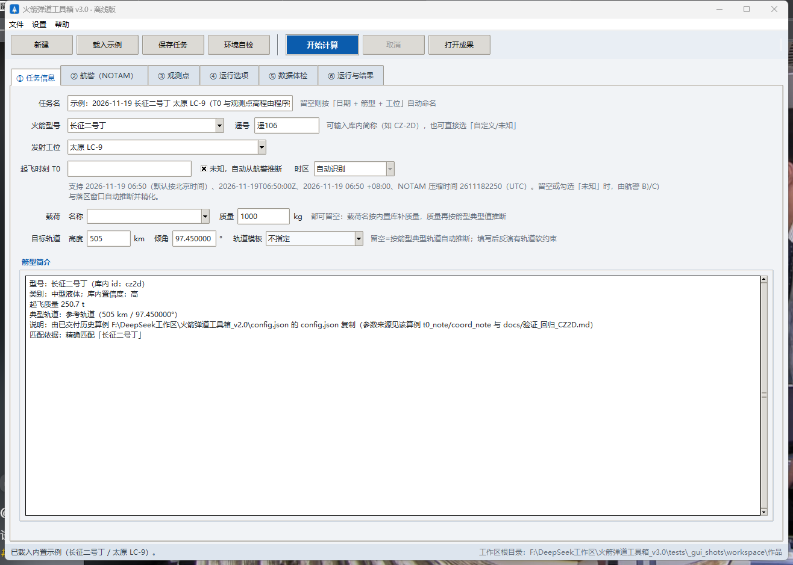
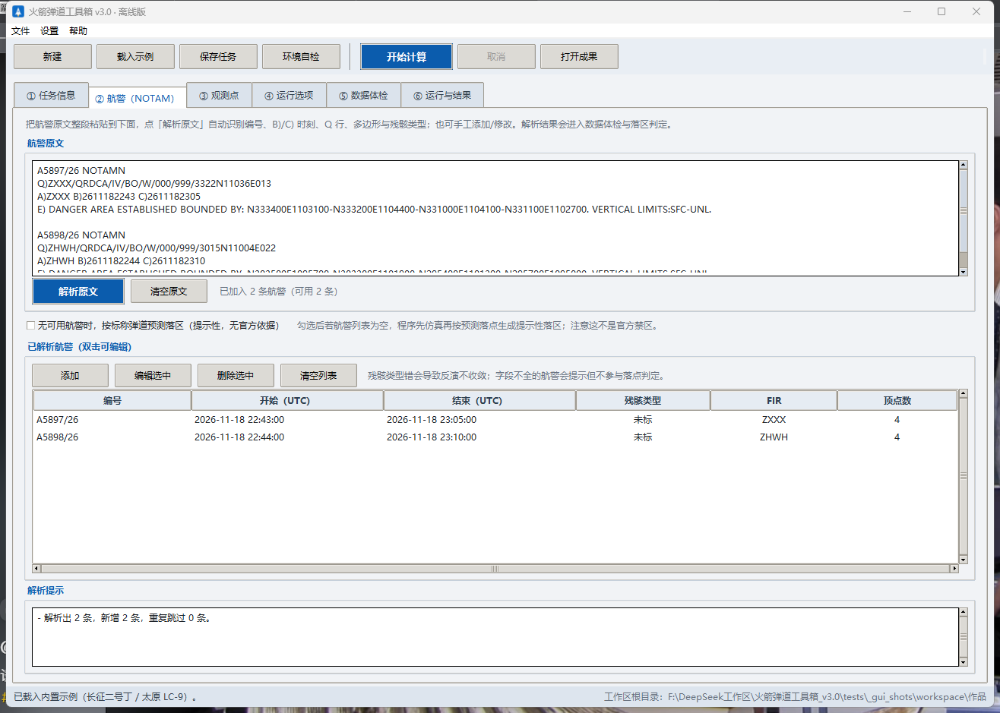
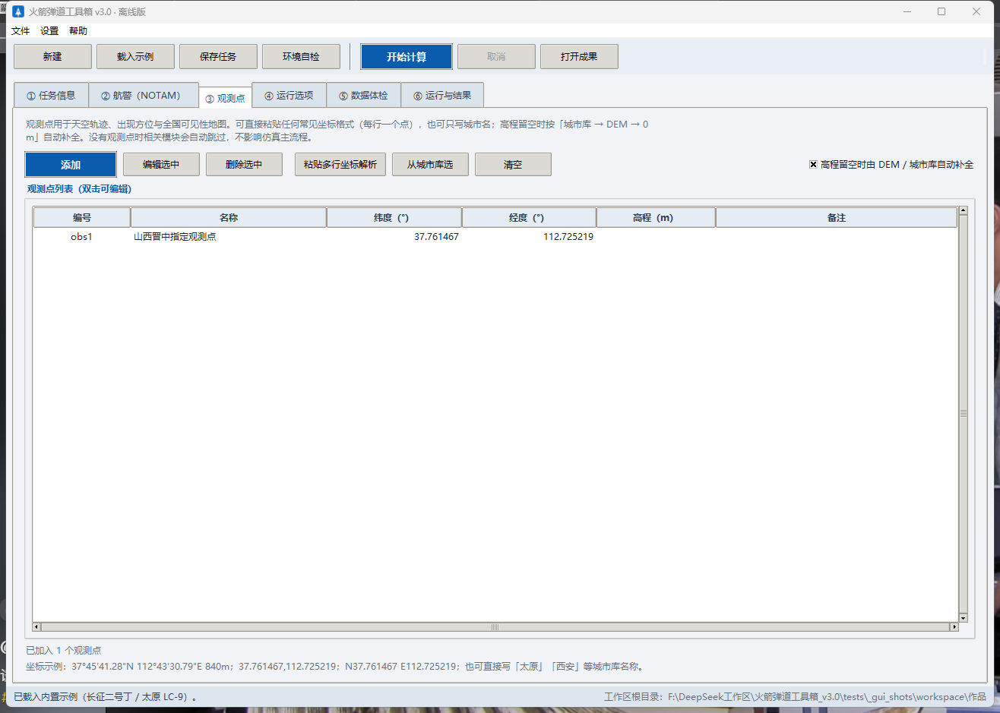
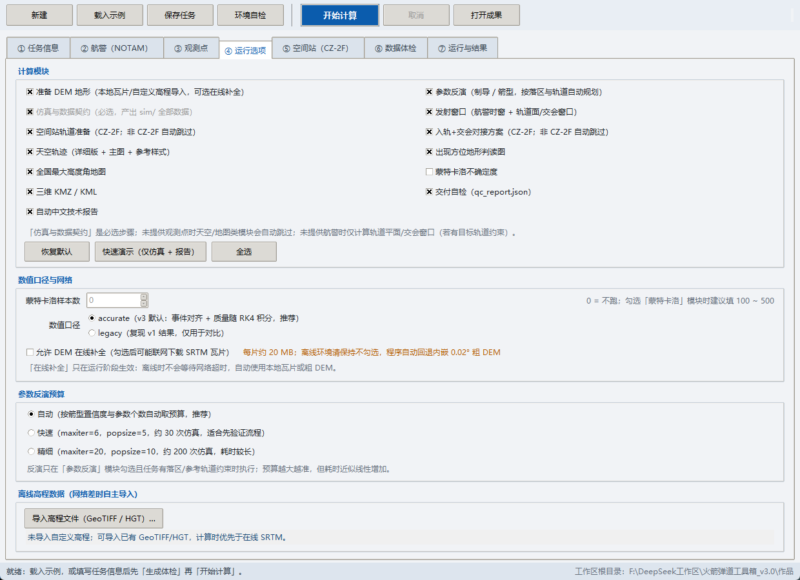
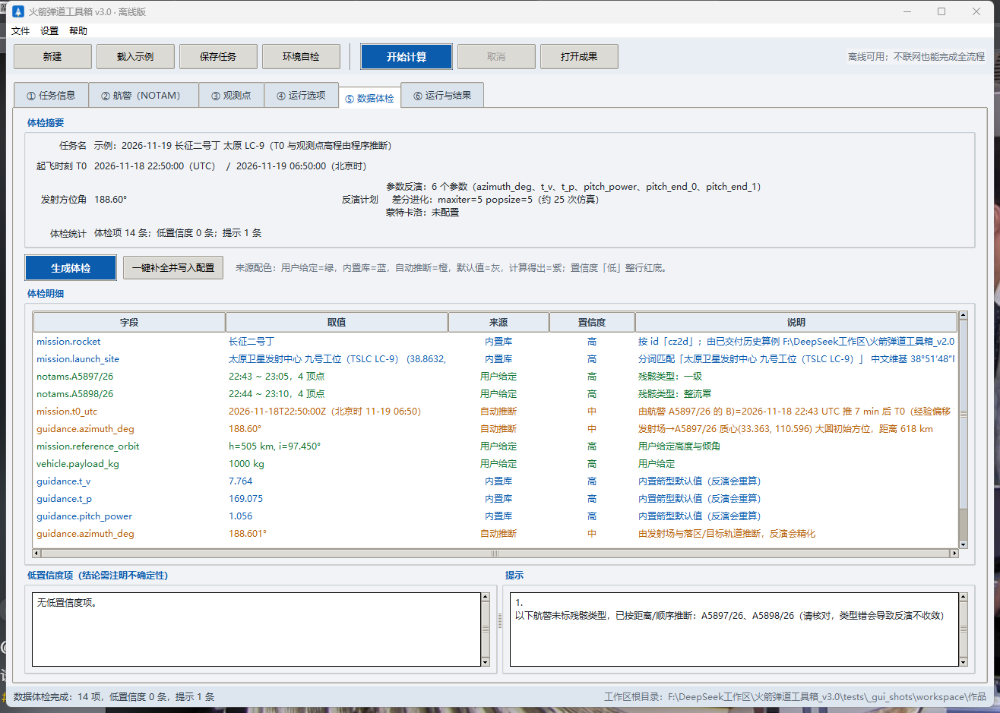
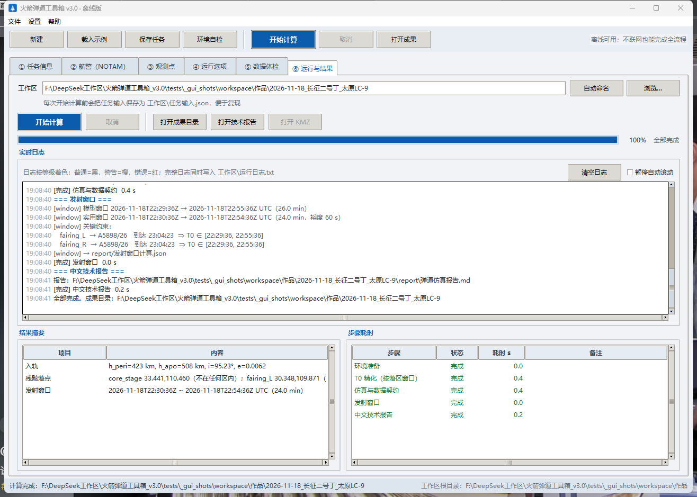

> **免责声明**：本工具仅供公开信息分析与教学演示使用，输出为模型估算，非实际发射弹道、非官方信息，不得用于安全/工程/发射决策或对外发布。

# 02 用户手册（完整版）

适用版本：火箭弹道工具箱 **v3.4** 离线版。文中「示例任务」指界面「载入示例」内置的长征二号丁 / 太原 LC-9 算例。

> v3.4 新增分页「⑤ 空间站（CZ-2F）」与「④ 运行选项 → 离线高程导入」，原⑤/⑥顺延为⑥/⑦；
> 发射窗口输出新增 `orbit_window`（轨道平面/交会窗口）。详见
> [07_新增功能_发射窗口与CZ2F_v3.4.md](07_新增功能_发射窗口与CZ2F_v3.4.md) 与
> [06_高程数据自主导入.md](06_高程数据自主导入.md)。

---

## 0. 术语与阅读说明

| 中文 | 英文/缩写 | 在本工具里的含义 |
|---|---|---|
| 起飞时刻 | T0 | 点火起飞的绝对时刻，统一用 UTC 存储（界面上括号里给北京时） |
| 上升段 | ascent phase | 从起飞到入轨关机之间的飞行段 |
| 3-DOF 弹道 | 3-degree-of-freedom trajectory | 只算质点三方向运动，不算姿态/滚转 |
| 航警 | NOTAM | 航行通告；其中"危险区"给出一块禁飞多边形与有效期 |
| 残骸落区 | debris impact zone | 一级/助推器/整流罩等残骸的理论落点范围 |
| 落区判定 | inside_zone | 程序算出的落点是否落在航警多边形内 |
| 入轨根数 | orbital elements | 半长轴 a、偏心率 e、倾角 i、近/远地点、周期等 |
| 发射窗口 | launch window | 使所有残骸到达时刻都落在对应航警有效期内的 T0 取值区间 |
| 仰角 / 方位角 | elevation / azimuth | 观测者看目标的高度角（0°=地平线）与自北顺时针方位 |
| 遮挡角 | terrain horizon | 该方位上地形挡住的最低仰角，低于它看不见 |
| 反演 | inversion / calibration | 自动调参，使落点进入航警区、入轨贴近参考轨道 |
| 差分进化 | Differential Evolution, DE | 反演用的全局搜索算法 |
| 蒙特卡洛 | Monte Carlo, MC | 随机抽样看结果散布（不确定度） |
| DEM | Digital Elevation Model | 数字高程模型；SRTM 1″≈30 m/格，粗 DEM≈2 km/格 |
| 数据体检 | data health / provenance | 逐字段显示"最后用了什么值、哪来的、多可信" |
| 置信度 | confidence | 高/中/低；低=只能当量级参考 |

**一句话原则**：任何「自动推断」或「默认值」都只能作为量级参考；「低」置信度项不能写进正式结论。

---

## 1. 界面总览与建议操作顺序



界面是 6 个分页，建议按顺序操作（也可以随时来回改）：

| 顺序 | 分页 | 做什么 | 必需？ |
|---|---|---|---|
| ① | 任务信息 | 火箭型号、发射工位、T0、载荷、目标轨道 | 工位必需 |
| ② | 航警（NOTAM） | 粘贴原文→解析；或勾选"预测落区" | 建议有 |
| ③ | 观测点 | 天空轨迹/地图的观测位置 | 可选 |
| ④ | 运行选项 | 勾要算哪些模块、反演预算、数值口径 | 默认即可 |
| ⑤ | 数据体检 | 检查程序补全了什么、可信度多少 | 强烈建议 |
| ⑥ | 运行与结果 | 开始计算、看实时日志、打开成果 | 必需 |

顶部工具栏按钮：

| 按钮 | 作用 |
|---|---|
| 新建 | 清空当前输入，开始一个新任务 |
| 载入示例 | 填入内置示例任务（验证安装、学习填写的最好方式） |
| 保存任务 | 把当前输入保存成 `任务.json`（可复用、可命令行重跑） |
| 环境自检 | 显示 Python/依赖/内置库/DEM 状态（提问前先点这个） |
| 开始计算 | 生成配置并运行流水线（后台线程，可取消） |
| 取消 | 中止当前计算（已生成的文件保留） |
| 打开成果 | 打开当前工作区目录 |

**常见错误**
- 没载入示例就直接粘贴航警，但没填发射场 → 点「开始计算」时会提示「无法确定发射场」。先选工位。
- 在压缩包里直接双击 exe → 解压后再运行。
- 一台电脑上开了两个窗口同时算 → 各任务目录不同没关系，但都占 CPU，反演会明显变慢。

---

## 2. ① 任务信息页


### 2.1 字段说明

| 字段 | 含义 | 格式/示例 | 留空的后果 |
|---|---|---|---|
| 任务名 | 报告标题与工作区名 | 任意中文 | 自动命名「日期 + 箭型 + 工位 + 上升段 3-DOF 弹道仿真」 |
| 火箭型号 | 内置库中的箭型；可输入中文名或简称 | `长征二号丁` / `CZ-2D` / `长征六号甲` | 退化为「通用中型液体火箭模板」+ 低置信度警告（只有量级意义）；若模板参数不足以入轨，`sim\入轨根数.json` 会带 `warning`、报告置顶提示"未正常入轨"，进程不会崩 |
| 遥号 | 只做文字标注 | `遥106` | 无影响 |
| 发射工位 | 内置工位名称，或「自定义坐标」手填经纬度/海拔 | `太原 LC-9`（最精确）；只写 `太原`/`酒泉`/`西昌`/`文昌` 等**场区名**时，会取该场区全部内置工位坐标的平均值作为「场区中心代表点」 | **不能留空**，否则无法定位、无法算弹道 |
| 起飞时刻 T0 | 点火时刻；勾「未知，自动从航警推断」则由航警 B)/C) 推 | 见 2.2 | 有 B)/C) 航警时可推断；否则报错「无法确定起飞时刻 T0」 |
| 时区 | T0 没写时区时的解释方式 | 自动识别 / UTC / 北京时 | 自动：认得 `Z`、`+08:00` 就用；否则按北京时间 |
| 载荷名称 | 内置载荷库匹配质量/轨道提示 | `神舟`、`遥感`、`天舟` | 无影响 |
| 载荷质量 kg | 卫星/飞船总质量 | `1000` | 用内置库该箭型典型载荷质量（体检里标注来源=内置库/推断） |
| 目标轨道 高度 km / 倾角 ° | 参考轨道（软约束） | `505` / `97.45` | 用箭型典型轨道；两个都留空时，倾角由方位角反算，并与箭型典型轨道比对：|Δi|≤5° 采用典型轨道值（置信度**中**，可能自动启用 dogleg）；5–8° 保留反算值（低）；>8° 不采用典型倾角（低）。详见 03 文档 §4.1 |
| 轨道模板 | 从内置轨道库选（SSO500/SSO700/LEO400…） | 选择后自动填高度/倾角 | 「不指定」= 按箭型典型轨道推断 |
| 箭型简介 | 显示该箭型的内置参数摘要与来源 | 只读 | — |

**关于只写场区名（v3.2.3 实测）**：写「太原」时，程序取该场区 4 个内置工位坐标的平均值，得到：

```
发射工位/坐标 = 太原（场区中心代表点） (38.8630, 111.5861, 1489.800 m)
# 场区中心回退（4 个工位平均）…**不代表具体工位**；如需精确落点请写全工位号（如「太原 LC-9」）
```

数据体检里来源=内置库、置信度=**中**。写全 `太原 LC-9` 仍精确匹配到 `38.8632, 111.5896, 1459 m`（置信度=高）。场区中心与具体工位差 1 km 以内，对落区量级影响很小，但正式结论建议写全工位号。

### 2.2 起飞时刻 T0 支持的写法

| 写法 | 解释 |
|---|---|
| `2026-11-18T22:50:00Z` | UTC（**最推荐**，无歧义） |
| `2026-11-18 22:50Z` / `2026/11/18 22:50 UTC` | UTC |
| `2026-11-19 06:50` | 北京时间（UTC+8），或按「时区」下拉框 |
| `2026-11-19 06:50 +08:00` / `2026-11-19T06:50:00+08:00` | 带偏移 |
| `11-19 06:50` / `19日 06:50` | 只写月日/日，年取任务年或当前年 |
| `2611182250` | NOTAM 压缩格式（UTC） |
| `明天早上` / `今晚` | **不支持**，会提示无法解析 |

### 2.3 关于「未知，自动从航警推断」

勾选后 T0 留空，程序按经验规则推：一级落区 `B) ≈ T0 − 7~10 min`（助推器 ≈ −8 min，整流罩 ≈ −8.5 min），取最早的一级/助推器类航警；首次试算后还会用落区窗口做一次自洽校核（只做最小平移，不硬凑中心）。

**案例（本机实测）**：

| 任务 | 航警依据 | 推断 T0 | 对照 | 置信度 |
|---|---|---|---|---|
| 长征六号甲 / 太原 / A6107/26（2026-11-27） | B)=2611271253（助推器落区） | `2026-11-27T13:01:00Z` | 真实 T0 = `2026-11-27T13:01:00Z`，**相差 0 分钟** | 中 |
| CZ-6A / 太原 / A6105/26（2026-11-29 真实任务） | B)=2026-11-29 03:46（类型由两遍法校正为整流罩） | `2026-11-29T03:53:00Z` | 任务尚未发射，无真实值可比；T0 精化后保持不变 | 中 |

数据体检里该行显示：来源「自动推断」、置信度「中」，并写明用的哪条航警、偏移多少分钟。

**常见错误**
- T0 用了北京时却写成带 `Z` 的形式（`2026-11-19T06:50:00Z`）→ 全流程偏移 8 小时，太阳高度、窗口、天空图全错。宁可写 `2026-11-19 06:50` 让程序按北京时解释。
- 勾了「未知自动推断」但航警没有 B)/C) → 报「无法确定起飞时刻 T0」。
- 自定义发射场只填了经度没填纬度 → 无法定位；界面上两个都要填。

---

## 3. ② 航警（NOTAM）页



### 3.1 粘贴原文 → 解析

支持三种形态（可混着贴，可一次贴多条）：

1. **ICAO 英文原文**（推荐，直接从航警网站复制）：

```
A6107/26 NOTAMN
Q)ZLHW/QRDCA/IV/BO/W/000/999/3800N10745E012
A)ZLHW B)2611271253 C)2611271315
E) A TEMPORARY DANGER AREA ESTABLISHED BOUNDED BY: N380800E1075600-N375700E1080000-
N375100E1073300-N380200E1072900, BACK TO START. VERTICAL LIMITS:SFC-UNL. F)SFC G)UNL
```

2. **中文任务卡式**（字段名 + 值，每行一条）：

```
航警号：A5897/26
生效：B) 2611182243  失效：C) 2611182305
Q)ZXXX/QRDCA/IV/BO/W/000/999/3322N11036E013
多边形：33.566667,110.516667; 33.533333,110.733333; ...
残骸类型：一级
```

3. **只有 Q 行 + 时间**：程序会用 Q 行末尾的圆心+半径合成八边形（近似），并在提示里注明。

解析结果表各列：

| 列 | 含义 | 注意 |
|---|---|---|
| 编号 | 航警号（A5897/26） | 解析不到会给"未识别航警编号"提示 |
| 开始 / 结束（UTC） | B)/C) 的 UTC 时刻 | C) 必须晚于 B)，且覆盖对应残骸的到达时刻 |
| 残骸类型 | 一级/二级/整流罩/助推器 | **最关键**；未标时程序先按距发射场距离给初值，**运行时会用"两遍法"按预测落点自动校正**（见 3.2） |
| FIR | 情报区代码 | 只做记录 |
| 顶点数 | 多边形个数 | 必须 ≥3 |

### 3.2 残骸类型的「两遍法」自动校正（v3.2.3）

航警原文通常**不写"这是哪一级的落区"**，只按"距发射场远近"猜并不可靠。v3.2.3 起程序会自动做两遍：

1. **第一遍（生成配置时）**：按距发射场远近给初值（最近的→一级/助推器，其次→整流罩，更远→二级），并在体检/提示里标注"残骸类型由程序推断…运行时会按预测落点自动校正"。
2. **第二遍（运行时自动步骤「残骸类型校正（按预测落点）」）**：先用标称参数**试算一次**得到各残骸的预测落点，再把每个"未标类型"的航警区与**尚未占用**的残骸对象做**最近匹配**，回填类型并**一对一绑定到具体对象**（`object_hint`，如 `fairing_L`、`booster_2`），最后写回 `config.json`。

实测日志（真实 CZ-6A 任务，两条航警原文都没写类型）：

```
先按标称参数试算一次，得到各残骸预测落点…
残骸类型校正（两遍法）：A6105/26：一级 → 整流罩（fairing_L，252 km）
残骸类型校正（两遍法）：A6106/26：整流罩 → 整流罩（fairing_R，326 km）
[完成] 残骸类型校正（按预测落点）  0.6 s
```

规则与注意：

- 两条整流罩航警会分别绑定左右半罩（`fairing_L`/`fairing_R`），反演与发射窗口都按对象配对；
- **只对"程序推断的类型"生效**：你在航警页手工指定/编辑过的类型不会被改动；
- 若某条航警与最近预测落点的距离 **>500 km**，日志会警告"模型初值与航警可能不匹配，反演可能难收敛，建议核对航警原文"——这通常意味着箭型参数或任务模型与真实任务差得多；
- 匹配结果会写进 `config.json` 的 `notams[].stage_hint` / `object_hint`，事后可复查。

### 3.3 手工编辑

- 「添加」：手动新增一条（适合把纸质资料敲进来）。
- 「编辑选中」/双击行：改编号/时间/残骸类型等。**手工改过的类型不会被两遍法覆盖**。
- 「删除选中」/「清空列表」：删除。
- 字段不全的航警（缺 B)/C)、顶点<3）会**提示但不参与落点判定**——不会让程序崩，但该区等于没用。

### 3.4 没有航警：勾「预测落区」

勾选后程序先按标称程序仿真，再用预测落点生成**提示性**落区（每个残骸一个约 ±39 km 的方块，有效期按到达时刻 ±20 min）。

> ⚠️ 这是"分析用的示意范围"，**不是官方禁区**，不能当作航警使用。报告与体检里会反复标注"非官方"。
> 生成方式：程序会先按标称制导试算一次，得到每个残骸落点，再以落点为中心生成约 ±0.35°（±39 km）的方块、有效期 = 到达时刻 ±20 min。几个残骸的方块可能**互相重叠**，落点判定里显示命中了相邻残骸的"预测-*"区属正常现象。

### 3.5 航警数据的正确性自检

| 检查 | 做法 |
|---|---|
| 多边形顺序 | 必须是 `[lat, lon]`（**纬度在前**）。写反会让落区跑到南极附近或判定永远失败 |
| B)/C) | UTC，格式 `YYMMDDHHMM`；C) 必须晚于 B) 且覆盖残骸到达时刻（一级约 T+5~10 min，整流罩约 T+10~15 min） |
| 残骸类型 | 与箭型级名对应；不确定就留空让程序两遍法自动校正，但建议在体检里核对校正结果 |
| 同一次任务多段航警 | 直接全部粘贴，程序按航警编号自动切分 |

**常见错误**
- 把 `N333400E1103100` 这类格式当成十进制抄错 → 解析出的顶点数不对或坐标偏移。
- 把"发射窗口"当成航警 B)/C) 填 → 落点时刻不在有效期内，窗口计算会输出"无可行窗口"。
- 只贴了 Q 行没贴 B)/C) → 无法推断 T0，也无法算窗口。

---

## 4. ③ 观测点页



| 操作 | 说明 |
|---|---|
| 添加 | 逐条添加：编号、名称、纬度、经度、高程（可空）、备注 |
| 编辑选中 / 双击行 | 修改 |
| 删除选中 / 清空 | 删除 |
| 粘贴多行坐标解析 | 一行一个点，粘贴后自动识别 |
| 从城市库选 | 直接选内置城市（343 个地级市），自动带经纬度与海拔 |
| 高程留空时由 DEM / 城市库自动补全 | 勾选后：城市库高 → SRTM 1″ → 内嵌 0.02° 粗 DEM → 0 m |

**坐标支持的写法**（每行一个点）：

```
37°45'41.28"N 112°43'30.79"E 840      ← 度分秒 + 高程
37.761467, 112.725219                 ← 十进制度
N37.761467 E112.725219                ← 半球字母前缀
北京                                  ← 直接写城市名（从城市库补）
```

**留空/填错的后果**
- 没有观测点 → 天空轨迹、出现方位判读**自动跳过**；**全国最大高度角地图照常生成**（全国任意地点的几何可见性上界，只是不叠加"指定观测点"标注；地图自带的 .md 会写"未指定观测点/发射点代理值"）。弹道与落区不受影响；
- 高程留空 → 按城市库/DEM 补，体检里会写来源；粗 DEM 下首次出现时刻误差可达数十秒；
- 纬度>90（把经度写在纬度位置）→ 程序会**拦截并报错**「纬度 116.4 超出 ±90°（疑似经纬度写反）」，退出码 2，不会继续算；GUI 里会在开始计算时提示。
- 若两个数都在合法范围内但写反了（例如经度 39.9、纬度 116.4 被填成 39.9/116.4），程序无法自动识别，会算出一堆无意义内容（例如天空摘要出现"仰角 −31.49°"这种地平线下的"首次出现"）。看到负仰角/明显离谱的方位，先检查坐标顺序。

**常见错误**
- 坐标写反（经纬顺序颠倒）：中国境内经度 73–135、纬度 3–54，**纬度大于 90 一定是错的**。
- 观测点与发射场相差上万公里：天空轨迹还能算，但目标可能从未升起（全程地平线下），无实用意义。
- 观测点写"北京市朝阳区xx路"：城市库只能匹配城市名，地址匹配不到。

**多个观测点时的成果文件名**：每个观测点各出一张主图（全景/太阳地影/出现方位地形仅对**第一个**观测点生成），文件名带**地点名+经纬度**，例如 `天空轨迹_广州_23.13N_113.26E.png`、`天空轨迹_北京_39.90N_116.41E.png`；同名会自动加 `_2`。**单个观测点**仍沿用 `天空轨迹_<obs_id>`（如 `天空轨迹_obspoint`）。详见 8.2 节。

---

## 5. ④ 运行选项页



### 5.1 计算模块（勾选框）

| 模块 | 名称 | 做什么 | 大约耗时（示例任务/本机） | 主要产物 |
|---|---|---|---|---|
| dem | 准备 DEM 地形 | 扫描本地瓦片、可选在线下载、建观测点缓存；缺瓦片回退粗 DEM | 0.1–0.7 s（离线扫描） | `engine\data\dem\cache\` |
| invert | 参数反演 | 用差分进化自动调方位角/俯仰程序等，使落点入区、入轨贴近参考 | **约 30 s～3 分钟**（自动预算；内置示例实测 47–51 s） | `sim\反演参数.json`、`sim\nominal_params.json` |
| export | 仿真与数据契约（**必选**） | 3-DOF 仿真 + 写 sim 全部数据 | 0.4–0.7 s | `sim\` 全部 |
| window | 发射窗口 | 由"航警 B)/C) 必须覆盖残骸到达"反推 T0 区间 | <1 s | `report\发射窗口计算.json` |
| sky | 天空轨迹 | 观测点可见性 + 三张图 + CSV/MD（**每次运行前自动清理 sky 旧产物**，图集只保留本次结果） | 6–9 s（每观测点；5 个观测点约 10–12 s） | `sky\天空轨迹_*.png/.csv/.md`、`sky_summary.json` |
| appear | 出现方位地形判读图 | 局部地形遮挡剖面 + 出现扇区图 | 4–6 s | `sky\出现方位地形示意图_*.png` |
| map | 全国最大高度角地图 | 中国范围 0.2° 网格最大仰角 + 晨昏线（**不依赖用户观测点**：未指定观测点时也生成，只是不叠加观测点标注） | 7–18 s | `map\全国最大高度角地图.png`、`晨昏线与阳光可见性.png`、`网格.csv`、`统计.json`、`.md` |
| mc | 蒙特卡洛不确定度 | N 次随机抽样统计 | N=250 约 10–30 s | `uncertainty\mc_stats.json`、`mc_samples.csv` |
| kml | 三维 KMZ/KML | Google Earth 三维弹道+残骸+航警区 | 0.1–0.4 s | `viz\弹道三维_含残骸坠落.kmz/.kml`、`校验_KML.json` |
| qc | 交付自检 | 文件齐全/结构/落区/窗口/KML 等 20+ 项检查 | 0.1 s | `report\qc_report.json` |
| report | 自动中文技术报告 | 12 章中文报告 | 0.2–0.4 s | `report\弹道仿真报告.md`（+`.docx`） |

按钮「恢复默认」「快速演示（仅仿真+报告）」「全选」是快捷组合。勾选全部常用模块时，内置示例全流程实测约 **71 s**（反演 51 s + 天空 5 s + 地图 8 s + 其它）。

### 5.2 数值口径

| 口径 | 含义 | 什么时候用 |
|---|---|---|
| accurate（默认） | 事件精确对齐 + 质量随 RK4 积分，dt=0.2 s | 新任务、正式结果（推荐） |
| legacy | 复现 v1/v2 旧交付数字（事件量化到步边界） | 只在核对历史结果时用 |

> 反演与导出必须用**同一口径**，否则参数会"补偿"离散化误差，换口径后落点会跑偏。

### 5.3 允许 DEM 在线补全

- 默认**不勾**：完全离线，缺瓦片就用内嵌 0.02° 粗 DEM（约 2 km），天空首次出现时刻误差可达数十秒；
- 勾选后允许联网下载 SRTM 1″ 瓦片（每片约 20–25 MB）。**国内网络可能很慢**，实测可能只有十几 KB/s；
- 想得到正式的天空可见性结论：请在有网机器上下好瓦片，把 `dem\hgt\`（或整个 `dem\` 目录）拷到本机 DEM 目录。

### 5.4 参数反演预算

| 选项 | 设置 | 大约仿真次数 | 适用 |
|---|---|---|---|
| 自动（推荐） | 按箭型置信度/参数个数自动 | 约 16–40 次 DE + 方位角粗扫/局部精修（示例实测约 47–51 s） | 大多数任务 |
| 快速 | maxiter=6, popsize=5 | 约 30 次 | 先验证流程、不想等 |
| 精细 | maxiter=20, popsize=10 | 约 200 次（实测 CZ-6A 真实任务 20×10 约 160 s） | 自动预算没收敛、落点还差几公里 |

反演只在「参数反演」勾选、且任务有落区或参考轨道时执行。预算越大越慢（约线性）。

**收敛守卫（v3.2.3）**：反演结束时会比较"标称参数（配置原值）的目标值"与"最优目标值"：

- 若最优目标 ≤200，或最优 ≤ 标称的 60% → 判定**收敛**，参数正常回填，体检/报告正常展示；
- 否则判定**未收敛**（即"越反越坏"或改善不明显）→ **自动回退到标称参数**，数据体检/报告 §2.2 警示"反演未收敛，落点可能仍在区外，请核对航警/箭型参数"，日志会打印：

```
[invert] 标称目标 10962.759 → 最优目标 9496.261；收敛判定=否（落区约束可能与本任务不匹配）
[警告] 反演未显著改善（最优 9496.3 vs 标称 10962.8）：已**回退标称参数**，落点仍可能不在区内，请核对航警/箭型参数
```

> 看到"未收敛回退"不要慌：说明程序认为这次反演不可信，主动保住了标称结果；按 04 文档 §3.6 排查数据即可。

### 5.5 蒙特卡洛样本数

0=不跑；勾「蒙特卡洛」后建议 100–500。它会随机扰动方位角、抛罩时刻、俯仰程序、比冲流量等，统计落点/入轨散布。

**常见错误**
- 关掉「仿真与数据契约」→ 程序直接报错，它是必选步骤。
- 什么都没勾就点开始 → 只会提示并跑最少的步骤；建议用「恢复默认」。
- 选了 legacy 又拿新结果做正式结论 → legacy 只是为了复现旧数字。

### 5.6 运行期的自动步骤（不在模块勾选里）

除了 11 个可勾选模块，流水线还会自动插入下面几步，日志里能看到独立的「=== … ===」标题：

| 自动步骤 | 什么时候跑 | 做什么 | 日志关键词 |
|---|---|---|---|
| 预测落区 | 没有可用航警、且勾了「预测落区」 | 先试算 → 按预测落点生成提示性落区 → 再导出一遍 | `=== 预测落区生成 ===` |
| **残骸类型校正（按预测落点）** | 航警里"哪一级的落区"是程序推断的（用户没标） | 先按标称参数试算一次，再用"各残骸预测落点 ↔ 各航警区"最近匹配，把残骸类型回填成一**一对一绑定**（如 `fairing_L`/`booster_2`） | `残骸类型校正（两遍法）：A6105/26：一级 → 整流罩（fairing_L，252 km）` |
| T0 精化 | T0 是推断值且航警有 B)/C) | 首次试算后按"落地时刻必须落在航警窗口内"校核/最小平移 T0 | `T0 精化：… → …` |
| 反演收敛守卫 | 勾了参数反演 | 反演未显著改善时自动回退标称参数（见 5.4） | `已**回退标称参数**` |

> 残骸类型校正只对"程序推断的类型"生效；你在航警页手工指定/编辑过的类型不会被改动。若某条航警与最近预测落点相距 **>500 km**，日志会警告"模型初值与航警可能不匹配，建议核对"。

### 5.7 v3.2.3 实测数据（本机，2026-11-23）

**A. 内置示例 `--demo cz2d`（全模块，正常任务）**

| 项目 | 结果 |
|---|---|
| 退出码 / 交付自检 | **0 / QC 26/26 PASS** |
| 全流程耗时 | 约 70 s（v3.2.2 实测 70.8 s / v3.2.3 实测 69.0 s；反演 46.6–50.7 s、天空 5 s、地图 8–10 s、其它） |
| 残骸落点 | 3/3 全部入区，距边界 **10.0 / 17.3 / 14.7 km** |
| 入轨根数 | h=483.0 km（近地点）、i=94.22°、e=0.0032 |
| 发射窗口 | 19.3 min（22:35:22Z ~ 22:54:40Z，裕度 60 s） |
| 残骸类型校正 | `A5897/26：一级 → 一级（core_stage，15 km）`；`A5898/26：整流罩 → 整流罩（fairing_L，23 km）` |
| 收敛判定 | `标称目标 615.438 → 最优目标 64.705；收敛判定=是` |
| KML 校验 | `impacts_in_zones=true, n_impacts_checked=3, n_impacts_outside=0, errors=[]` |

**B. 真实任务 `tests\qa\missions\real_cz6a_20261129_auto.json`（CZ-6A，航警未标类型、无 T0、不给目标轨道；数据与模型不匹配的典型例子）**

| 项目 | 结果 |
|---|---|
| 退出码 / 交付自检 | 1（QC 23/25；失败 2 项：落点未入区、入轨根数不合理——数据不匹配，属如实报告） |
| T0 推断 | `2026-11-29T03:53:00Z`（B)=03:46 + 7 min；T0 精化后保持不变） |
| 残骸类型校正 | `A6105/26：一级 → 整流罩（fairing_L，252 km）`、`A6106/26：整流罩 → 整流罩（fairing_R，326 km）`；配置里写入 `object_hint=fairing_L/fairing_R` |
| **参考轨道（v3.2.3 新规则）** | `参考轨道 = h=700 km, i=98.200°（自动推断/中）`：方位角 193.7° 反算倾角 100.61°，与箭型典型「SSO 700 km」的 98.20° **相差 2.4°（≤5°）** → 采用典型轨道值 |
| **连带影响** | 参考倾角 98.2° 与反算 100.61° 相差 2.4°（2°–12°）→ **自动启用末级平面机动（dogleg）**；自动反演 `t_p` 区间为 **130–150 s**（含标称 133.7 s，不再走"低置信放宽"分支） |
| 反演收敛 | `标称目标 11530.607 → 最优目标 10443.198；收敛判定=否` → 自动回退标称参数（反演 49.9 s） |
| 落点（回退后） | 整流罩距最近航警区边界 **228.14 / 287.50 km**（区外）；助推器与一级无对应类型区 |
| KML | 区外落点红色图标，标注"（A6105/26 区外，距边界 228.14 km）"；无对应区的显示"（无对应航警区）"；`校验_KML.json`：`n_impacts_checked=2, n_impacts_outside=2, errors=[]`，KML 步骤本身 OK |
| 地图自检 | 白天任务：`航警窗口跨越中国晨昏带` **PASS**（详情"统计域全程昼侧，无晨昏线穿越"）；全流程 70.9 s |

> B 任务说明：两段航警距发射场约 1213/1286 km，模型标称弹道的整流罩落点只有约 963 km（差 250–323 km），6 个制导参数无法补上这个差距 → 收敛守卫判定不收敛并回退。**这不是程序错误，是"箭型参数/航模与任务实际不一致"**，处理见 04 文档 §3.6。

**C. 无观测点任务 `tests\qa\missions\no_observer_map.json`（v3.2.3 新行为）**

| 项目 | 结果 |
|---|---|
| 模块开关（config `_v3.modules`） | `sky=false, appear=false, map=true`（只关确实需要观测点的模块） |
| 全国最大高度角地图 | **正常生成**：`map\全国最大高度角地图.png` **2175×1559**，自检 25/25 通过；QC「全国地图 PNG」**PASS** |
| 天空/出现方位 | 跳过（日志/体检："未提供观测点：天空轨迹与出现方位图将被跳过；全国最大高度角地图照常生成（不叠加观测点标注）"） |
| 地图说明 .md | 写"本任务未指定观测点；图与统计均为'全国任意地点对火箭的几何可见性上界'…"；关键地点表用"发射点（未指定观测点，代理）" |
| 退出码 | 1（仅剩数据不匹配的落点/入轨 2 项 QC 失败；地图相关全 PASS） |

**D. 数据与回归自检**

| 检查 | 结果 |
|---|---|
| 内置库校验 `tests\test_db_validate.py` | **8894 项校验，0 失败**（30 条低置信度条目需人工复核） |
| 引擎回归（v2 历史产物对比） | **6/6 逐位一致**；本机 3 任务（CZ-2D/CZ-2F/CZ-6A）复跑偏差 0 |
| 打包版 CLI 冒烟（便携构建产物） | `--env` 约 0.5 s、快速链路约 1.6 s、退出码 0 |

**E. 真实 CZ-2F 任务（5 个观测点，用户任务复现；v3.2.3 天空口径 + 两遍法告警）**

| 项目 | 结果 |
|---|---|
| 任务 | 2026-11-25 长征二号F（CZ-2F，含载人型）/ 酒泉 921 工位 / T0=2026-11-25T00:16:30Z / 观测点 5 个（含广州低仰角掠射点） |
| 结果 | **exit 0、QC 26/26 PASS**；全流程约 24 s（无反演复现；含 dem/sky/appear/map/kml/qc/report） |
| sky 清理 | 预先在 `sky\` 放 3 个旧产物 → 运行日志打印 `[sky] 清理旧产物 3 个（sky）`，目录只剩本轮文件 |
| 最大高度角口径 | 口径：**按可见时段内统计；全程不可见则 `basis=geometric_only`，只给几何参考值**。可见观测点用 `basis=visible_interval`（如 obs1 79.53°、obs2 29.93°、obs3 32.93°、obs4 19.30°，日志均标"（可见时段内）"）；广州 obs5 在本机粗 DEM 下**全程几何不可见**，只给几何值 0.33°；**同一任务在用户有 SRTM 1″ 瓦片的机器上**则出现掠射可见窗口：可见时段内 0.48° @ T+506.43 s + INFO 几何 0.62° 被遮挡（两种都正常，见 04 文档 §4.7） |
| 说明 md | 按任务动态生成："2026-11-25 长征二号F（CZ-2F，含载人型）发射；T0 = …；发射点：酒泉卫星发射中心 921工位…"（不再写死 CZ-2D） |
| 图名（多观测点规则） | `天空轨迹_观测点1_37.76N_112.73E.*`、`天空轨迹_g_35.29N_111.68E.*`、`天空轨迹_北京_39.90N_116.41E.*`、`天空轨迹_西安_34.34N_108.94E.*`、`天空轨迹_广州_23.13N_113.26E.*`；全景/太阳地影/出现方位地形只对第一个观测点生成，命名同规则（`天空轨迹_全景_观测点1_…`、`太阳地影示意_观测点1_…`），单层后缀、无 `_obs1_obs1` |
| `sky_summary` 命名字段 | `observers.<id>.label/file_tag/outputs`（真实文件名）；报告「天空轨迹」章节按 `outputs` 列出实际文件名 |
| 重复成果保护 | 同目录连跑：第二次自动新建 `<目录>_2`（日志 `[提示] 本次自动新建工作区…`）；加 `--overwrite` 复用原目录、不产生 `_3` |
| 两遍法告警 | 日志与报告「数据体检」均含：`航警 A6095/26 与最近预测落点 fairing_L 相距 1189 km（>500 km）：该区可能不属于本任务…`、`航警 A6094/26 原文残骸类型为「一级」，程序按预测落点改判为「整流罩 / fairing_R」（距区中心 72 km）…` |

---

## 6. ⑤ 数据体检页（最重要的一页）



「数据体检」回答三个问题：**这个字段最后用了什么值？哪来的？多可信？**

### 6.1 表格列的读法

| 列 | 含义 |
|---|---|
| 字段 | 内部字段名（如 `mission.t0_utc`、`guidance.azimuth_deg`） |
| 取值 | 最终写入 `config.json` 的值（T0 会同时给北京时） |
| 来源 | **用户给定**（绿）/ **内置库**（蓝）/ **自动推断**（橙）/ **默认值**（灰）/ **计算得出**（紫） |
| 置信度 | 高 / 中 / 低；**低=整行红底** |
| 说明 | 为什么是这个值：匹配到哪条数据库记录、用什么规则推的、误差注意 |

### 6.2 五种来源的含义

| 来源 | 含义 | 结论怎么用 |
|---|---|---|
| 用户给定 | 你在界面/任务 JSON 里填的 | 可直接用（但要保证自己填对了） |
| 内置库 | 从 `app/data/*.json` 匹配到的公开资料（含 sources 与 confidence） | 可用；正式结论建议核对原始来源 |
| 自动推断 | 程序用物理/经验规则补的（T0、方位角、参考轨道、残骸类型…） | **只能当量级参考**，写结论要注明"推断" |
| 默认值 | 完全没有信息时的兜底（通用模板、0 m 高程等） | 只能说明"程序能跑"，不可用于结论 |
| 计算得出 | 由其它字段派生的值（如由方位角反算的倾角） | 看它的上游字段可信度 |

### 6.3 「红色行」意味着什么

置信度=低 的整行会红底，含义是：**这一项错了会显著改变结果，而程序无法自己确认它**。典型红行：

- 未给箭型 → 火箭型号=通用模板（低）；
- 无落区可依据 → 方位角由目标倾角反算（低，误差可达数度）；
- 无观测点高程也无 DEM → 高程 0 m（低）；
- 粗 DEM 下的观测点高程（低）。

处理办法：补数据（填 T0/给航警/选箭型/加观测点高程），或在报告里明确声明不确定性。

### 6.4 低置信度项与提示框

- **低置信度项**：只列出真正"低"的行（可能是 0 条）；
- **提示框**：程序运行期的警告，例如"以下航警未标残骸类型，已按距离/顺序推断：A5897/26、A5898/26（请核对）"。

> 说明：CLI 的"低置信度/推断项"与报告的"低置信度/推断字段"**口径一致**——都把所有"自动推断/默认值"项列出来（即使置信度是"中"）。真正置信度=低的项，在体检表里整行红底。

### 6.5 「一键补全并写入配置」

点这个按钮会把体检结果（完整 `config.json`）和你的输入（`任务输入.json`）写进当前工作区，便于：

- 命令行重跑：`python -m app.main --cli --mission 工作区\任务输入.json --workdir 工作区`
- 与他人共享"我怎么填的"；
- 事后核对反演改动了哪些参数（对比 `config.json` 与 `config_initial.json`）。

**常见错误**
- 体检里出现两条"发射方位角"：一条是初值推断、一条是写入 guidance 的最终值，以**靠后**那条为准（通常数值相同）。
- 只看到"低置信度 0 条"就以为没问题：**橙色自动推断**同样要打折，报告里会列出来。

---

## 7. ⑥ 运行与结果页



| 区域 | 说明 |
|---|---|
| 工作区 | 本次成果目录；每次开始计算前会把界面输入存成 `任务输入.json` |
| 自动命名 | 按「日期_箭型_工位」重新生成目录名；目录已存在时自动加 `_2`/`_3` |
| 浏览 | 选择已有目录（可在旧任务上重跑） |
| **开始计算（重复成果检查）** | 目标目录已有上次成果时弹窗："是=覆盖（复用该目录）/ 否=新建 `<目录>_2` 副本 / 取消=不计算"；选择会写进状态栏与运行日志 |
| 开始计算 / 取消 | 后台线程执行，主界面不卡；取消后已生成的文件保留 |
| 进度条 + 实时日志 | 普通=黑、警告=橙、错误=红；同一份日志完整写入 `运行日志.txt` |
| 结果摘要 | 入轨根数、残骸落点是否在区内、发射窗口、天空首次出现/**最大高度角（可见时段内）**、MC 次数 |
| 步骤耗时 | 每步「完成/失败」+ 耗时，失败步骤会标红 |
| 打开成果目录 / 技术报告 / KMZ | 用系统程序打开对应文件/目录；正常 Windows 上等同双击（KMZ 优先 Google Earth、报告优先记事本）；受限环境（企业管控/沙箱）打不开时会把**路径自动复制到剪贴板**并提示，粘贴到资源管理器地址栏即可；没装 Google Earth 时 KMZ 会退化为"在资源管理器中定位文件" |

> v3.2.3 起，"打开"不再出现系统错误框 `0xc0000142`：程序按"系统 shell → 指定程序 → 复制路径到剪贴板"逐级降级，失败时弹中文提示（含"路径已复制到剪贴板"）。详见 04 文档 §7.3。

**v3.2.3 重复成果保护（GUI 与命令行行为一致）**

- **GUI**：点「开始计算」时，如果目标目录里已有上次成果，会弹窗三选一：**是 = 覆盖**（复用该目录，同类文件会覆盖/清理旧文件）、**否 = 新建**（自动建 `<目录>_2`，旧成果保留）、**取消 = 不计算**；选择会显示在状态栏并写入运行日志。
- **命令行**：默认检测到已有成果就**自动新建 `<目录>_2`** 并打印：
  `[提示] 本次自动新建工作区：…\r4_dup_2（如需覆盖旧成果请加 --overwrite）`；
  加 `--overwrite` 则复用原目录：`[提示] 覆盖模式：复用已有工作区 …`（不会产生 `_3`）。
  （命令行这两条提示只打印到控制台，不写入 `运行日志.txt`；GUI 的覆盖/新建选择会写入状态栏与运行日志。）
- 判定"已有成果"的标记：`config.json`、`运行日志.txt`、`sim\trajectory.csv`、`sim\落点与射程.csv`、`report\qc_report.json`、`report\弹道仿真报告.md` 任一存在。

**判断"算成功"的标准**（不要只看进度 100%）：

1. 「步骤耗时」里没有红色"失败"；若有，看 `运行日志.txt` 对应步骤（**未启用的模块会显示"（未启用，跳过）"，这是正常 PASS**）；
2. 结果摘要里有「入轨」且数值合理；如果任务是入轨任务却出现"警告：轨道偏心率偏大/近地点过低"，说明未正常入轨（报告 §2.1 会置顶"注意：入轨根数异常…"）；
3. 残骸落点后面写「区内 A5897/26（距边界 3.16 km）」才算入区；写「不在任何区内」要按 04 文档排查；
4. 若日志/报告出现"反演未收敛（已回退标称参数）"，说明这次反演不可信、已回退，落点仍可能在区外——按 04 文档 §3.6 处理，不要把回退后的落点当"反演成功"；
5. `report\qc_report.json` 的 `passed/total` 用于交付自检（未启用模块的检查项算"跳过"且按 PASS 计）。

**常见错误**
- 进度 100% 但有"失败"：先看是哪一步。交付自检的失败项会写在 `report\qc_report.json`（未启用模块显示"未启用，跳过"不算失败）；若是"仿真与数据契约"或"天空轨迹"失败，按日志提示修数据后重跑。
- 点「打开 KMZ」没反应：说明没勾「三维 KMZ/KML」，或该步骤失败，去 `viz\` 看有没有 `.kmz`。

---

## 8. 工作区与产物清单

默认工作区根：便携版 = `火箭弹道工具箱\作品\`；开发版 = 项目根 `作品\`（可在 `settings.json` 里改 `work_root`）。

```
作品\2026-11-18_长征二号丁_太原LC-9\
├─ config.json                 ← 最终配置（含 mission._provenance 体检记录）
├─ config_initial.json         ← 反演前配置（对比"反演改了什么"）
├─ 任务输入.json                ← GUI 每次开始计算前保存的输入（复现用）
├─ 运行日志.txt                 ← 完整日志（排查先看这个）
├─ sim\                        ← 仿真与数据契约（下游全部只读它）
├─ sky\                        ← 天空轨迹（有观测点才有）
├─ map\                        ← 全国最大高度角地图
├─ viz\                        ← 三维 KML/KMZ
├─ report\                     ← 报告、发射窗口、交付自检
├─ uncertainty\                ← 蒙特卡洛（勾选后才有内容）
└─ 数据体检\                    ← 预留目录（当前版本体检记录写在 config.json 里）
```

### 8.1 `sim\`：核心数据

| 文件 | 内容 | 列/字段 |
|---|---|---|
| `trajectory.csv` | 上升段弹道时间序列（0.5 s 采样） | t_met_s, t_utc, lat_deg, lon_deg, alt_m, vx/vy/vz_ecef, speed_m_s, mass_kg, phase |
| `弹道事件表.csv` | 关键事件 | event, t_met_s, t_utc, lat_deg, lon_deg, alt_m, speed_m_s, mass_kg, note |
| `落点与射程.csv` | 残骸落点 + 落区判定 | object, impact_t_met_s/utc, lat/lon, great_circle_km, downrange_km, crossrange_km, zone_id, inside_zone, dist_to_boundary_km, **nearest_zone_id, nearest_dist_km**, note（共 14 列） |
| `debris_trajectories.csv` | 残骸再入轨迹（1 s 采样） | object, t_met_s, t_utc, lat_deg, lon_deg, alt_m, speed_m_s, phase |
| `入轨根数.json` | SECO 瞬时根数 | a_km, e, i_deg, raan_deg, argp_deg, nu_deg, perigee_km, apogee_km, period_s, insertion{...}；**未正常入轨时多一个 `warning` 字段**（中文说明原因） |
| `orbit_track.csv` | 入轨后首圈星下点（1.5 圈） | t_met_s, t_utc, lat/lon, alt_m, speed_m_s |
| `objects.json` | 残骸对象清单 | obj, name_cn, color, mass_kg, t_sep_s, cda_m2 |
| `notam_zones.json` | 写进配置的航警区（供下游脚本读） | zones[{id, polygon_latlon, b_utc, c_utc, q_line, fir, stage_hint, **object_hint**}] |
| `trajectory_meta.json` | 运行元数据 | t0_utc, site, rocket, azimuth_deg, insertion_t_met_s, vehicle, guidance, version |
| `反演参数.json` | 反演结果（有反演时） | parameters{...}, objective, **nominal_objective, converged**, bounds, nfev, iterations, de{...}；`converged=false` 时 runner 会回退标称参数并在 config `_v3.inversion.reverted` 记 `true` |
| `nominal_params.json` | 反演后的名义参数（有反演时） | azimuth_deg, t_v, t_p, pitch_power, t_fairing, dt, orbit{a,e,i} |

### 8.2 `sky\`：天空轨迹（有观测点才生成）

> v3.2.3 起：**每次运行 sky 前会自动清理本目录旧产物**（旧 PNG/CSV/MD/sky_summary.json，实测清理 3–22 个），不会再出现"上一轮图 + 本轮图"混在一起。

**文件命名规则（v3.2.3）**

| 场景 | 命名 |
|---|---|
| **单个观测点** | `天空轨迹_<obs_id>.png/.csv/.md`（如 `天空轨迹_obspoint.png`）；全景 `天空轨迹_全景.png`；太阳地影 `太阳地影示意_<obs_id>.png`；出现方位地形 `出现方位地形示意图_<obs_id>.png` |
| **多个观测点** | `天空轨迹_<地点名>_<纬度>N_<经度>E.png/.csv/.md`，如 `天空轨迹_广州_23.13N_113.26E.png`；全景 `天空轨迹_全景_<第一个观测点的地点名>_<纬度>N_<经度>E.png`；太阳地影 `太阳地影示意_<第一个观测点的地点名>_<纬度>N_<经度>E.png`；出现方位地形 `出现方位地形示意图_<第一个观测点的地点名>_<纬度>N_<经度>E.png`；重名自动加 `_2`（全景/太阳地影/出现方位地形只对第一个观测点生成） |
| 不再出现 | 双后缀（如 `太阳地影示意_obs1_obs1.png`）；旧图混在图集里 |

`sky_summary.json` 每个观测点除可见性事件外，还有 `label`（地点名）、`file_tag`（文件名里的地点+坐标片段）、`outputs`（本次真实文件路径与图片尺寸/CSV 行数）；报告「天空轨迹」章节的"图片/数据"清单会按 `outputs` 列出**实际文件名**。

| 文件 | 内容 |
|---|---|
| `天空轨迹_<观测点>.csv`（单点=obs_id；多点=地点名_纬度N_经度E） | 逐时可见性：时刻、方位、仰角、斜距、是否被地形遮挡、是否被阳光照亮 |
| `天空轨迹_<观测点>.png` | 主图：目标在天球上的轨迹（方位-仰角） + 关键事件标注 |
| `天空轨迹_全景<后缀>.png` | 全景图：**只对第一个观测点生成**。单观测点=`天空轨迹_全景.png`；多观测点=`天空轨迹_全景_<第一个观测点的地点名>_<纬度>N_<经度>E.png` |
| `太阳地影示意_<观测点>.png` | 太阳/地影示意（判断目标是否被照亮） |
| `出现方位地形判读图` 相关 | `出现方位地形示意图_<观测点>.png`、`出现方位地形_数据.json`（近场地形剖面、扇区遮挡角） |
| `天空轨迹_<观测点>.md` | 该点的说明：**任务描述按本次任务动态生成**（日期/箭型/T0/发射点），不写死某一型号；含结论摘要、可见性事件表、遮挡角说明 |
| `sky_summary.json` | 汇总：首位出现/消失时刻、**两套最大高度角**（见下）、可见总时长、阳光可见时长、DEM 模式、遮挡角范围、自检结果 |

**`sky_summary.json` 里"最大高度角"有两种口径（v3.2.3）**：

| 字段 | 含义 |
|---|---|
| `max_elevation` | **默认口径：可见时段内**的最大高度角（被地形/地球曲率遮挡的时段不算）。附 `basis`（`visible_interval` 或 `geometric_only(no_visible_interval)`）、`geometric_max_masked`（几何最大值是否被遮挡在可见区间外）、`geom_max_el_deg` / `geom_max_t_met_s`（全弹道几何最大值及其时刻） |
| `max_elevation_geometric` | **全弹道几何口径**：不考虑地形遮挡的最大高度角（参考用） |

> 为什么要改：观测点离弹道很远、视线是低仰角"掠射"时，地形会先于几何最大值挡住火箭（物理上正常）。旧版把"几何最大值"当可见最大值、再要求它在首次出现与消失之间，会误判"自检失败"；v3.2.3 改为可见时段内统计，几何最大值若落在可见区间外只给 INFO 提示。

### 8.3 `map\`：全国最大高度角地图

| 文件 | 内容 |
|---|---|
| `全国最大高度角地图.png` | 中国范围 0.2° 网格：该点能看到火箭的最大仰角（含晨昏线） |
| `晨昏线与阳光可见性.png` | 太阳高度场 + 目标被阳光照亮的可见性 |
| `网格.csv` | 64,521 格数据：lat/lon/最大几何仰角/阳光可见仰角/是否中国陆域/T0 太阳高度… |
| `统计.json` | 统计与自检：区域最大仰角、面积占比、晨昏线、发射点/观测点/城市数值、25 项自检 |
| `全国最大高度角地图.md` | 方法与读图说明（章节含方法/晨昏线/限制） |

### 8.4 `viz\`：三维

| 文件 | 内容 |
|---|---|
| `弹道三维_含残骸坠落.kml` | 完整 KML（弹道、残骸轨迹、航警区、起降点、飞行视角 Tour）；残骸落点图标分三种：**绿色=区内、红色=区外（标注最近航警区与距边界距离）、灰/其他=无对应航警区** |
| `弹道三维_含残骸坠落.kmz` | 自包含 KMZ（图标打包在内，直接双击用 Google Earth 打开） |
| `校验_KML.json` | KML 结构自检；`checks` 含 `xml_parse / track_pairs_ok / impacts_in_zones / n_impacts_checked / n_impacts_outside / kmz_selfcontained / all_ok`，另有 `warnings`（如"存在落在危险区外的残骸落点"）与 `errors`。落点在区外只记**告警**，不会让 KML 步骤失败（落区判定由交付自检负责） |

落点标注示例（实测真实 CZ-6A 任务）：区外 → `整流罩左半残骸落点（A6105/26 区外，距边界 228.14 km）`、样式 `#impactOut`（红色）；无对应类型区 → `助推器1残骸落点（无对应航警区）`、样式 `#impactOther`；区内 → `（A5898/26 区内）`、样式 `#impactIn`（绿色）。

### 8.5 `report\`：报告与自检

| 文件 | 内容 |
|---|---|
| `弹道仿真报告.md` / `.docx` | 12 章中文技术报告：任务概况与数据来源、弹道事件、入轨根数、反演、落点与危险区、发射窗口、天空可见性、不确定度、交付自检结论、假设/局限/免责、结论建议、数据来源、误差分析、附件清单。§2.2 反演一节在"未收敛回退"时会置顶警示 |
| `发射窗口计算.json` | t0_nominal_utc, margin_s, model_window（理论）, practical_window（扣裕度）, constraints（每残骸/航警的到达时刻与允许 T0 区间）, note |
| `qc_report.json` | 交付自检：total/passed/results[{check, ok, detail}]；失败项在 `ok=false` 里 |

### 8.6 报告怎么读（推荐顺序）

1. §1 任务概况 + §1.1 数据体检 → 先确认"哪些是推断的"；
2. §2 弹道与事件 → 起飞/分离/抛罩/关机时刻是否合理；**§2.2 若出现"注意：本次反演未收敛…已回退标称参数"，说明参数不可信，按 04 文档 §3.6 处理**；
3. §3 落点与危险区 → 看「区内/否」，这是最能说明"算得准不准"的一节；
4. §4 发射窗口 → 有窗口才能说"这个时段可发射"；
5. §5 天空可见性 → 首次出现/最大仰角/消失，注意粗 DEM 提示；
6. §7 交付自检结论 → 26 项检查通过几项；失败项在 `report\qc_report.json`；
7. §8/§11 → 局限与误差，写结论时照抄免责声明。

---

## 9. 保存与复现任务（任务 JSON）

### 9.1 怎么保存

- GUI：顶部「保存任务」→ 选路径存 `.json`；每次开始计算还会自动存 `工作区\任务输入.json`。
- 命令行：`--mission 任意.json` 直接读，格式 = `MissionInput`。

### 9.2 任务 JSON 字段表（全部可选项，按需填）

| 字段 | 类型 | 说明 |
|---|---|---|
| `name` | str | 任务名（留空自动命名） |
| `rocket_id` | str | `rockets.json` 的 id（`cz2d`…）；`auto`=按名称模糊匹配 |
| `rocket_label` | str | 型号显示名/简称（`长征二号丁`、`CZ-2D`） |
| `site_id` | str | `launch_sites.json` 的 id（`ty_lc9`…）；`auto`=按名称匹配；`custom`=用坐标 |
| `site_label` | str | 工位名（`太原 LC-9`） |
| `site_lat` / `site_lon` / `site_alt` | float | 自定义发射场坐标与海拔（椭球高，m） |
| `t0_text` | str | 起飞时刻，任意支持格式；空=自动推断 |
| `tz_hint` | str | `auto` / `UTC` / `BJT` |
| `serial` | str | 遥号（只标注） |
| `payload_name` | str | 载荷名（匹配内置载荷库） |
| `payload_kg` | float | 载荷质量 kg |
| `orbit_alt_km` / `orbit_i_deg` | float | 参考轨道高度/倾角 |
| `notams_text` | str | 航警原文（多段可一起贴） |
| `notams` | list | 已解析的航警对象（id/b_utc/c_utc/q_line/fir/polygon_latlon/stage_hint） |
| `notams_mode` | str | `auto`（默认）/ `provided` / `predict`（无航警预测落区）/ `off`（明确不做落区） |
| `observers` | list | 观测点：`{id,name,lat_deg,lon_deg,alt_m,note}` |
| `mode` | str | `accurate`（默认）/ `legacy` |
| `modules` | dict | 11 个模块开关（见 5.1）；建议写全 |
| `mc_n` | int | 蒙特卡洛样本数（0=不跑） |
| `jobs` | int | 并行进程数（0=自动；Windows 下反演默认串行更快） |
| `dem_radius_km` | float | 地形遮挡搜索半径（默认 200） |
| `vehicle_overrides` | dict | 按点号路径覆盖箭型参数，如 `{"vehicle.stages.1.prop_kg": 42000}` |
| `inversion_maxiter` / `inversion_popsize` | int | 反演预算（0=自动） |
| `notes` | str | 备注（写进报告） |

### 9.3 最小可用任务 JSON（无航警，给 T0）

```json
{
  "name": "我的第一个任务：CZ-2D 太原 LC-9",
  "rocket_label": "长征二号丁",
  "site_label": "太原 LC-9",
  "t0_text": "2026-11-18T22:50:00Z",
  "observers": [{"id": "obs1", "name": "北京"}],
  "notams_mode": "off",
  "modules": {
    "dem": false, "invert": false, "export": true, "window": false,
    "sky": true, "appear": true, "map": true, "mc": false,
    "kml": true, "qc": true, "report": true
  }
}
```

### 9.4 带航警的任务 JSON 片段

```json
{
  "rocket_label": "长征六号甲",
  "site_label": "太原",
  "notams_text": "A6107/26 NOTAMN\nQ)ZLHW/QRDCA/IV/BO/W/000/999/3800N10745E012\nA)ZLHW B)2611271253 C)2611271315\nE) A TEMPORARY DANGER AREA ESTABLISHED BOUNDED BY: N380800E1075600-N375700E1080000-N375100E1073300-N380200E1072900, BACK TO START. VERTICAL LIMITS:SFC-UNL.\n",
  "modules": {"dem": false, "invert": true, "export": true, "window": true,
              "sky": false, "appear": false, "map": false, "mc": false,
              "kml": false, "qc": true, "report": true}
}
```

也可以不用 `notams_text` 而直接给结构化 `notams`（适合从别的工具导出的数据）：

```json
"notams": [{
  "id": "A5897/26",
  "b_utc": "2026-11-18T22:43:00Z",
  "c_utc": "2026-11-18T23:05:00Z",
  "q_line": "Q)ZXXX/QRDCA/IV/BO/W/000/999/3322N11036E013",
  "fir": "ZXXX",
  "polygon_latlon": [[33.566667,110.516667],[33.533333,110.733333],
                     [33.166667,110.683333],[33.183333,110.45]],
  "stage_hint": "一级"
}]
```

### 9.5 复现一次历史任务

1. 打开那次任务的工作区，`config.json` 里有全部参数；
2. 命令行：`python -m app.main --cli --mission 工作区\config.json --workdir 新目录`（程序会自动从完整 config 反推输入）；
3. 或 GUI「文件 → 打开工作区」载入后重跑。

**常见错误**
- JSON 用记事本另存成了 GBK/ANSI → 程序读取出错。请存成 **UTF-8**（推荐用界面「保存任务」生成）。
- 字段名拼错（如 `rocket` 应为 `rocket_label`）→ 该字段被忽略，程序按默认推断；看体检表确认。
- `polygon_latlon` 写成 `[lon, lat]` → 落区判定全错。

---

## 10. 命令行参数速查

```text
python -m app.main [选项]

--cli                 命令行模式（无界面）
--mission <file>      任务输入 JSON（MissionInput）或完整 config.json
--workdir <dir>       任务工作区（默认自动命名到 作品\ 下）
--demo cz2d           内置示例任务
--modules a,b,c       只跑指定模块：dem,invert,export,window,sky,appear,map,mc,kml,qc,report
                     （未列出的模块关闭；export 始终保留）
--overwrite           工作区已有成果时直接覆盖（默认自动新建 <目录>_2，避免误删旧成果）
--no-invert           跳过参数反演
--mc <N>              蒙特卡洛样本数
--jobs <N>            并行进程数（0=自动）
--quick               快速反演预算
--allow-network       允许联网补全 DEM 瓦片
--env                 打印环境自检后退出
--config <file>       兼容旧参数：等价于 --mission
```

示例：

```powershell
$env:PYTHONIOENCODING="utf-8"; $env:PYTHONUTF8="1"
python -m app.main --cli --demo cz2d --workdir 作品\示例                 # 全流程
python -m app.main --cli --demo cz2d --workdir 作品\示例 --modules export,report  # 最快验证
python -m app.main --cli --mission 我的任务.json --workdir 作品\我的任务 --quick   # 快速反演
python -m app.main --env                                                 # 环境自检
python -m app.main                                                       # 启动 GUI
```

退出码：`0`=成功；`1`=有步骤失败（工作区/日志仍保留）；`2`=输入/配置错误（打印 `[错误] ...`，无堆栈）或 GUI 无法启动。

---

## 11. 附加：内置数据库内容（v3.2.3）

| 文件 | 内容 | 数量 |
|---|---|---|
| `app\data\rockets.json` | 箭型预设：分级质量/推力/比冲/制导默认值/典型轨道 | 28 |
| `app\data\launch_sites.json` | 发射工位：经纬度/海拔/别名 | 28 |
| `app\data\cities.json` | 城市：经纬度/海拔/别名（观测点与地图用） | 343 |
| `app\data\payloads.json` | 载荷：质量范围/类型 | 26 |
| `app\data\orbits.json` | 轨道模板：SSO/LEO/MEO/GTO/IGSO | 15 |
| `app\data\china_dem_0p02.npz` | 内嵌全国 0.02° 粗 DEM（约 2 km） | 9.2 MB |

每条箭型/工位带 `confidence`（高/中/低）与 `sources`（公开来源+访问日期）；`中/低` 的箭型结果要在报告里声明不确定性。

---

*本文档由 docs-qa 编写，所有命令与数字均来自 v3.2.3 实机运行（2026-11-23）。*
